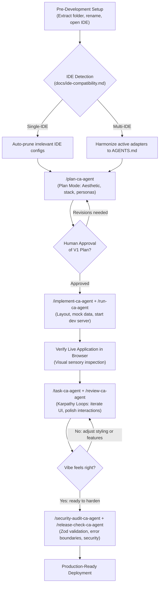
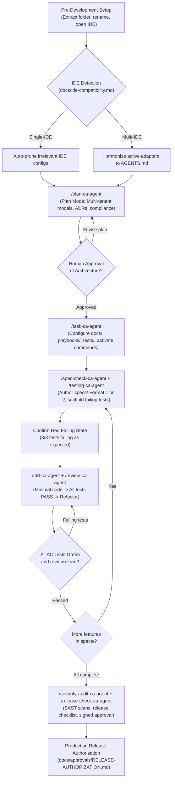

# AI-Powered Project Development — Custom Slash Commands & SMS Demo
### Operational Guide for `.agents/commands/` & Complete Production-Grade SaaS Walkthrough

**Author / Engineering Lead:** Chandan Adhikary & Antigravity Engineering  
**Version:** 2.0.0 (Production-Grade Universal Release)  
**Applies to:** Claude Code, Cursor, Windsurf, Antigravity, OpenCode, Codex, Trae, VS Code with AI Agents  

---

## 1. Executive Overview & Behavioral Contract Architecture

In this engineering framework, custom slash commands are not merely chat shortcuts—they are **deterministic behavioral contracts**.

When you type a slash command (such as `/plan-ca-agent` or `/tdd-ca-agent`), the host AI coding agent automatically binds its execution to the governance rules, security constraints, and quality gates defined in `.agents/commands/<name>-ca-agent.md`.

### 1.1 Why Slash Commands Prevent Development Errors
1. **Deterministic Guardrails:** Free-form prompts often cause agents to hallucinate dependencies, skip tests, or start writing application code prematurely. A slash command forces the agent to read repository policy first.
2. **Collision Prevention (`-ca-agent` suffix):** Modern AI IDEs (Cursor, Claude Code, Windsurf, Antigravity, OpenCode) reserve standard tokens like `/run`, `/plan`, `/test`, or `/review`. Our custom commands use the explicit `-ca-agent` namespace to guarantee zero collisions and predictable cross-IDE execution.
3. **Fidelity to Specifications:** Commands like `/implement-ca-agent` or `/tdd-ca-agent` strictly prohibit the agent from adding features outside approved specifications.

---

## 2. How Slash Commands Work in AI Coding IDEs

### 2.1 IDE Discovery & Autocompletion
- In **Cursor, Windsurf, Antigravity, OpenCode, and Claude Code**, typing `/` directly into the chat prompt input brings up the slash command palette.
- Selecting any `-ca-agent` command loads the operational contract from `.agents/commands/<name>-ca-agent.md`.

### 2.2 Two Usage Patterns for Developers

#### Pattern 1: Direct Command with Attached Context (Recommended)
Type the slash command followed immediately by your project details or task requirements in the same message:
```text
/plan-ca-agent Project Name: EduSphere SMS, Vision: Multi-tenant school portal...
```

#### Pattern 2: Sequential Command Chaining
Run the slash command as an action trigger after completing an implementation step:
```text
/run-ca-agent
/testing-ca-agent tests/unit/student-enrollment.test.ts
/review-ca-agent
```

---

## 3. The 15 Custom Slash Commands Matrix

| Slash Command | File Location | Purpose & Operational Scope |
|---|---|---|
| `/plan-ca-agent` | `.agents/commands/plan-ca-agent.md` | Scoped pre-development research, architecture proposal, and plan artifact generation in read-only mode. |
| `/run-ca-agent` | `.agents/commands/run-ca-agent.md` | Documented local startup and runtime verification; reports observed URLs without inventing outputs. |
| `/tdd-ca-agent` | `.agents/commands/tdd-ca-agent.md` | Red-Green-Refactor test-driven implementation cycle; requires approved spec version and failing tests. |
| `/testing-ca-agent` | `.agents/commands/testing-ca-agent.md` | Targeted test suite execution and failure reporting without altering application code. |
| `/implement-ca-agent` | `.agents/commands/implement-ca-agent.md` | Scope-restricted feature implementation adhering strictly to approved specifications. |
| `/review-ca-agent` | `.agents/commands/review-ca-agent.md` | Pre-commit diff, lint, and security review to prevent unauthorized changes and secret leaks. |
| `/verify-ca-agent` | `.agents/commands/verify-ca-agent.md` | Objective quality gate verification against specifications and acceptance criteria. |
| `/spec-check-ca-agent` | `.agents/commands/spec-check-ca-agent.md` | Feature spec traceability and criteria check across `specs/` (Format 1 or 2). |
| `/task-ca-agent` | `.agents/commands/task-ca-agent.md` | Atomic task execution and contract enforcement for isolated units of work. |
| `/security-audit-ca-agent` | `.agents/commands/security-audit-ca-agent.md` | SAST, secret leak, and dependency audit across the repository. |
| `/release-check-ca-agent` | `.agents/commands/release-check-ca-agent.md` | Final production gate and evidence-based ship/no-ship decision. |
| `/change-request-ca-agent` | `.agents/commands/change-request-ca-agent.md` | Formal change impact assessment and spec revision before modifying approved code. |
| `/handoff-ca-agent` | `.agents/commands/handoff-ca-agent.md` | Verifiable engineering handoff report generation for team transfers. |
| `/errorlogs-ca-agent` | `.agents/commands/errorlogs-ca-agent.md` | Structured runtime error and diagnostic log analysis. |
| `/gitlogs-ca-agent` | `.agents/commands/gitlogs-ca-agent.md` | Commit history and git traceability validation against authorized task IDs. |

---

## 4. Visual Workflow Diagrams

### Track 1: Vibe-Coding Prompt Flow (Slash Commands & Karpathy Loops)



---

### Track 2: Spec-Driven Development + TDD Flow (Formal Gated Slash Commands)



---

## 5. End-to-End Production Demo: School Management SaaS (EduSphere SMS)
### Layman-Friendly Step-by-Step Walkthrough via Slash Commands (Purely Instructional — Zero Application Code in Framework Folders)

To demonstrate how slash commands drive development in practice, this section walks through the complete prompt-by-prompt journey of building **EduSphere**, an enterprise-ready School Management SaaS.

> [!IMPORTANT]
> **No Application Code in Framework Folders:**
> This demonstration illustrates the exact slash commands you paste into your AI IDE chat. The framework folders (`Vibe-Coding` and `Spec-Driven-Development`) remain clean templates.

#### The Demo Product: EduSphere SMS
- **Core Modules:** Student Rosters, Daily Attendance Sheet, Course Scheduling, Tuition Billing, Guardian Alerts.
- **User Roles:** SuperAdmin, SchoolAdmin (Principal), Teacher, Student, Parent.

---

### Part A: The SMS Demo via Vibe-Coding (Driven by Slash Commands)

#### Step V1: Discovery & Aesthetic Vibe Check
**Command Typed into Chat:**
```markdown
/plan-ca-agent Project Name: EduSphere School Management SaaS
Product Type: Multi-Tenant Web SaaS
Product Vision: A modern, friendly, and ultra-fast portal for schools. Schools can manage student rosters, take daily classroom attendance in 30 seconds, generate tuition invoices, and give parents real-time visibility.
Target Users: School Principals, Teachers (mobile-first), Parents, Students.
Aesthetic / Vibe: Warm Modern SaaS (Indigo & Slate palette, clean typography, rounded cards, instant search filters, optimistic UI).
Active IDE: Antigravity
```

*What the AI Agent Does:*
- Invokes `/plan-ca-agent` contract in read-only mode.
- Detects Antigravity, auto-prunes competing `.cursor/`, `.windsurf/`, `.claude/` files.
- Generates an **Implementation Plan Artifact** specifying: Next.js App Router, Tailwind CSS, Lucide icons, Supabase/PostgreSQL schema, and component hierarchy.

---

#### Step V2: Scaffold Layout & Launch Dev Server
**Command Typed into Chat:**
```markdown
/implement-ca-agent Scaffold the EduSphere application based on the approved V1 plan.
Create the responsive sidebar navigation (Students, Attendance, Courses, Billing, Settings).
Populate the main dashboard with 4 summary stat cards (Total Students: 1,240, Today's Attendance: 96.4%, Pending Invoices: $14,200, Active Teachers: 68), and a Recent Activity feed.
Follow with:
/run-ca-agent Start the local development server and verify the active URL.
```

*What the AI Agent Does:*
- Implements the layout, Tailwind tokens, and dashboard component with realistic mock data.
- Runs `/run-ca-agent` which starts the dev server and reports `http://localhost:3000` is live.
- The developer opens the browser and visually verifies the dashboard layout.

---

#### Step V3: Conversational Vibe-Tuning (Karpathy Loops)
**Command Typed into Chat:**
```markdown
/task-ca-agent Build the Classroom Attendance sheet for 'Grade 10 - Section B (Biology)'.
Display 25 students with avatars, roll numbers, and quick toggle badges for [Present (Green), Absent (Red), Late (Yellow), Excused (Blue)].
Add a 1-click 'Mark All Present' button at the top.
Keep the interactions instant with smooth color transitions.
Follow with:
/review-ca-agent
```

*What the AI Agent Does:*
- Creates `AttendanceSheet.tsx` with optimistic state toggling (instant badge clicks without page reload).
- Runs `/review-ca-agent` to inspect the git diff, ensuring clean component structure and zero console warnings.

---

#### Step V4: Production Hardening & Pre-Deploy Audit
**Command Typed into Chat:**
```markdown
/security-audit-ca-agent
Audit EduSphere for security: wrap state inputs in Zod schemas, add error boundaries, and configure authentication route guards.
Follow with:
/release-check-ca-agent
Verify production build and generate deployment readiness checklist.
```

*What the AI Agent Does:*
- Enforces Zod schemas on form inputs and adds React error boundaries.
- Runs `/security-audit-ca-agent` (verifying zero secret leaks and clean security posture).
- Runs `/release-check-ca-agent`, runs `npm run build`, and confirms 100% production readiness.

---

### Part B: The SMS Demo via SDD + TDD (Driven by Slash Commands)

#### Step S1: Enterprise Architecture Discovery & Compliance R&D
**Command Typed into Chat:**
```markdown
/plan-ca-agent Project Name: EduSphere Enterprise School Management System
Product Type: Multi-Tenant Enterprise SaaS
Project Description: Enterprise education ERP requiring strict tenant data isolation, FERPA compliance, auditable grade changes, and automated tuition payment processing.
Target Audience: District Admins, School Principals, Teachers, Accountants, Parents.
Compliance: FERPA & GDPR compliant audit logging.
Selected Active IDE: Antigravity
```

*What the AI Agent Does:*
- Formulates architectural design in plan mode: PostgreSQL Row-Level Security (RLS) for tenant isolation, JWT authentication with rotating refresh tokens, and immutable audit logs.
- Establishes specification roadmap: `001.spec.tenant-auth`, `002.spec.student-enrollment`, `003.spec.fee-billing`.

---

#### Step S2: Configure Codebase & Test Harness
**Command Typed into Chat:**
```markdown
/task-ca-agent Configure EduSphere codebase docs/, playbooks/, tests/ harness, and activate .agents/ custom commands.
Record ADR-001 (Multi-Tenant RLS) and ADR-002 (FERPA Audit Logging) in docs/adrs/.
Setup Vitest test runner configuration in tests/.
```

*What the AI Agent Does:*
- Updates `docs/memory.md`, `docs/database.md`, and writes ADRs.
- Initializes test harness in `tests/`.
- Configures `.agents/hooks/HOOK-MATRIX.md` with pre-commit gates.

---

#### Step S3: Author Specification & Scaffold Failing Tests (Red Phase)
**Command Typed into Chat:**
```markdown
/spec-check-ca-agent Author specification for Feature 002: Student Enrollment in specs/002.spec.student-enrollment.md using Format 1.
Define Acceptance Criteria:
- AC-ENROLL-001: Generate immutable Student ID matching format 'SCH-{YEAR}-{SEQUENCE:05d}'.
- AC-ENROLL-002: Reject enrollment if primary guardian email or phone is missing.
- AC-ENROLL-003: Prevent duplicate enrollment for same student name + DOB in same academic year.
Follow with:
/testing-ca-agent tests/unit/student-enrollment.test.ts
Scaffold failing tests covering all 3 ACs and confirm RED failure state.
```

*What the AI Agent Does:*
- Authors `specs/002.spec.student-enrollment.md` with complete API contracts and schema constraints.
- Scaffolds `tests/unit/student-enrollment.test.ts` testing each AC ID.
- Executes `/testing-ca-agent` and verifies that all 3 tests fail (Red phase established).

---

#### Step S4: TDD Feature Implementation (Green & Refactor Phase)
**Command Typed into Chat:**
```markdown
/tdd-ca-agent specs/002.spec.student-enrollment.md
Implement StudentEnrollmentService and API endpoint.
Write the minimal clean code required to turn all 3 failing tests green.
Follow with:
/review-ca-agent
```

*What the AI Agent Does:*
- Implements enrollment logic with database sequence generation and uniqueness constraints.
- Runs tests: 3/3 tests PASS (Green phase).
- Runs `/review-ca-agent` to verify clean diff, zero lint errors, and atomic commit message citing Spec ID and AC IDs.

---

#### Step S5: Production Readiness Audit & Release Gate
**Command Typed into Chat:**
```markdown
/security-audit-ca-agent
Run SAST vulnerability scanning, dependency CVE audits, and FERPA log validation.
Follow with:
/verify-ca-agent specs/
Verify 100% of Acceptance Criteria across all specs/ have passing tests.
Follow with:
/release-check-ca-agent
Generate final signed Release Authorization in docs/approvals/RELEASE-1.0.0-AUTHORIZATION.md.
```

*What the AI Agent Does:*
- Executes security scan and confirms zero vulnerabilities.
- Executes `/verify-ca-agent` confirming complete AC test coverage.
- Completes `docs/release-checklist.md` and generates formal release authorization report.

---
*End of Custom Slash Commands & SMS Demo Guide.*
