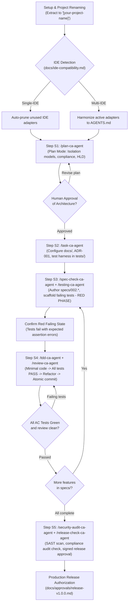

# AI-Powered Project Development — Universal Custom Slash Commands for SDD & TDD
### Operational Reference for `.agents/commands/` & Complete Universal Production Demo for Any Project

**Framework:** Spec-Driven Development (SDD) + Test-Driven Development (TDD) · High-Assurance Production Software  
**Author / Engineering Lead:** Chandan Adhikary & Antigravity Engineering  
**Version:** 2.0.0 (Production-Grade Universal Release)  
**Application Scope:** Universal (Enterprise SaaS, Multi-Tenant Platforms, FinTech, HealthTech, Core APIs, Regulated Systems)  
**Reference Example:** EduSphere Enterprise Multi-Tenant School Management System (SMS)  
**Applies to:** Claude Code, Cursor, Windsurf, Antigravity, GitHub Copilot, Codex, Trae, VS Code with AI Agents  

---

## 1. Executive Overview & Formal Governance Architecture

In the **Spec-Driven Development (SDD) + TDD Framework**, custom slash commands serve as **binding compliance gates**. 

When an AI agent receives a slash command (such as `/spec-check-ca-agent` or `/tdd-ca-agent`), it is bound by immutable repository policies defined in `.agents/commands/<name>-ca-agent.md`.

```text
+-------------------------------------------------------------------------------+
|                       SDD + TDD SLASH COMMAND PIPELINE                        |
+-------------------------------------------------------------------------------+
|                                                                               |
|   /plan-ca-agent           --> Enterprise architecture, data isolation,       |
|                                compliance standards, strict plan mode.        |
|                                                                               |
|   /task-ca-agent           --> Configure docs/, ADRs, and automated harness   |
|                                in 'tests/' directory.                         |
|                                                                               |
|   /spec-check-ca-agent     --> Author & validate specs/ (Format 1 or 2)       |
|                                with explicit Acceptance Criteria (AC-*).      |
|                                                                               |
|   /testing-ca-agent        --> Scaffold failing tests (TDD Red Phase)         |
|                                and verify intended failure state.             |
|                                                                               |
|   /tdd-ca-agent            --> Implement MINIMAL code to turn tests green,    |
|                                followed by architectural refactoring.         |
|                                                                               |
|   /review-ca-agent         --> Verify test-to-spec traceability & code diff.  |
|                                                                               |
|   /security-audit-ca-agent --> Run SAST scan, compliance checks, RLS audit.   |
|                                                                               |
|   /release-check-ca-agent  --> Final gate: 100% green tests & signed approval |
|                                in docs/approvals/release-v1.0.0.md.           |
|                                                                               |
+-------------------------------------------------------------------------------+
```

### 1.1 The Invariant Rules of SDD Commands
1. **No Spec, No Code:** The agent is prohibited from writing application source code unless an approved specification exists in `specs/`.
2. **Tests Before Code (Red First):** Any command attempting to implement code before failing tests are authored and executed will be aborted.
3. **Traceability Invariant:** Every commit and pull request must cite the active Spec ID and Acceptance Criteria (e.g. `feat([module]): satisfy [SPEC_AC_PREFIX]-001`).
4. **Collision Prevention (`-ca-agent` Suffix):** Standard tokens (`/plan`, `/test`, `/review`) are namespace-protected with `-ca-agent` to eliminate collisions with IDE-native commands across Cursor, Claude Code, Windsurf, Antigravity, and VS Code.

---

## 2. Universal Variable Substitution Matrix

When invoking custom slash commands on any software project, replace the placeholder tokens in brackets with your domain-specific values. 

The table below illustrates how to customize these variables using the **School Management System (SMS)** reference alongside an **Enterprise FinTech / Core Banking** example:

| Variable Token | Description | School Management System (SMS) Example | FinTech / Core Banking Example |
| :--- | :--- | :--- | :--- |
| `[PROJECT_NAME]` | Name of the software project | EduSphere Enterprise School Management System | ApexLedger Multi-Asset Core Banking Engine |
| `[PRODUCT_TYPE]` | Delivery model & architecture | Multi-Tenant Enterprise Educational SaaS | High-Throughput Double-Entry Ledger API |
| `[PRODUCT_VISION]` | System vision & scope | Multi-campus student records, attendance, grades | Real-time multi-currency transaction clearing |
| `[TARGET_USERS]` | Stakeholder roles | District SuperAdmins, Principals, Teachers, Parents | Treasury Ops, Compliance Auditors, Risk Officers |
| `[COMPLIANCE_STANDARDS]` | Regulatory policies | FERPA, COPPA, GDPR | PCI-DSS v4.0, SOC 2 Type II, ISO 27001 |
| `[DATA_ISOLATION_MODEL]` | Multi-tenancy isolation | Shared PostgreSQL with Row-Level Security (RLS) | PostgreSQL RLS + Hardware Security Module (HSM) |
| `[PRIMARY_FEATURE]` | Core module for first TDD cycle | `specs/002.spec.student-enrollment.md` | `specs/002.spec.double-entry-transfer.md` |
| `[SPEC_AC_PREFIX]` | Acceptance Criteria prefix | `AC-ENROLL-*` | `AC-TXN-*` |

---

## 3. Managing `specs/` via Slash Commands: Flat vs. Modular Formats

The SDD framework supports two specification layouts in `specs/`:

```text
specs/
├── Format 1 (Flat Spec Files - for discrete, cohesive features):
│   ├── 001.spec.[feature-name].md
│   └── 002.spec.[feature-name].md
│
└── Format 2 (Modular Spec Folders - for complex enterprise sub-systems):
    ├── 001.spec.[module-name]/
    │   ├── spec.md
    │   ├── schema.json
    │   └── acceptance-criteria.md
    └── 002.spec.[module-name]/
        ├── spec.md
        ├── schema.json
        └── acceptance-criteria.md
```

Using `/spec-check-ca-agent`, the agent automatically parses either format, validates requirement traceability, and verifies that every feature has unambiguous, testable Acceptance Criteria (`[SPEC_AC_PREFIX]-[NUMBER]`).

---

## 4. The SDD + TDD Slash Command Suite

| Slash Command | File Location | Operational Scope in SDD + TDD |
|---|---|---|
| `/plan-ca-agent` | `.agents/commands/plan-ca-agent.md` | Scoped pre-development research, regulatory compliance modeling, and architecture baseline in read-only mode. |
| `/task-ca-agent` | `.agents/commands/task-ca-agent.md` | Updating documentation, ADRs, and initializing automated test harnesses in `tests/`. |
| `/spec-check-ca-agent` | `.agents/commands/spec-check-ca-agent.md` | Validating living specifications in `specs/` against PRDs and database contracts. |
| `/testing-ca-agent` | `.agents/commands/testing-ca-agent.md` | Scaffolding and executing test suites; confirming the Red failing state without altering application code. |
| `/tdd-ca-agent` | `.agents/commands/tdd-ca-agent.md` | Red → Green → Refactor implementation engine; enforces minimal passing code. |
| `/review-ca-agent` | `.agents/commands/review-ca-agent.md` | Pre-commit diff, lint, and security review to prevent unauthorized changes and secret leaks. |
| `/verify-ca-agent` | `.agents/commands/verify-ca-agent.md` | Objective quality gate verification against specifications and acceptance criteria. |
| `/security-audit-ca-agent` | `.agents/commands/security-audit-ca-agent.md` | SAST, secret leak, dependency audit, and database data isolation verification. |
| `/release-check-ca-agent` | `.agents/commands/release-check-ca-agent.md` | Final production gate and evidence-based release authorization in `docs/approvals/`. |
| `/change-request-ca-agent` | `.agents/commands/change-request-ca-agent.md` | Formal change impact assessment before modifying approved specifications. |

---

## 5. Visual Workflow Diagram: The Universal SDD + TDD Flow



---

## 6. End-to-End Universal Production Demo via Slash Commands
### Complete Step-by-Step Command Sequence for Any Project

> [!IMPORTANT]
> **Pure Template Invariant:**
> The framework folder (`SDD-TDD-Chandan-Adhikary/Spec-Driven-Development/`) is an immutable distribution template. Always copy or extract it to `[your-project-name]/` before executing these commands.

---

### Step S1: Enterprise Architecture Discovery & Compliance R&D (`/plan-ca-agent`)

**Command Typed into Chat:**
```markdown
/plan-ca-agent Project Name: [PROJECT_NAME]
Product Type: [PRODUCT_TYPE]
Product Vision: [PRODUCT_VISION: A comprehensive description of the mission-critical operations, institutional/enterprise lifecycles, and audit logging needs]
Target Users: [TARGET_USERS: Primary administrative, operational, and customer roles]
Compliance Requirements: [COMPLIANCE_STANDARDS: e.g. SOC 2, GDPR, HIPAA, FERPA, PCI-DSS]
Architecture: [DATA_ISOLATION_MODEL: e.g. Shared PostgreSQL database with mandatory tenant_id and native Row-Level Security (RLS) policies]
Active IDE: [ACTIVE_IDE: e.g. Claude Code, Cursor, Windsurf, or Antigravity]
```

<details>
<summary><b>View Concrete Reference Example (School Management System)</b></summary>

```markdown
/plan-ca-agent Project Name: EduSphere Enterprise School Management System
Product Type: Multi-Tenant Enterprise Educational Platform & SaaS
Product Vision: A mission-critical School Management System for school districts and multi-campus networks. Governs Student Enrollment Lifecycle (SIS), Course Scheduling, Classroom Attendance, Examination Gradebooks, and Fee Invoicing with immutable audit trails.
Target Users: District SuperAdmins, Principals, Registrars, Teachers, Students, Parents.
Compliance Requirements: Strict FERPA (Family Educational Rights and Privacy Act), COPPA, and GDPR compliance.
Architecture: Shared PostgreSQL database with mandatory tenant_id and native Row-Level Security (RLS) policies.
Active IDE: Claude Code (or Cursor)
```
</details>

**What the AI Agent Does:**
1. Invokes the `.agents/commands/plan-ca-agent.md` contract in **Plan Mode (Read-Only)**.
2. Detects the active IDE and prunes irrelevant competitor config files per `docs/ide-compatibility.md`.
3. Inspects `AGENTS.md` and repository guidelines.
4. Generates a comprehensive **17-section planning report** covering:
   - High-Level Architecture (HLD) & Low-Level Architecture (LLD).
   - Relational database schema & data isolation policy.
   - Immutable audit logging tables.
   - Testing strategy: Unit, integration, and API contract testing.
5. **Stops and awaits human review.**

---

### Step S2: Approved Project Configuration & Harness Setup (`/task-ca-agent`)

**Command Typed into Chat:**
```markdown
/task-ca-agent The architecture baseline for [PROJECT_NAME] has been APPROVED.
1. Update 'docs/INDEX.md', 'docs/system-architecture.md', 'docs/database.md', and 'docs/security.md'.
2. Record 'ADR-001: Architecture & Data Isolation Baseline' in 'docs/decision-log.md'.
3. Initialize the automated test harness in 'tests/' with path alias support ('@/*').
4. Configure 'tests/unit/', 'tests/integration/', and 'tests/fixtures/'.
5. Create '.env.example' with required database and environment variables (zero real credentials).

Do not implement application features or production endpoints.
```

**What the AI Agent Does:**
1. Updates all canonical architecture and database documentation in `docs/`.
2. Creates test runner configuration (e.g. `vitest.config.ts`) and directory structure in `tests/`.
3. Adds a sanity test (`tests/unit/sanity.test.ts`) and verifies test runner health with `npm test`.
4. Prepares `.env.example`.
5. Reports configuration status and requests human approval.

---

### Step S3: Specification Validation & Failing Test Scaffolding (`/spec-check-ca-agent` + `/testing-ca-agent`)

**Command Typed into Chat:**
```markdown
/spec-check-ca-agent specs/002.spec.[PRIMARY_FEATURE].md
Validate the [PRIMARY_FEATURE_NAME] specification against the approved architecture.
Ensure it defines the following Acceptance Criteria:
- [SPEC_AC_PREFIX]-001: System generates a unique sequential identifier scoped to the tenant/organization.
- [SPEC_AC_PREFIX]-002: System rejects invalid business states with appropriate HTTP 422 errors.
- [SPEC_AC_PREFIX]-003: System enforces strict data isolation across tenants/organizations.
- [SPEC_AC_PREFIX]-004: System writes an immutable audit log upon successful state mutation.

Follow immediately with:
/testing-ca-agent Scaffold tests/unit/[PRIMARY_FEATURE].test.ts covering [SPEC_AC_PREFIX]-001 through [SPEC_AC_PREFIX]-004.
Execute the tests and confirm they FAIL in the RED state.
```

<details>
<summary><b>View Concrete Reference Example (School Management System)</b></summary>

```markdown
/spec-check-ca-agent specs/002.spec.student-enrollment.md
Validate the Student Enrollment specification against the approved architecture.
Ensure it defines the following Acceptance Criteria:
- AC-ENROLL-001: System generates a unique sequential admission number (e.g. 'ADM-2026-0001') scoped to the tenant.
- AC-ENROLL-002: System rejects enrollment if student age is below the grade level minimum with an HTTP 422 error.
- AC-ENROLL-003: System enforces multi-tenant isolation; School A cannot access School B enrollments.
- AC-ENROLL-004: System writes an immutable audit log upon successful enrollment.

Follow immediately with:
/testing-ca-agent Scaffold tests/unit/student-enrollment.test.ts covering AC-ENROLL-001 through AC-ENROLL-004.
Execute the tests and confirm they FAIL in the RED state.
```
</details>

**What the AI Agent Does:**
1. Runs `/spec-check-ca-agent` to validate `specs/002.spec.[PRIMARY_FEATURE].md`.
2. Scaffolds `tests/unit/[PRIMARY_FEATURE].test.ts` covering all 4 Acceptance Criteria.
3. Runs the test suite via `/testing-ca-agent`.
4. Confirms the **RED Phase**: All tests fail with expected assertion or module resolution errors.
5. **Stops and awaits authorization to implement.**

---

### Step S4: Feature Implementation via Strict TDD (`/tdd-ca-agent` + `/review-ca-agent`)

**Command Typed into Chat:**
```markdown
/tdd-ca-agent Implement Feature 002: [PRIMARY_FEATURE_NAME] according to specs/002.spec.[PRIMARY_FEATURE].md.
1. Implement minimum code in 'src/services/[PRIMARY_FEATURE].service.ts' to satisfy all tests in tests/unit/[PRIMARY_FEATURE].test.ts.
2. Verify all tests pass (GREEN Phase).
3. Refactor: Optimize query performance and extract reusable middleware without breaking tests.
4. Run static type checking ('npx tsc --noEmit') and linting.

Follow immediately with:
/review-ca-agent Inspect git diff and verify acceptance criteria traceability.
```

**What the AI Agent Does:**
1. Creates `src/services/[PRIMARY_FEATURE].service.ts` with runtime validation and tenant-scoped sequencing.
2. Re-runs `tests/unit/[PRIMARY_FEATURE].test.ts`—all tests pass (**100% GREEN**).
3. Refactors code cleanly, ensuring zero regressions.
4. Runs `/review-ca-agent`, which inspects the diff and generates a proposed atomic commit message:
   `feat([module]): implement [PRIMARY_FEATURE] service satisfying [SPEC_AC_PREFIX]-001 through [SPEC_AC_PREFIX]-004`.

---

### Step S5: Production Readiness Audit & Release Gate (`/security-audit-ca-agent` + `/release-check-ca-agent`)

**Command Typed into Chat:**
```markdown
/security-audit-ca-agent
Perform an exhaustive security and compliance audit on [PROJECT_NAME]:
1. Validate database data isolation enforcement across all queries.
2. Verify compliance audit trail generation for all sensitive mutations.
3. Scan for OWASP Top 10 vulnerabilities and dependency CVEs ('npm audit').

Follow immediately with:
/release-check-ca-agent
Execute full test suite with coverage, verify production build, and generate the release sign-off report at 'docs/approvals/release-v1.0.0.md'.
```

**What the AI Agent Does:**
1. Runs `/security-audit-ca-agent`: confirms zero data leaks, zero isolation bypasses, and zero critical CVEs.
2. Runs `/release-check-ca-agent`: executes full test suite (>90% branch coverage verified), runs production build, and writes formal release documentation to `docs/approvals/release-v1.0.0.md`.
3. Reports release readiness and requests final human deployment authorization.

---

## 7. Best Practices for Developers Using SDD Slash Commands

1. **Never Skip `/spec-check-ca-agent`:** Always ensure the specification has explicit Acceptance Criteria (`AC-*`) before authoring tests.
2. **Honor the RED State:** Always run `/testing-ca-agent` before implementing production code to verify that the tests genuinely catch missing functionality.
3. **Commit Atomically with Traceability:** Always cite the Spec ID and AC numbers in git commits to maintain an unbroken audit trail for compliance officers and enterprise clients.
