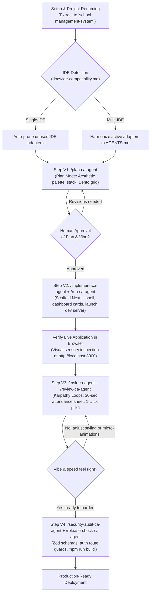

# AI-Powered Project Development — Custom Slash Commands for Vibe-Coding
### Operational Reference for `.agents/commands/` & Complete Vibe-Coding SMS SaaS Demo

**Framework:** Vibe Coding Framework · Rapid Interactive Prototyping to Production SaaS  
**Author / Engineering Lead:** Chandan Adhikary & Antigravity Engineering  
**Version:** 2.0.0 (Production-Grade Universal Release)  
**Applies to:** Claude Code, Cursor, Windsurf, Antigravity, GitHub Copilot, Codex, Trae, VS Code with AI Agents  

---

## 1. Executive Overview & Behavioral Contract Architecture

In the **Vibe-Coding Framework**, custom slash commands are not merely chat shortcuts—they are **deterministic behavioral contracts**.

When you type a slash command (such as `/plan-ca-agent` or `/implement-ca-agent`), your AI coding agent automatically binds its execution to the governance rules, styling guidelines, and quality gates defined in `.agents/commands/<name>-ca-agent.md`.

```text
+-------------------------------------------------------------------------------+
|                       VIBE-CODING SLASH COMMAND PIPELINE                      |
+-------------------------------------------------------------------------------+
|                                                                               |
|   /plan-ca-agent           --> Scoped discovery, aesthetic palette,           |
|                                tech stack, zero premature coding.             |
|                                                                               |
|   /implement-ca-agent      --> Scaffold core layout, bento grids, mock data.  |
|                                                                               |
|   /run-ca-agent            --> Start local dev server & verify live URL.      |
|                                                                               |
|   /task-ca-agent           --> Rapid Karpathy conversational loops;           |
|                                1-click status pills, optimistic UI.           |
|                                                                               |
|   /review-ca-agent         --> Inspect git diff, verify clean component state.|
|                                                                               |
|   /security-audit-ca-agent --> Runtime Zod schemas & auth route guards.       |
|                                                                               |
|   /release-check-ca-agent  --> Production build check ('npm run build')       |
|                                and final release checklist sign-off.          |
|                                                                               |
+-------------------------------------------------------------------------------+
```

### 1.1 Why Slash Commands Prevent Vibe-Coding Pitfalls
1. **Preventing AI Drift:** Autonomous agents frequently hallucinate unneeded dependencies or change design tokens without permission. Slash commands force the agent to consult repository guidelines (`AGENTS.md`) first.
2. **Zero Reserved Token Collisions (`-ca-agent` Suffix):** Major AI IDEs (Cursor, Claude Code, Windsurf, Antigravity) reserve native tokens like `/run`, `/plan`, or `/test`. Our custom commands use the explicit `-ca-agent` namespace to guarantee 100% collision-free execution across all editors.
3. **Taste & Visual Verification:** Commands like `/run-ca-agent` and `/review-ca-agent` ensure that developers test working software interactively before layering further complexity.

---

## 2. How Slash Commands Work in AI Coding IDEs

### 2.1 IDE Discovery & Autocompletion
- In **Cursor, Windsurf, Antigravity, OpenCode, and Claude Code**, typing `/` directly into the chat input triggers the slash command palette.
- Selecting any command (e.g. `/plan-ca-agent`) loads the operational prompt template from `.agents/commands/<name>-ca-agent.md`.

### 2.2 Two Invocation Patterns

#### Pattern 1: Direct Command with Attached Context (Recommended)
Type the slash command followed immediately by your project vision and requirements in the same prompt:
```text
/plan-ca-agent Project Name: EduSphere SMS Website, Vibe: Warm Modern SaaS (Indigo & Slate)...
```

#### Pattern 2: Action Triggering
Type the slash command as an isolated action instruction after completing a step:
```text
/run-ca-agent
/review-ca-agent
/release-check-ca-agent
```

---

## 3. The Vibe-Coding Slash Command Suite

| Slash Command | File Location | Operational Scope in Vibe-Coding |
|---|---|---|
| `/plan-ca-agent` | `.agents/commands/plan-ca-agent.md` | Pre-development discovery, color palette selection, component hierarchy, and read-only plan artifact. |
| `/implement-ca-agent` | `.agents/commands/implement-ca-agent.md` | Scaffolding application shell, responsive navigation, and interactive mock screens. |
| `/run-ca-agent` | `.agents/commands/run-ca-agent.md` | Starting the local development server and reporting the active URL without inventing output. |
| `/task-ca-agent` | `.agents/commands/task-ca-agent.md` | Fast Karpathy iterative feature execution (e.g., building attendance sheet or student modal). |
| `/review-ca-agent` | `.agents/commands/review-ca-agent.md` | Visual diff inspection, type checking, and component sanity reviews. |
| `/security-audit-ca-agent` | `.agents/commands/security-audit-ca-agent.md` | Applying Zod runtime schemas, securing sessions, and scanning for secret leaks. |
| `/release-check-ca-agent` | `.agents/commands/release-check-ca-agent.md` | Running production bundle build (`npm run build`) and generating pre-deployment checklist. |

---

## 4. Andrej Karpathy Engineering Skill (`andrej-karpathy-skill`)

Embedded within `.agents/skills/andrej-karpathy-skill/SKILL.md`, this skill equips the AI agent with core heuristics for high-velocity Vibe Coding:
- **Inspect the Raw Data First:** Never guess API shapes or schema fields. Inspect mock data or database payloads directly.
- **Single-Batch Overfit / Micro-Baseline:** Make a single vertical feature slice (e.g. 1 classroom attendance sheet) work completely before abstracting into multi-school hierarchies.
- **Immediate Feedback Loops:** Keep diffs small, verify each change live in the browser, and avoid blind multi-file refactoring.
- **Anti-Overengineering:** Prefer clean, flat, readable React components over complex nested abstraction layers.

---

## 5. Visual Workflow Diagram: The Vibe-Coding Flow



---

## 6. End-to-End Production Demo: School Management SaaS (EduSphere SMS)
### A Complete Step-by-Step Walkthrough via Slash Commands (Purely Instructional — Zero Application Code in Framework Folders)

This section demonstrates the exact slash commands you paste into your AI coding assistant to build **EduSphere SMS**, a modern School Management SaaS website.

> [!IMPORTANT]
> **Pure Template Invariant:**
> The framework folder (`Vibe-Coding-Chandan-Adhikary/Vibe-Coding/`) is an immutable template. Always copy or extract it to `school-management-system/` before executing these commands.

---

### Step V1: Discovery & Aesthetic Vibe Check (`/plan-ca-agent`)

**Command Typed into Chat:**
```markdown
/plan-ca-agent Project Name: EduSphere SMS Website
Product Type: Multi-Tenant School Management SaaS Platform
Product Vision: A modern, lightning-fast school portal designed to eliminate administrative friction. Schools manage student rosters, take daily classroom attendance in 30 seconds with 1-click status pills, generate tuition invoices, and give parents real-time visibility.
Target Users: SuperAdmin, Principals, Classroom Teachers (mobile-first), Students, Parents.
Aesthetic / Vibe: Warm Modern SaaS (Indigo #4F46E5 & Slate #0F172A palette, Emerald #10B981 for present, Rose #F43F5E for absent, clean geometric typography, rounded-xl cards, instant search filters, optimistic UI).
Active IDE: Antigravity (or Cursor)
```

**What the AI Agent Does:**
1. Invokes the `.agents/commands/plan-ca-agent.md` contract in **Plan Mode (Read-Only)**.
2. Detects the active IDE and prunes irrelevant competitor config files per `docs/ide-compatibility.md`.
3. Inspects `AGENTS.md` and repository guidelines.
4. Generates a comprehensive **17-section planning report** covering:
   - Tech stack: Next.js 15 (App Router), Tailwind CSS v4, shadcn/ui, Lucide Icons, Supabase (PostgreSQL).
   - Relational database schema (`schools`, `users`, `classes`, `students`, `attendance_records`, `fee_invoices`).
   - UI design direction with color tokens and Bento Grid layout.
5. **Stops and awaits human review.**

---

### Step V2: Scaffold Layout & Launch Dev Server (`/implement-ca-agent` + `/run-ca-agent`)

**Command Typed into Chat:**
```markdown
/implement-ca-agent Scaffold the EduSphere SMS application based on the approved V1 plan.
1. Configure Tailwind CSS v4 tokens with the approved Indigo, Slate, Emerald, and Rose palette.
2. Build the public marketing landing page (Hero section, Bento grid features, pricing calculator, and CTA).
3. Build the authenticated dashboard shell with a responsive collapsible sidebar (Students, Attendance, Classes, Invoices, Settings).
4. Populate the dashboard overview with 4 summary stat cards:
   - Total Students: 1,248
   - Today's Attendance Rate: 96.4%
   - Pending Tuition Fees: $14,250
   - Active Teachers: 78
5. Provide realistic mock data for 5 classes and 25 students.

Follow immediately with:
/run-ca-agent Start the local development server and verify the active URL.
```

**What the AI Agent Does:**
1. Scaffolds `app/layout.tsx`, `app/globals.css`, and `app/page.tsx` (Landing Page).
2. Scaffolds `app/dashboard/layout.tsx` (Sidebar + Header) and `app/dashboard/page.tsx` (Stat cards + Activity feed).
3. Populates `lib/mock-data.ts` with structured student and class records.
4. Executes `/run-ca-agent`, which launches `npm run dev` and confirms `http://localhost:3000` is active.
5. Reports verified URLs to the developer for immediate browser inspection.

---

### Step V3: Conversational Vibe-Tuning: 30-Second Attendance Sheet (`/task-ca-agent` + `/review-ca-agent`)

**Command Typed into Chat:**
```markdown
/task-ca-agent Implement the flagship feature at '/dashboard/attendance': the 30-Second Classroom Attendance Sheet.
Apply Andrej Karpathy heuristics:
1. Header Controls: Dropdown for Class (default: "Grade 10-A") and Date Picker (default: Today), plus a live counter pill: 'Total: 25 | Present: 22 | Absent: 2 | Late: 1 (92%)'.
2. Top Batch Action: Add a 1-click emerald '[Mark All Present]' button.
3. High-Density Student Grid: For each student, display their avatar, roll number, full name, and 4 tactile status toggle pills:
   - [P] Present (Emerald active)
   - [A] Absent (Rose active)
   - [L] Late (Amber active)
   - [E] Excused (Blue active)
4. Interaction Vibe: Clicking any pill updates the student's status optimistically with zero delay and updates the top percentage counter smoothly.
5. Floating Save Bar: Add a sticky bottom bar with '[Save & Finalize Attendance]' that triggers a celebratory toast notification on click.

Follow immediately with:
/review-ca-agent Inspect the git diff and verify clean component state.
```

**What the AI Agent Does:**
1. Implements `app/dashboard/attendance/page.tsx` with optimistic local state and fluid transitions.
2. Ensures 44x44px minimum touch targets for effortless thumb tapping on tablets and smartphones.
3. Invokes `/review-ca-agent` to inspect the code diff, verifying that no unwanted dependencies were introduced and that all React props are strictly typed.

---

### Step V4: Production Hardening & Pre-Deploy Audit (`/security-audit-ca-agent` + `/release-check-ca-agent`)

**Command Typed into Chat:**
```markdown
/security-audit-ca-agent
Perform a production security audit on EduSphere SMS:
1. Enforce strict Zod runtime schemas on attendance and student enrollment payloads.
2. Configure Next.js route middleware ('middleware.ts') to protect all '/dashboard/*' routes and enforce role checks (Teachers cannot access school billing).
3. Add React Error Boundaries ('error.tsx') and shimmering skeleton screens ('loading.tsx').
4. Verify zero exposed secrets or sensitive student PII in client bundles.

Follow immediately with:
/release-check-ca-agent
Verify production compilation ('npm run build') and generate the deployment readiness checklist.
```

**What the AI Agent Does:**
1. Creates `lib/validations/attendance.ts` and `lib/validations/student.ts` using Zod schemas.
2. Implements `middleware.ts` for multi-tenant authentication and route protection.
3. Adds `app/dashboard/error.tsx` and `app/dashboard/loading.tsx`.
4. Runs `/security-audit-ca-agent` (confirming zero vulnerabilities and clean input validation).
5. Runs `/release-check-ca-agent`, which executes `npm run build`, verifies zero TypeScript/ESLint warnings, and generates the production deployment checklist.

---

## 7. Best Practices for Developers Using Vibe Slash Commands

1. **Keep Prompts Actionable:** Combine the slash command with clear visual and functional intent (e.g. `/task-ca-agent Add a search filter for student names with a 200ms debounce`).
2. **Review Diffs Regularly:** Run `/review-ca-agent` after each major UI iteration to keep the codebase clean and maintainable.
3. **Never Skip the Build Gate:** Always run `/release-check-ca-agent` before pushing to production or staging to guarantee that `npm run build` succeeds without errors.
