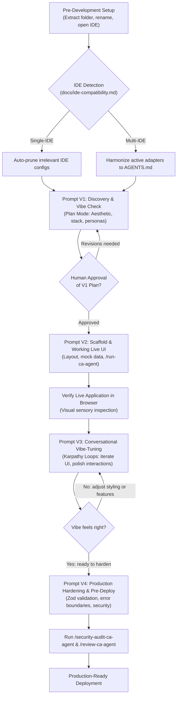
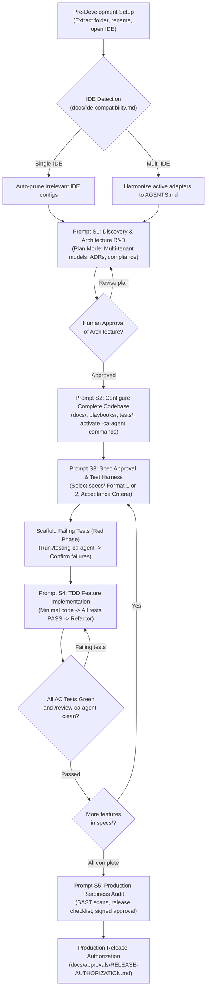

# AI-Powered Project Development — Complete Setup & Prompting Guide
### 2-in-1 Master Architecture: Vibe-Coding Framework & Spec-Driven Development (SDD + TDD)
**Author / Engineering Lead:** Chandan Adhikary & Antigravity Engineering  
**Version:** 2.0.0 (Production-Grade Universal Release)  
**Applies to:** Claude Code, Cursor, Windsurf, Antigravity, OpenCode, Codex, Trae, VS Code with AI Agents  

---

## 1. Executive Overview & Foundational Principles

This guide provides a standardized, battle-tested methodology for building scalable, secure, maintainable, and **production-grade software applications** using autonomous AI coding agents and modern AI-assisted IDEs.

### 1.1 The Golden Rule of AI Engineering
> **DO NOT ask the AI agent to start coding immediately.**
> First, make the agent research your requirements, inspect the repository governance, select the appropriate architecture, configure the codebase documentation, and present a verified implementation plan for human approval.

### 1.2 Two Distinct Development Paradigms (2-in-1 Framework)
To eliminate confusion, this repository provides two distinct, purpose-built development frameworks. Both frameworks are engineered to produce **strictly production-grade output**, but they follow different working processes:

```text
=============================================================================================
                        AI-POWERED DEVELOPMENT FRAMEWORKS
=============================================================================================
             TAB / WINDOW 1                                   TAB / WINDOW 2
         VIBE-CODING FRAMEWORK                            SPEC-DRIVEN DEVELOPMENT (SDD + TDD)
---------------------------------------------   ---------------------------------------------
* Philosophy: Intuitive, Visual, Fast Iteration  * Philosophy: Contract-First, Strict Verification
* Workflow: 4 Fluid Prompts (Karpathy Loops)     * Workflow: 5 Formal Quality Gated Prompts
* Specs: Lightweight / Working Memory          * Specs: Formal 'specs/' (Flat or Modular Folders)
* Testing: Visual runtime & sanity harnesses    * Testing: Test-First (TDD Red-Green-Refactor)
* Best For: Rapid SaaS MVPs, UI/UX-driven apps,  * Best For: High-stakes enterprise SaaS, fintech,
  consumer dashboards, interactive tools          healthcare, compliance, multi-tenant core systems
=============================================================================================
```

### 1.3 Andrej Karpathy Engineering Heuristics (`andrej-karpathy-skill`)
Both frameworks incorporate Andrej Karpathy's core Software 2.0/3.0 engineering heuristics as a built-in capability in `.agents/skills/andrej-karpathy-skill/`:
1. **Inspect the Raw Data First:** Never author schemas or code on assumptions. Always inspect raw inputs, mock payloads, or database models first.
2. **Single-Batch Overfit / Micro-Baseline:** Build a minimal, verifiable end-to-end slice before creating elaborate architectures or layers.
3. **Failure-Mode Test Harnesses:** Verify boundary conditions, null inputs, and error states; never assume the model understands edge cases zero-shot.
4. **Anti-Overengineering:** Keep code flat, readable, and modular. Avoid premature abstractions.

---

## 2. Pre-Development Setup & Active IDE Governance

Before issuing your first prompt to the AI agent, execute this essential 2-minute setup.

### Step 1: Choose Your Framework Folder
Extract your preferred framework folder from the repository:
- **Option A — Vibe Coding:** Use `Vibe-Coding-Chandan-Adhikary/Vibe-Coding/`
- **Option B — SDD + TDD:** Use `SDD-TDD-Chandan-Adhikary/Spec-Driven-Development/`

### Step 2: Rename the Project Folder
Rename the extracted folder to match your product name using lowercase `kebab-case`:
```bash
# Example:
Vibe-Coding/              --> school-management-saas/
# OR
Spec-Driven-Development/  --> school-management-saas/
```

### Step 3: Open in Your AI Coding IDE
Open the renamed folder as the **project root** in your IDE (Cursor, Windsurf, Antigravity, OpenCode, Claude Code, VS Code, etc.). Ensure the agent has full visibility of `AGENTS.md`, `docs/`, and `.agents/`.

### Step 4: Active IDE Detection & Cleanup Protocol (docs/ide-compatibility.md)
To eliminate rule conflicts, command shadowing, and context bloat, the repository enforces an automatic cleanup policy:

- **Mode A: Single-IDE Mode (Automated Pruning - Recommended):**
  When you start in an IDE (e.g., Antigravity or OpenCode), all competing, irrelevant IDE configuration folders (`.cursor/`, `.cursorrules`, `.windsurf/`, `.windsurfrules`, `.claude/`, `CLAUDE.md`) are automatically pruned before or during Prompt 1.
  
- **Mode B: Multi-IDE / Multi-Agent Coexistence Mode:**
  If you or your team use multiple IDEs simultaneously (e.g., Antigravity + Cursor, or Cursor + Claude Code), declare your active list in Prompt 1 (e.g. `ACTIVE_IDES=["antigravity", "cursor"]`). The system preserves adapters for all declared active IDEs, synchronizes them to the canonical `AGENTS.md` and `.agents/`, and prunes only unselected ones.

### Step 5: Collision-Free Agent Commands (`.agents/commands/`)
Host IDEs reserve generic tokens like `/run`, `/plan`, `/test`, or `/review`. To prevent system errors, all 15 custom commands use the explicit `-ca-agent` suffix:
- `/plan-ca-agent` | `/run-ca-agent` | `/tdd-ca-agent` | `/testing-ca-agent` | `/implement-ca-agent`
- `/review-ca-agent` | `/verify-ca-agent` | `/spec-check-ca-agent` | `/task-ca-agent` | `/security-audit-ca-agent`
- `/release-check-ca-agent` | `/change-request-ca-agent` | `/handoff-ca-agent` | `/errorlogs-ca-agent` | `/gitlogs-ca-agent`

---

## 3. TAB / WINDOW 1: The Vibe-Coding Framework
### Fast, Visual, Intuitive & Iterative (4 Fluid Prompts)

The Vibe-Coding track is designed for rapid iteration, instant visual feedback, and conversational steering while maintaining **production-grade engineering standards** under the hood.



### Prompt V1 — Master Vision, Aesthetic & Tech Stack
**Operating Mode:** Plan Mode / Read-Only Discovery  
**Purpose:** Define user personas, design system, tech stack, and trigger IDE cleanup.

```markdown
PROMPT V1 — VIBE-CODING DISCOVERY, AESTHETICS & TECH STACK

Your Role:
Act as a Principal Full-Stack Architect and World-Class Product Designer with 15+ years of experience in rapid SaaS prototyping and modern frontend design systems.

Your Objective:
Research, establish the aesthetic vision, and define the complete production-grade tech stack for our application without writing application code yet.

IMPORTANT: WORK IN PLAN MODE ONLY. DO NOT CREATE APPLICATION CODE FILES YET.

1. Project Information
Project Name: <PROJECT_NAME>
Product Type: <SaaS / Web App / Dashboard / Mobile App / AI Tool>
Product Vision: <Describe what the product does, who it is for, and the core experience>
Target Users: <Primary personas e.g. Admins, Students, Teachers>
Aesthetic / Vibe: <e.g., Clean Modern SaaS, Dark Mode Minimalist, Warm Editorial, High-Density Dashboard>
Active IDE: <Antigravity / Cursor / Windsurf / OpenCode / Claude Code / Multi-IDE: list them>

2. Mandatory Repository & Environment Inspection
- Inspect the project root: README.md, AGENTS.md, docs/INDEX.md, docs/ide-compatibility.md.
- Execute IDE Detection & Pruning:
  * If Single-IDE: Prune irrelevant IDE configuration files to prevent context bloat.
  * If Multi-IDE: Retain adapters for declared active IDEs and synchronize them to AGENTS.md.
- Review in-built skills in .agents/skills/, specifically andrej-karpathy-skill.

3. Deliverables for this Step:
Provide a structured Plan Artifact containing:
1. Architecture Overview: Frontend framework, backend runtime, database, styling engine (e.g. Next.js App Router, Tailwind CSS, shadcn/ui, Supabase/PostgreSQL, TypeScript).
2. Design System Tokens: Primary color palette, typography, border radiuses, dark/light theme approach.
3. Component Hierarchy: Layout wrappers, navigation, main dashboard views, and interactive modals.
4. Immediate Execution Plan for Prompt V2 (Scaffolding).

Rules:
- MUST enforce TypeScript with strict mode.
- MUST choose modern, battle-tested UI libraries (Tailwind CSS, Lucide icons, Framer Motion).
- MUST NOT write application code in this step.
```

---

### Prompt V2 — Rapid Codebase Scaffold & Live Working UI
**Operating Mode:** Implementation Mode  
**Purpose:** Scaffold the application structure, initialize layout, create mock data models, and verify local startup.

```markdown
PROMPT V2 — SCAFFOLDING & LIVE WORKING UI

Your Role:
Act as a Lead Frontend Engineer and Full-Stack Developer specializing in rapid execution.

Your Objective:
Generate the project structure, install verified dependencies, implement the main responsive navigation and dashboard layouts with high-fidelity mock data, and launch the dev server.

1. Instructions
- Scaffold the application using the tech stack approved in Prompt V1.
- Configure Tailwind CSS, design tokens, and base UI component library.
- Implement responsive layout: Sidebar navigation, header with user avatar, and breadcrumbs.
- Build the core landing dashboard screen populated with realistic, production-like mock data.
- Ensure zero TypeScript compiler errors and zero console warnings.
- Run the local startup command and report the active local URL.

2. Karpathy Heuristics Applied:
- Inspect raw data structures: Build explicit TypeScript interfaces for mock entities before rendering components.
- Single-batch overfit: Ensure the main dashboard renders perfectly from end to end before adding sub-routes.

3. Completion Requirement:
Provide the exact terminal command to run the application locally (or run /run-ca-agent) and verify that the UI renders without errors.
```

---

### Prompt V3 — Conversational Vibe-Tuning & Feature Expansion (Karpathy Loops)
**Operating Mode:** Implementation & Refinement Mode  
**Purpose:** Iteratively adjust UI components, polish interactions, add business views, and tune the aesthetic feel.

```markdown
PROMPT V3 — CONVERSATIONAL VIBE-TUNING

Your Role:
Act as a Senior UI/UX Engineer paired with a Product Specialist.

Your Objective:
Refine the active screen, improve component feel, and add the next core feature based on interactive feedback.

1. Target Feature / Adjustments:
Feature to Add / Polish: <e.g., Student Attendance Tracker / Course Schedule Grid / Fee Invoice Drawer>
Specific Visual Tweaks: <e.g., Make table rows denser, add badge status pills (Active/Overdue/Pending), add smooth hover transitions>

2. Execution Guidelines:
- Keep the loop tight: Edit only the necessary components and sub-modules.
- Use modular components: Extract reusable table, card, and modal elements.
- Verify live state: Ensure all mock interactions (clicks, tab switches, filter searches) work smoothly.
- Reference .agents/commands/review-ca-agent.md before completing the turn.

3. Completion Report:
List the exact components modified, describe visual/UX enhancements applied, and confirm local runtime stability.
```

---

### Prompt V4 — Production Hardening, Polish & Pre-Deploy
**Operating Mode:** Quality Audit & Hardening Mode  
**Purpose:** Transform the prototype into a secure, production-grade application ready for deployment.

```markdown
PROMPT V4 — PRODUCTION HARDENING & DEPLOYMENT PREPARATION

Your Role:
Act as a Senior DevOps and Cybersecurity Engineer.

Your Objective:
Harden the codebase for production deployment: enforce authentication guards, input validation schemas, environment variable sanitization, and production build checks.

1. Hardening Checklist:
- Input Validation: Implement Zod schemas for all forms and API endpoints.
- Error Boundaries: Add React error boundaries and graceful empty-state fallbacks.
- Security Headers: Configure CSP, CORS, X-Frame-Options, and secure cookie policies.
- Environment Separation: Ensure zero hardcoded API keys or secrets; create .env.example with complete documentation.
- Production Build Verification: Run full build and lint scripts; ensure zero build warnings or type errors.
- Containerization: Provide a lightweight multi-stage Dockerfile or Vercel/Netlify deploy configuration.

2. Quality Gate:
Execute /security-audit-ca-agent and /release-check-ca-agent to verify production readiness.
```

---

## 4. TAB / WINDOW 2: Spec-Driven Development + TDD Framework
### Formal, Contract-Bound, Test-First & Traceable (5 Formal Quality Gates)

The SDD-TDD framework is engineered for high-assurance, enterprise systems where every feature must be preceded by an approved specification, failing test suite, and traceable acceptance criteria.



### Prompt S1 — Master Project Discovery, Architecture R&D & Pre-Development Planning
**Operating Mode:** Plan Mode / Ask Mode / Read-Only Planning  
**Purpose:** Deep technical discovery, system architecture, database schema, risk analysis, and IDE detection/cleanup.

```markdown
PROMPT S1 — MASTER PROJECT DISCOVERY, R&D & ARCHITECTURE PLANNING

Your Role:
Act as a team of senior enterprise software professionals with 15+ years of experience:
- Senior Enterprise Architect & Technical Program Manager
- Senior Backend & Database Architect
- Senior Cybersecurity & Compliance Engineer
- Lead QA Automation & Test Architect

Your Objective:
Conduct deep technical research and draft a comprehensive architectural plan for a scalable, secure, multi-tenant SaaS application adhering to Spec-Driven Development.

IMPORTANT: WORK IN PLAN MODE ONLY. DO NOT WRITE CODE. DO NOT CREATE DATABASE MIGRATIONS YET.

1. Project Information
Project Name: <PROJECT_NAME>
Product Type: <Multi-Tenant SaaS / Enterprise Platform / Financial System / Healthcare Application>
Project Description: <Detailed description of business domain, operational workflows, and tenant requirements>
Target Audience: <Roles e.g., SuperAdmin, TenantAdmin, Operator, EndUser>
Compliance Requirements: <GDPR / FERPA / HIPAA / SOC2 / None>
Selected Active IDE(s): <Antigravity / Cursor / Windsurf / OpenCode / Claude Code / Multi-IDE list>

2. Mandatory Repository & Environment Inspection
- Inspect project root: README.md, AGENTS.md, docs/INDEX.md, docs/constitution.md, docs/rules.md.
- Execute IDE Detection & Pruning per docs/ide-compatibility.md:
  * Prune inactive IDE configs in Single-IDE mode or synchronize declared active adapters in Multi-IDE mode.
- Inspect .agents/ structure: Verify that all commands use the collision-free -ca-agent.md naming.
- Review .agents/skills/andrej-karpathy-skill/ for data-first and micro-baseline heuristics.

3. Required Architectural Deliverables:
Provide a comprehensive Implementation Plan Artifact covering:
1. System Architecture: Service boundaries, API style (REST/GraphQL/gRPC), authentication model (JWT/OAuth2/RBAC).
2. Database Schema Design: Entity-Relationship diagram, tenant isolation strategy (shared DB with tenant_id vs schema-per-tenant), indexing strategies.
3. Security & Governance: Row-Level Security (RLS), input sanitization, rate limiting, and secret management.
4. Specification Roadmap: Numbered breakdown of all core features to be specified in specs/.
5. Risk Assessment & Mitigation Matrix.

Rules:
- MUST treat docs/rules.md and docs/constitution.md as the non-negotiable process authority.
- MUST NOT generate application code or alter database state in this step.
- MUST present the complete plan for human review and approval.
```

---

### Prompt S2 — Configure the Complete Project Codebase
**Operating Mode:** Configuration & Project Scaffolding Mode  
**Purpose:** Update all governance documentation in `docs/`, configure `playbooks/`, setup `tests/`, configure `.agents/` hooks/skills/templates, and activate `-ca-agent` commands for the project.

```markdown
PROMPT S2 — CONFIGURE COMPLETE PROJECT CODEBASE & AGENTS

Your Role:
Act as a Principal DevOps Architect and Engineering Operations Lead.

Your Objective:
Transform the generic SDD template into a fully customized, project-specific engineering harness based on the approved architecture plan from Prompt S1.

1. Instructions & Target Areas:
- Documentation Layer (docs/):
  * Update docs/memory.md with the approved project scope, tech stack, and architectural decisions.
  * Update docs/tech-stacks.md, docs/system-architecture.md, docs/database.md, and docs/security.md.
  * Record initial Architectural Decision Records in docs/adrs/ (e.g., ADR-001: Tech Stack, ADR-002: Tenant Isolation).
- Testing Layer (tests/):
  * Initialize test runner configuration (e.g. Jest, Vitest, pytest, or Go test).
  * Setup unit, integration, and end-to-end test directory scaffolds.
- Agent Layer (.agents/):
  * Configure .agents/hooks/HOOK-MATRIX.md with project-specific validation triggers.
  * Activate custom slash commands: Ensure /plan-ca-agent, /tdd-ca-agent, /testing-ca-agent, /review-ca-agent are mapped.
  * Verify that andrej-karpathy-skill and domain review skills are active.

2. Quality Gate:
Verify that all updated documents reference valid paths and that no broken links exist in docs/INDEX.md.
Do not write feature implementation code yet.
```

---

### Prompt S3 — Approve SDD Specifications & Scaffold Failing TDD Tests
**Operating Mode:** Specification & Test Authoring Mode  
**Purpose:** Formalize feature specifications in `specs/` (asking user to select Format 1 or Format 2), establish acceptance criteria, and scaffold failing unit/integration tests before writing any code.

```markdown
PROMPT S3 — SPECIFICATION APPROVAL & TDD READINESS

Your Role:
Act as a Senior Product Requirements Specialist and Lead QA Automation Architect.

Your Objective:
Author the official feature specification in specs/, obtain format alignment, define strict Acceptance Criteria (AC), and scaffold the corresponding failing test suite.

1. Target Feature:
Feature Name: <e.g., 001.spec.tenant-authentication>
Feature Scope: <Define exact business workflows, roles, inputs, and invariants>

2. User Format Selection:
Ask the user to confirm their preferred specification layout if not previously selected:
- Format 1 (Flat file): specs/001.spec.<feature-name>.md
- Format 2 (Modular folder): specs/001.spec.<feature-name>/ containing memory.md, rules.md, task.md

3. Specification Authoring:
Author the specification including:
- Unique Spec ID and Version (e.g. SPEC-001, Version 1.0.0-APPROVED).
- Domain Invariants and Security Constraints.
- Exact API contracts (endpoints, request/response JSON schemas, error codes).
- Traceable Acceptance Criteria with unique IDs (e.g. AC-AUTH-001, AC-AUTH-002).

4. Test-First Scaffolding (TDD Red Phase):
- Author unit and integration test files that directly test every Acceptance Criterion ID.
- Run the test suite using /testing-ca-agent and verify that tests fail as expected (RED phase).
- Ensure failure is due to missing implementation, not syntax or import errors.

Rules:
- MUST NOT write implementation code in this step.
- MUST ensure every Acceptance Criterion has at least one corresponding failing test.
```

---

### Prompt S4 — Develop One Approved Feature (Strict TDD Cycle)
**Operating Mode:** Implementation Mode  
**Purpose:** Implement the minimum clean code required to pass the failing tests (Green phase), refactor for quality, and commit with atomic traceability.

```markdown
PROMPT S4 — TDD FEATURE IMPLEMENTATION (RED-GREEN-REFACTOR)

Your Role:
Act as a Senior Software Engineer specializing in Test-Driven Development and Clean Architecture.

Your Objective:
Implement the approved feature to turn all failing tests green, refactor for maintainability, and verify full compliance with the specification.

1. Feature Scope:
Target Spec: <e.g., specs/001.spec.tenant-authentication.md>
Approved Acceptance Criteria: <e.g., AC-AUTH-001 through AC-AUTH-005>

2. TDD Execution Sequence:
1. Verify Red State: Run /testing-ca-agent to confirm initial failing tests.
2. Green Phase (Minimal Code):
   - Implement the domain logic, database queries, and route handlers.
   - Write only the minimal code necessary to satisfy the failing tests.
   - Re-run /testing-ca-agent until all tests PASS (100% green).
3. Refactor Phase:
   - Clean up code duplication, optimize queries, and enforce type safety.
   - Re-run test suite to guarantee zero regression.
4. Security & Quality Review:
   - Run /review-ca-agent to inspect diff, ensure zero secrets or debug logs.

Rules:
- MUST NOT implement any behavior not defined in the approved specification.
- MUST NOT modify test assertions to force a pass.
- MUST produce an atomic commit message citing the Spec ID and AC IDs.
```

---

### Prompt S5 — Final Review & Production-Readiness Validation
**Operating Mode:** Release Engineering & Audit Mode  
**Purpose:** Execute all quality gates, security scans, performance benchmarks, and authorize release.

```markdown
PROMPT S5 — PRODUCTION READINESS AUDIT & RELEASE GATE

Your Role:
Act as a Principal Release Engineer, Security Auditor, and Compliance Officer.

Your Objective:
Conduct a comprehensive production readiness audit across the entire codebase and generate the final Release Authorization Report.

1. Audit Scope & Quality Gates:
- Full Test Suite Execution: Unit, integration, and contract tests must pass with 100% success.
- Security Audit (/security-audit-ca-agent):
  * Static code analysis (SAST) for SQL injection, XSS, CSRF, and timing attacks.
  * Dependency vulnerability scan (audit for CVEs).
  * Verification that zero credentials, API tokens, or secrets exist in repository history.
- Performance & Query Profiling:
  * Database query analysis (no N+1 queries, verified indexes on foreign keys).
  * API response latency evaluation under simulated load.
- Traceability Audit (/spec-check-ca-agent):
  * Verify that 100% of Acceptance Criteria across all specs/ have passing automated tests.
- Release Checklist: Complete docs/release-checklist.md with verified evidence.

2. Deliverable:
Produce a formal Release Sign-Off Report in docs/approvals/ documenting audit findings, test summaries, and authorization decision.
```

---

## 5. End-to-End Production Demo Example: School Management SaaS (SMS)
### Layman-Friendly Step-by-Step Prompt Walkthrough (Purely Instructional — Zero Application Code in Framework Folders)

To demonstrate how both frameworks operate in the real world, this section walks through the complete prompt-by-prompt journey of a production-grade **School Management SaaS (SMS)** platform.

> [!IMPORTANT]
> **No Application Code in Framework Folders:**
> This demonstration is strictly an educational, prompt-wise guide. The framework folders (`Vibe-Coding` and `Spec-Driven-Development`) remain clean templates.

#### The Demo Product: EduSphere SMS
- **Core Modules:** Student Information, Attendance Tracking, Class Timetables, Fee Billing & Invoicing, Guardian Notifications.
- **User Roles:** SuperAdmin (District/Platform), SchoolAdmin (Principal/Staff), Teacher, Student, Parent.

---

### Part A: The SMS Demo via Vibe-Coding (Fast & Visual)

#### Prompt V1 (Discovery) Input for SMS:
```markdown
[PASTE PROMPT V1 INTO AGENT]
Project Name: EduSphere School Management SaaS
Product Type: Multi-Tenant Web SaaS
Product Vision: A modern, friendly, and ultra-fast portal for schools. Schools can manage student rosters, take daily classroom attendance in 30 seconds, generate tuition invoices, and give parents real-time visibility.
Target Users: School Principals, Teachers (mobile-first), Parents, Students.
Aesthetic / Vibe: Warm Modern SaaS (Indigo & Slate palette, clean typography, rounded cards, instant search filters, optimistic UI).
Active IDE: Antigravity
```
*Expected Agent Output:*
- Agent detects Antigravity runtime, automatically cleans up competing `.cursor/`, `.windsurf/`, `.claude/` files.
- Agent generates an Implementation Plan proposing: Next.js App Router, Tailwind CSS, Lucide-React, TypeScript, Supabase/PostgreSQL.
- Presents design system tokens and mock data models (Student, Classroom, AttendanceRecord, Invoice).

#### Prompt V2 (Scaffold) Execution for SMS:
```markdown
[PASTE PROMPT V2 INTO AGENT]
Approved the V1 plan! Proceed with scaffolding EduSphere.
Create the responsive sidebar navigation (Students, Attendance, Courses, Billing, Settings).
Populate the main dashboard with realistic mock data: 4 summary stat cards (Total Students: 1,240, Today's Attendance: 96.4%, Pending Invoices: $14,200, Active Teachers: 68), and a Recent Activity feed.
Start the local development server.
```
*Expected Agent Output:*
- Agent scaffolds Next.js structure, installs dependencies, sets up Tailwind tokens.
- Creates layout and dashboard components with beautiful mock data.
- Executes local dev server and reports `http://localhost:3000` is live and visually inspectable.

#### Prompt V3 (Vibe-Tuning Karpathy Loop) for SMS:
```markdown
[PASTE PROMPT V3 INTO AGENT]
The dashboard looks great! Now let's tune the Attendance module:
1. Build the Classroom Attendance sheet for 'Grade 10 - Section B (Biology)'.
2. Display a list of 25 students with avatars, roll numbers, and quick toggle buttons for [Present (Green), Absent (Red), Late (Yellow), Excused (Blue)].
3. Add a 1-click 'Mark All Present' button at the top.
4. Keep the interactions instant with smooth color transitions.
```
*Expected Agent Output:*
- Agent creates `AttendanceSheet` component with optimistic state toggling.
- Clicking badges updates student status instantly without page reload.
- Reports modified components and verifies zero UI console errors.

#### Prompt V4 (Hardening) for SMS:
```markdown
[PASTE PROMPT V4 INTO AGENT]
Attendance UI feels perfect. Now harden the application:
1. Wrap all state inputs in Zod validation schemas.
2. Add error boundaries and empty state components.
3. Configure authentication route guards (redirect unauthenticated users to /login).
4. Run production build check to ensure zero build errors.
```
*Expected Agent Output:*
- Generates Zod schemas, error boundaries, and Next.js middleware route protection.
- Runs `npm run build` and verifies clean production compile.

---

### Part B: The SMS Demo via SDD + TDD (Formal & Traceable)

#### Prompt S1 (Architecture Discovery) Input for SMS:
```markdown
[PASTE PROMPT S1 INTO AGENT]
Project Name: EduSphere Enterprise School Management System
Product Type: Multi-Tenant Enterprise SaaS
Project Description: Enterprise education ERP requiring strict tenant data isolation, FERPA compliance, auditable grade changes, and automated tuition payment processing.
Target Audience: District Admins, School Principals, Teachers, Accountants, Parents.
Compliance: FERPA & GDPR compliant audit logging.
Selected Active IDE: Antigravity
```
*Expected Agent Output:*
- Agent confirms Antigravity and executes single-IDE auto-pruning.
- Drafts deep architectural design: PostgreSQL Row-Level Security (RLS) for tenant isolation, JWT authentication with rotating refresh tokens, immutable audit log table for all grade/fee changes.
- Proposes specification roadmap: `001.spec.tenant-auth`, `002.spec.student-enrollment`, `003.spec.fee-billing`.

#### Prompt S2 (Codebase Configuration) for SMS:
```markdown
[PASTE PROMPT S2 INTO AGENT]
Architecture approved! Configure the codebase docs/, playbooks/, tests/, and .agents/ for EduSphere.
Activate custom slash commands: /plan-ca-agent, /tdd-ca-agent, /testing-ca-agent, /review-ca-agent.
Setup Vitest test runner configuration.
```
*Expected Agent Output:*
- Updates `docs/memory.md`, `docs/database.md`, and creates `docs/adrs/ADR-001-tenant-isolation.md`.
- Configures test harness in `tests/`.
- Configures `.agents/hooks/HOOK-MATRIX.md` with pre-commit security and test checks.

#### Prompt S3 (Specification & Failing Tests) for SMS:
```markdown
[PASTE PROMPT S3 INTO AGENT]
Author specification for Feature 002: Student Enrollment.
Use Format 1 (specs/002.spec.student-enrollment.md).
Acceptance Criteria:
- AC-ENROLL-001: Generate immutable Student ID matching format 'SCH-{YEAR}-{SEQUENCE:05d}'.
- AC-ENROLL-002: Reject enrollment if primary guardian email or phone is missing.
- AC-ENROLL-003: Prevent duplicate enrollment for same student name + DOB in same academic year.
Scaffold failing unit and integration tests covering all 3 ACs.
```
*Expected Agent Output:*
- Authors `specs/002.spec.student-enrollment.md` with complete API contract and schema invariants.
- Creates `tests/unit/student-enrollment.test.ts` asserting all 3 ACs.
- Runs `/testing-ca-agent` and confirms all 3 tests FAIL (Red phase established).

#### Prompt S4 (TDD Feature Implementation) for SMS:
```markdown
[PASTE PROMPT S4 INTO AGENT]
Proceed with TDD Green phase for specs/002.spec.student-enrollment.md.
Implement StudentEnrollmentService and API endpoint.
Turn all 3 failing tests green with minimal, clean code.
Run /review-ca-agent upon completion.
```
*Expected Agent Output:*
- Implements enrollment logic with database uniqueness constraint and sequence generator.
- Runs `/testing-ca-agent`: 3/3 tests PASS (Green phase).
- Runs `/review-ca-agent` confirming zero lint errors, full type safety, and clean git diff.

#### Prompt S5 (Production Release Audit) for SMS:
```markdown
[PASTE PROMPT S5 INTO AGENT]
Run the full production readiness audit for EduSphere:
1. Run all unit and integration test suites.
2. Run /security-audit-ca-agent for vulnerability and secret scans.
3. Verify FERPA audit log compliance.
4. Complete docs/release-checklist.md and provide sign-off report.
```
*Expected Agent Output:*
- Executes test suite (100% passing).
- Validates zero CVEs and zero secrets committed.
- Produces formal signed release authorization in `docs/approvals/RELEASE-1.0.0-AUTHORIZATION.md`.

---

## 6. Command & Architecture Quick Reference

### 6.1 Collision-Free Custom Commands (`.agents/commands/`)
| Slash Command | File Name | Primary Purpose |
|---|---|---|
| `/plan-ca-agent` | `plan-ca-agent.md` | Scoped pre-development discovery and architecture alignment |
| `/run-ca-agent` | `run-ca-agent.md` | Documented local startup and runtime verification |
| `/tdd-ca-agent` | `tdd-ca-agent.md` | Red-Green-Refactor test-driven implementation cycle |
| `/testing-ca-agent` | `testing-ca-agent.md` | Targeted test suite execution and failure reporting |
| `/implement-ca-agent` | `implement-ca-agent.md` | Scope-restricted feature implementation |
| `/review-ca-agent` | `review-ca-agent.md` | Pre-commit diff, lint, and security review |
| `/verify-ca-agent` | `verify-ca-agent.md` | Objective gate verification against specifications |
| `/spec-check-ca-agent` | `spec-check-ca-agent.md` | Feature spec traceability and criteria check |
| `/task-ca-agent` | `task-ca-agent.md` | Atomic task execution and contract enforcement |
| `/security-audit-ca-agent` | `security-audit-ca-agent.md` | SAST, secret leak, and dependency audit |
| `/release-check-ca-agent` | `release-check-ca-agent.md` | Final production gate and ship/no-ship decision |
| `/change-request-ca-agent` | `change-request-ca-agent.md` | Formal change impact assessment and spec revision |
| `/handoff-ca-agent` | `handoff-ca-agent.md` | Verifiable engineering handoff report generation |
| `/errorlogs-ca-agent` | `errorlogs-ca-agent.md` | Diagnostic log analysis and error tracking |
| `/gitlogs-ca-agent` | `gitlogs-ca-agent.md` | Commit history and git traceability validation |

### 6.2 In-Built Skills Map (`.agents/skills/`)
- `andrej-karpathy-skill` — Core AI engineering heuristics (data-first, micro-baseline, failure-mode testing, vibe loops).
- `architecture-review` — System design and contract verification.
- `tdd-enforcer` — Strict test-first cycle validator.
- `security-auditor` — Security and credential vulnerability analysis.
- `spec-validator` — Acceptance criteria and specification completeness checker.
- `ui-fidelity-review` — Design token and responsive UI quality auditing.

---
*End of Complete Setup & Prompting Guide — Build with Confidence.*
