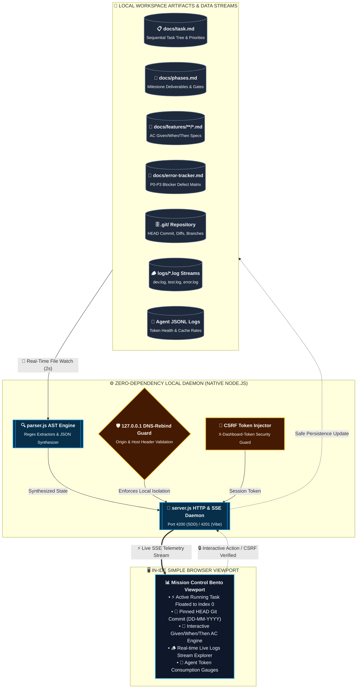
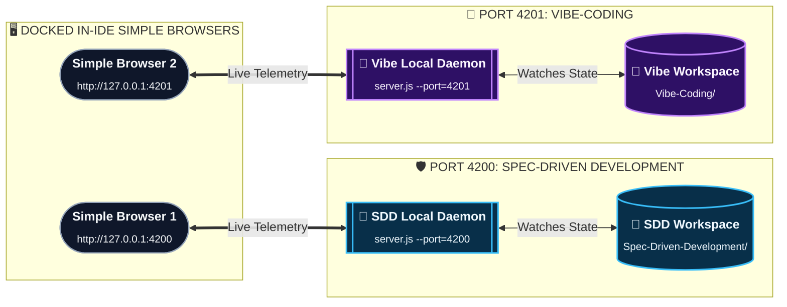
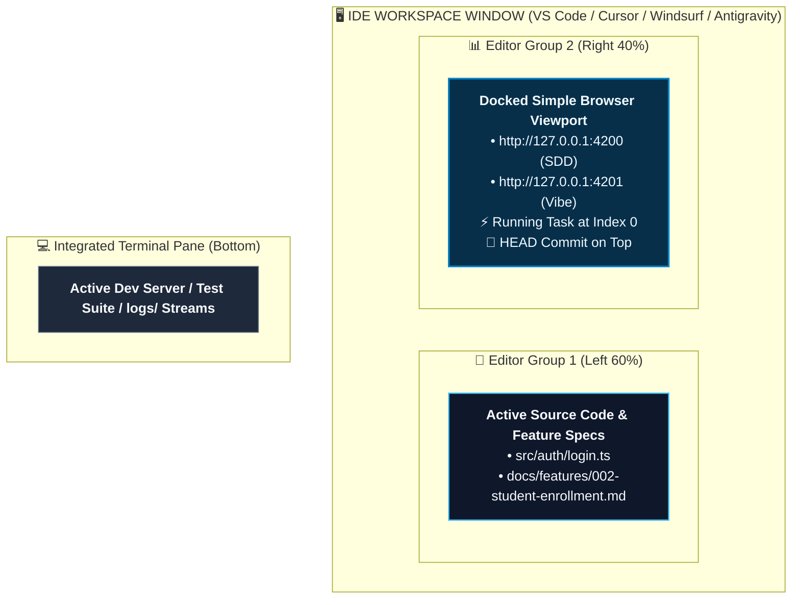
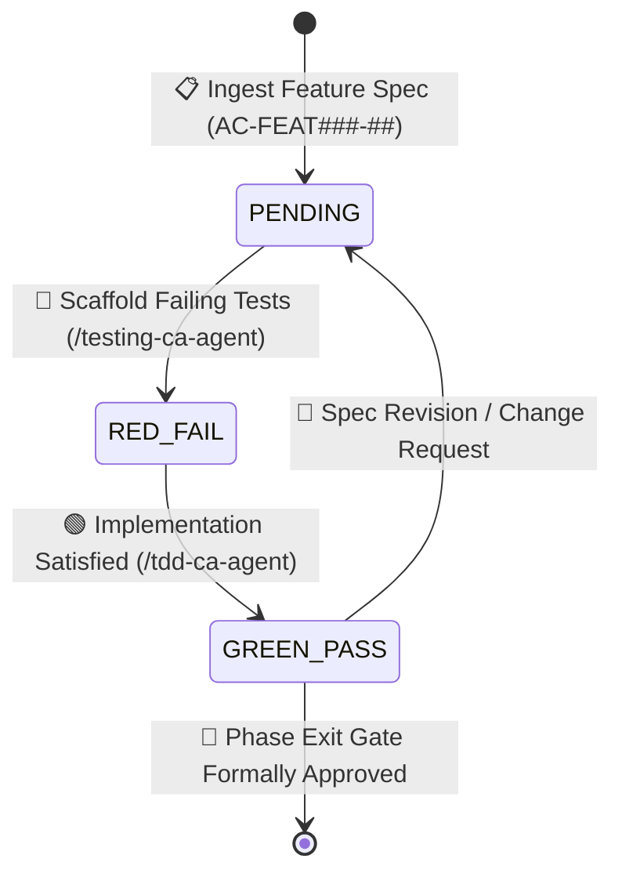
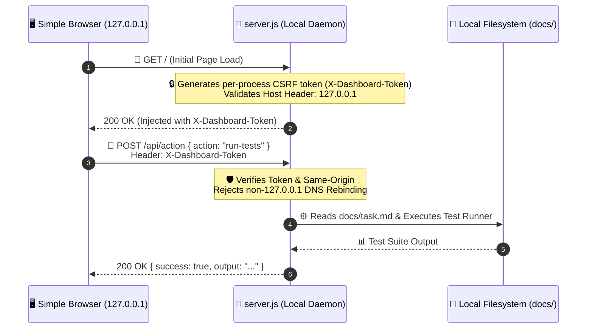

# In-IDE Project-Manager-Dashboard: Step-by-Step Master Guide

### Zero-Dependency, Real-Time Mission Control for SDD-TDD & Vibe-Coding Frameworks

<div align="center">

[](.)
[_|_4201_(Vibe)-indigo?style=for-the-badge>)](.)
[-teal?style=for-the-badge>)](.)
[](.)

**Engineering Lead:** Chandan Adhikary · **Standard:** Production-Grade Universal Release  
**Compatibility:** VS Code · Cursor · Windsurf · Antigravity · Webkit / Chromium

[🏛️ Architecture](#1-architectural-overview--design-philosophy) • [⚡ Quick-Start](#2-quick-start-launching-the-dashboard) • [🖥️ IDE Docking](#3-step-by-step-ide-docking-setup) • [📊 Telemetry Modules](#4-key-features--visual-telemetry-modules) • [🔒 Security](#6-security-model--data-privacy) • [🔧 Troubleshooting](#7-troubleshooting--faq)

</div>

---

## 1. Architectural Overview & Design Philosophy

The **Project-Manager-Dashboard** is a zero-dependency, Apple/Linear and Shadcn UI-inspired telemetry dashboard designed specifically for local development workflows. It runs side-by-side with your code inside the IDE, providing live visibility into tasks, acceptance criteria contracts, git commits, milestones, error triage, logs, and AI agent token consumption.



### Core Design Principles

1. **Zero External Dependencies:** Built using standard Node.js native modules (`http`, `fs`, `path`, `crypto`) with vanilla ES6+ and modern CSS variables. No `npm install` or node_modules required.
2. **Dual-Track Port Isolation:** Runs isolated instances without port collisions:
   - **Port `4200`:** Spec-Driven Development (`SDD-TDD-Chandan-Adhikary/Spec-Driven-Development/`)
   - **Port `4201`:** Vibe-Coding (`Vibe-Coding-Chandan-Adhikary/Vibe-Coding/`)
3. **100% Fluid & Dynamic Layout:** No hardcoded widths. Smoothly scales across compact split editor panes, full vertical monitor orientations, and 4K Ultrawide setups.
4. **Strict Security Sandbox:** Binds exclusively to `127.0.0.1`, enforces origin validation, and issues per-session CSRF security tokens (`X-Dashboard-Token`).



---

## 2. Quick-Start: Launching the Dashboard

You can start the dashboard using any of three methods based on your preferred workflow.

### Method A: Slash Command (Inside Agent Chat)

Simply trigger the registered slash command inside your AI assistant chat window:

```text
/dashboard-ca-agent
```

The agent executes the background runner, verifies port health, and returns the direct local URL.

---

### Method B: Native Shell Launchers (One-Click)

#### On Windows:

Open PowerShell or Command Prompt in the project folder and run:

```powershell
# For SDD-TDD Track
cd SDD-TDD-Chandan-Adhikary\Spec-Driven-Development\Project-Manager-Dashboard
.\open-in-ide.bat

# For Vibe-Coding Track
cd Vibe-Coding-Chandan-Adhikary\Vibe-Coding\Project-Manager-Dashboard
.\open-in-ide.bat
```

#### On macOS & Linux:

Open Terminal in the project directory:

```bash
# For SDD-TDD Track
cd SDD-TDD-Chandan-Adhikary/Spec-Driven-Development/Project-Manager-Dashboard
chmod +x open-in-ide.sh
./open-in-ide.sh

# For Vibe-Coding Track
cd Vibe-Coding-Chandan-Adhikary/Vibe-Coding/Project-Manager-Dashboard
chmod +x open-in-ide.sh
./open-in-ide.sh
```

---

### Method C: Direct Node.js Invocation

Run the server daemon directly with Node.js (v16+ recommended):

```bash
# SDD-TDD Track (Default Port 4200)
node SDD-TDD-Chandan-Adhikary/Spec-Driven-Development/Project-Manager-Dashboard/server.js

# Vibe-Coding Track (Default Port 4201)
node Vibe-Coding-Chandan-Adhikary/Vibe-Coding/Project-Manager-Dashboard/server.js
```

---

## 3. Step-by-Step IDE Docking Setup

For the ultimate distraction-free developer experience, dock the dashboard directly inside your IDE alongside your code.



### 4-Step Docking Instructions:

1. **Open Command Palette:**
   - **Windows / Linux:** Press `Ctrl + Shift + P`
   - **macOS:** Press `Cmd + Shift + P`
2. **Launch Internal Browser:**
   - Type **`Simple Browser: Show`** and press **Enter**.
3. **Enter Local URL:**
   - For SDD-TDD: `http://127.0.0.1:4200`
   - For Vibe-Coding: `http://127.0.0.1:4201`
4. **Dock Side-by-Side:**
   - Drag the newly opened Simple Browser tab header over to the right half of your editor window (**Editor Group 2**).
   - Release the mouse when the vertical split drop zone highlights.

> [!TIP]
> The dashboard automatically polls for changes every 2 seconds. When you or your AI agent edit `docs/task.md`, change a test status, or make a git commit, the dashboard updates immediately without manual page refreshes.

---

## 4. Key Features & Visual Telemetry Modules

### 1. Actively Running Task Floats to Top

- **Dynamic Prioritization:** Whichever task is actively flagged as in-progress (`Task 1`, `Task 2`, `IN_PROGRESS`, `RED_TEST_FAIL`, or `RUNNING`) automatically floats to **index 0** at the very top of the Task Command Center.
- **Visual Callout:** Highlighted with a luminous `⚡ CURRENT RUNNING TASK` badge and dedicated status ring.
- **Sequential Preservation:** Completed and pending tasks preserve their logical numerical order beneath the active task.

### 2. Ubiquitous Dates in DD-MM-YYYY

- All timestamps across the dashboard strictly conform to **`DD-MM-YYYY`** formatting:
  - **Live Header Clock:** Real-time clock with seconds and current day (`DD-MM-YYYY HH:mm:ss`).
  - **Task Start & Stop Chips:** Explicit micro-badges (`🟢 Start: 14-11-2026`, `⏹️ Stop: 14-11-2026`).
  - **Milestone & Phase Cards:** Delivery deadlines and completion gates formatted in `DD-MM-YYYY`.
  - **Git Commits Feed:** Every commit timestamp rendered as `DD-MM-YYYY`.

### 3. HEAD Git Commit Always Pinned on Top

- The latest commit to the repository is locked at index 0 of the Git Telemetry panel.
- Badged with a distinct `[HEAD / CURRENT COMMIT]` indicator, short commit hash, commit message, and author info.

### 4. Interactive Acceptance Criteria (AC) Contract Engine

- Automatically parses all spec files in `docs/features/**/spec.md` or flat `docs/features/*.md`.
- Displays individual `AC-FEAT###-##` criteria cards with Given / When / Then scenario breakdown and test traceability mapping.



### 5. AI Model Profiles & Token Telemetry

- **Model Profile Auto-Detection:** Automatically detects whether you are running Gemini (`gemini-2.5-pro`, `gemini-2.5-flash`), Claude (`claude-3-7-sonnet`), or GPT models.
- **Context Capacity Gauges:** Visual progress bars displaying current context utilization against maximum capacity (e.g., 1M, 200k tokens).
- **Multi-Window Rate Limiting:** Monitors 5-hour rolling windows, hourly limits, and daily consumption with automatic reset countdown timers.

### 6. Prev Error Tracking (Preventive & Defect Matrix)

- **Dedicated Navigation Bar Item:** Quick access with a real-time red badge showing active defect counts (`#nav-errors`, hotkey `7` or `E`).
- **4-Card Bento Summary:** Visual metrics displaying Active Defects, Resolved count, P0 Blocker alerts, and SLA Triage Health percentage.
- **Filter Tabs & Instant Search:** Filter defects instantly by `ALL`, `ACTIVE`, `RESOLVED`, `P0/P1`, or by typing keywords (ID, path, summary).
- **Interactive Radix Sheet Defect Inspector:** Click any defect row to view full root cause analysis, stack traces, impacted paths, and toggle status between `ACTIVE` and `RESOLVED` with 1-click Markdown persistence back to `docs/error-tracker.md`.

### 7. One-Click Pipeline Action Terminal

The dashboard features an integrated command center for triggering automated actions:

- **Run Tests (`btn-run-tests`):** Executes unit and integration test suites.
- **Spec Check (`btn-spec-check`):** Validates spec traceability and acceptance criteria compliance.
- **Code Review (`btn-code-review`):** Audits uncommitted diffs for anti-patterns and lint errors.
- **Security Audit (`btn-security-audit`):** Scans for exposed API keys, secret leaks, and insecure dependencies.
- **Release Verification (`btn-release-verify`):** Runs pre-flight ship/no-ship quality gate checks.

### 8. Live Development Logs Explorer (`logs/` Directory)

The dashboard includes a dedicated Live Development Logs Explorer integrated directly into the navigation bar (`#nav-logs`, hotkey `8` or `L`):

- **Real-Time Navigation Badge:** Displays total count of active `.log` files in the dedicated `logs/` folder (`dev.log`, `test.log`, `server.log`, `error.log`).
- **Log Stream Selector & Tail Controls:** Switch between log streams, tail last 50-500 lines, search keywords, and toggle auto-scroll.
- **Semantic Highlighting:** Distinct monospace line styling for error (red), warn (amber), success (green), and info (cyan).

---

## 5. Configuration & Environment Variables

| Variable                 | Default Value                | Description                                                             |
| :----------------------- | :--------------------------- | :---------------------------------------------------------------------- |
| `DASHBOARD_PORT`         | `4200` (SDD) / `4201` (Vibe) | Port on which the HTTP daemon listens.                                  |
| `DASHBOARD_PROJECT_ROOT` | Current framework root       | Overrides the root directory parsed for docs and git telemetry.         |
| `DASHBOARD_TRANSCRIPT`   | Auto-detected newest JSONL   | Absolute path to agent conversation transcript log for token telemetry. |
| `POLL_INTERVAL_MS`       | `2000`                       | Frontend polling interval in milliseconds.                              |

---

## 6. Security Model & Data Privacy



### Security Directives:

- **127.0.0.1 Binding Only:** Strictly rejects all external and non-local network traffic.
- **DNS-Rebinding Protection:** Validates incoming `Host` headers; drops non-whitelisted requests.
- **CSRF Token Validation:** Mutating endpoints require an `X-Dashboard-Token` issued uniquely per server process.
- **Read-Only Code Isolation:** The daemon reads markdown documentation, git metadata, and local agent logs. It never modifies application source code without explicit user action.

---

## 7. Troubleshooting & FAQ

### Q1: The port is already in use (`EADDRINUSE: 4200` / `4201`).

**Resolution:**
Terminate any orphaned server instance:

```powershell
# Windows
Get-Process -Name node | Where-Object { $_.CommandLine -like "*server.js*" } | Stop-Process

# macOS / Linux
lsof -ti:4200 | xargs kill -9
lsof -ti:4201 | xargs kill -9
```

### Q2: "Failed to save file: The content of the file is newer" warning appears in the IDE.

**Resolution:**
This occurs when Git touches file timestamps during commits. Click **"Overwrite"** on the notification, or run **`File: Revert File`**. The `.gitattributes` file in the repository root guarantees consistent LF endings to prevent recurring conflicts.

### Q3: How do I test the dashboard engines?

**Resolution:** Run the dedicated test suites:

```bash
# SDD-TDD Track
node SDD-TDD-Chandan-Adhikary/Spec-Driven-Development/tests/test_token_telemetry.js
node SDD-TDD-Chandan-Adhikary/Spec-Driven-Development/tests/test_ac_contracts.js
node SDD-TDD-Chandan-Adhikary/Spec-Driven-Development/tests/test_error_tracker.js
node SDD-TDD-Chandan-Adhikary/Spec-Driven-Development/tests/test_logs_feature.js

# Vibe-Coding Track
node Vibe-Coding-Chandan-Adhikary/Vibe-Coding/tests/test_token_telemetry.js
node Vibe-Coding-Chandan-Adhikary/Vibe-Coding/tests/test_ac_contracts.js
node Vibe-Coding-Chandan-Adhikary/Vibe-Coding/tests/test_error_tracker.js
node Vibe-Coding-Chandan-Adhikary/Vibe-Coding/tests/test_logs_feature.js
```
