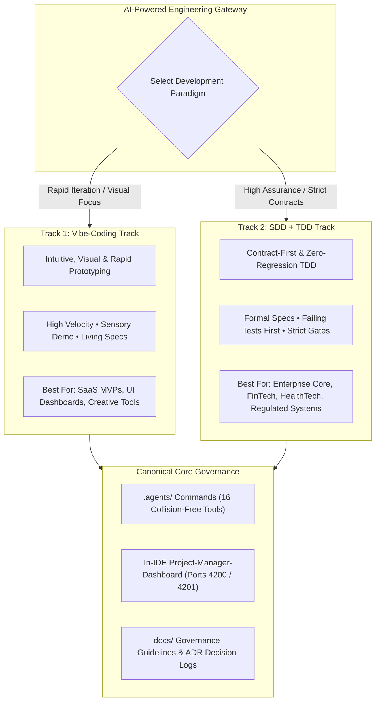
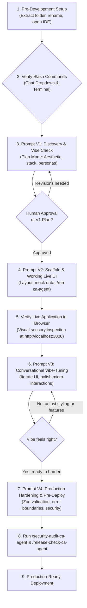
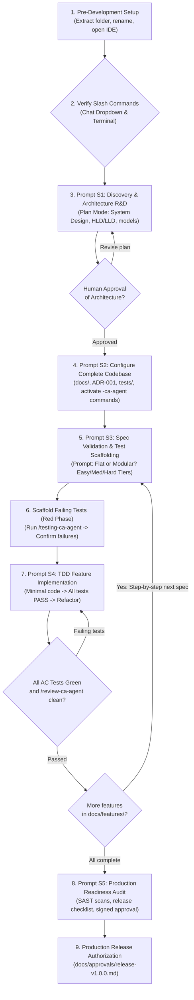
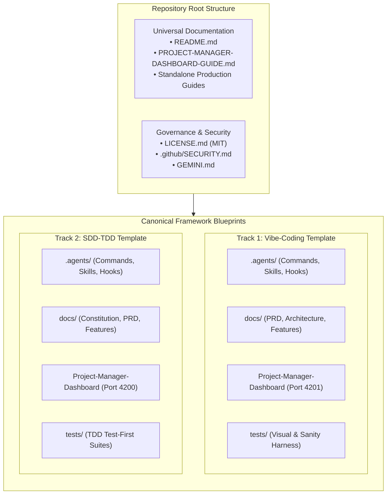
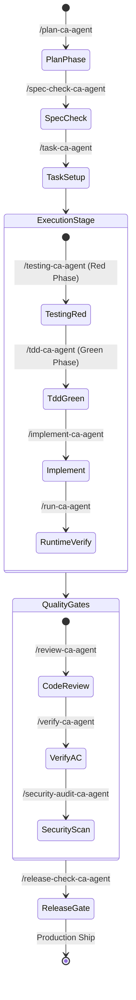
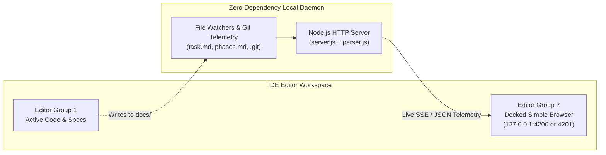

# AI-Powered Project Development Frameworks
### 2-in-1 Enterprise Architecture: Vibe-Coding & Spec-Driven Development (SDD + TDD)

<div align="center">

[](.)
[](.)
[](LICENSE.md)
[](.github/SECURITY.md)
[](.)

**Engineering Lead:** Chandan Adhikary · **Standard:** Production-Grade Universal Release  
**Supported Platforms:** Claude Code · Cursor · Windsurf · Antigravity · OpenCode · Codex · Trae · VS Code

[🌟 Executive Overview](#-executive-overview) • [🧭 Dual-Track Decision](#-the-2-in-1-dual-workflow-framework) • [🔄 Architecture Workflows](#-prompt-workflow-diagrams) • [📁 Blueprint](#-repository-architecture-blueprint) • [⚡ Quick-Start](#-quick-start-guide-step-by-step-for-any-project) • [🖥️ Dashboard](#-in-ide-project-manager-dashboard) • [📖 Catalog](#-complete-documentation-catalog)

</div>

---

## 🌟 Executive Overview

This repository provides two standardized, battle-tested engineering frameworks for developing **production-grade software** using autonomous AI coding agents. Whether you are building rapid consumer-facing SaaS products or mission-critical, enterprise multi-tenant systems, this repository enforces strict governance, zero speculative coding, and measurable quality gates.



### The 4 Foundational Directives of Agentic Engineering:
> 1. **Never Code Speculatively:** Autonomous agents must first inspect repository governance, synthesize domain architecture, configure living documentation, and obtain explicit human sign-off before writing production code.
> 2. **Pre-Prompting Domain Knowledge & System Design Synthesis:** Before Step 5 (First Prompting), establish deep domain mastery and system design blueprints (HLD/LLD); if not manually prepared, instruct the AI agent to formulate the architecture during planning.
> 3. **Mandatory Development Logging (`logs/` Folder):** Always maintain clean, sanitized development logs (`logs/dev.log`, `logs/test.log`, `logs/server.log`, `logs/error.log`) inside a dedicated `logs/` directory.
> 4. **Staged Web Development (Frontend-First Verification):** For web applications, never build all features at once. First develop the frontend (UI design, layout, responsiveness, mock/client state), verify it via a live demo run (`/run-ca-agent`), and only after visual sign-off proceed to backend persistence, security, and automated tests.

---

## 🧭 The 2-in-1 Dual Workflow Framework

Choose the framework that matches your delivery model and architectural requirements:

| Architectural Dimension | 🌟 Track 1: Vibe-Coding | 🛡️ Track 2: SDD + TDD |
| :--- | :--- | :--- |
| **Workspace Location** | `Vibe-Coding-Chandan-Adhikary/Vibe-Coding/` | `SDD-TDD-Chandan-Adhikary/Spec-Driven-Development/` |
| **Core Workflow** | Fluid Prompts & Rapid Iterative Loops | Formal Quality-Gated Prompts & Phase Gates |
| **Engineering Philosophy** | Intuitive, visual feedback & rapid sensory UI | Contract-first, zero regression, test-driven |
| **Specification Model** | Living `docs/features/` contracts (Iterative) | Formal `docs/features/` (Flat vs. Modular Tiers) |
| **Verification Strategy** | Visual runtime inspection & sanity harnesses | Test-First (TDD: Red → Green → Refactor) |
| **In-IDE Dashboard** | Port `4201` (`http://127.0.0.1:4201`) | Port `4200` (`http://127.0.0.1:4200`) |
| **Recommended Scope** | Rapid SaaS MVPs, interactive apps, dashboards | Enterprise core, multi-tenant fintech, healthtech |

---

## 🔄 Prompt Workflow Diagrams

### Track 1: Vibe-Coding Prompt & Sensory Loop



---

### Track 2: Spec-Driven Development + TDD Quality-Gated Loop



---

## 📁 Repository Architecture Blueprint



```text
SDD-Vibe/
├── README.md                                         # Universal overview & quick-start guide
├── LICENSE.md                                        # MIT License (Chandan Adhikary)
├── PROJECT-MANAGER-DASHBOARD-GUIDE.md                # In-IDE Project-Manager-Dashboard Step-by-Step Guide
├── GEMINI.md                                         # Master Agent Configuration & Operational Contracts
├── .github/
│   ├── SECURITY.md                                   # Vulnerability disclosure & security policy
│   └── workflows/frameworks-ci.yml                   # CI pipeline validating framework packages
│
├── 🌟 VIBE-CODING TRACK (STANDALONE GUIDES):
│   ├── Vibe-Coding-Production-Guide-Universal.md     # Universal Vibe-Coding Production Guide for ANY Project
│   ├── Vibe-Coding-Production-Guide-SMS.md           # Reference Vibe-Coding Production Guide (SMS Demo)
│   ├── Vibe-Coding-Custom-Slash-Command-Universal.md # Universal Vibe Slash Commands Guide (16 Commands Table)
│   └── Vibe-Coding-Custom-Slash-Command-SMS.md       # Reference Vibe Slash Commands Guide (SMS Demo)
│
├── 🛡️ SDD + TDD TRACK (STANDALONE GUIDES):
│   ├── SDD-TDD-Production-Guide-Universal.md         # Universal SDD-TDD Production Guide for ANY Project
│   ├── SDD-TDD-Production-Guide-SMS.md               # Reference SDD-TDD Production Guide (SMS Demo)
│   ├── SDD-TDD-Custom-Slash-Command-Universal.md     # Universal SDD Slash Commands Guide (16 Commands Table)
│   └── SDD-TDD-Custom-Slash-Command-SMS.md           # Reference SDD Slash Commands Guide (SMS Demo)
│
├── 📦 CANONICAL STARTER BLUEPRINTS:
│   ├── Vibe-Coding-Chandan-Adhikary/Vibe-Coding/     # Track 1 Starter Template (Port 4201)
│   └── SDD-TDD-Chandan-Adhikary/Spec-Driven-Development/ # Track 2 Starter Template (Port 4200)
```

---

## ⚡ Quick-Start Guide (Step-by-Step for Any Project)

### Step 1: Pick & Rename Your Framework Blueprint
1. Copy or extract either `Vibe-Coding-Chandan-Adhikary/Vibe-Coding/` or `SDD-TDD-Chandan-Adhikary/Spec-Driven-Development/` to your clean workspace.
2. Rename the directory to your target application name in lowercase `kebab-case` (e.g. `my-awesome-saas/`).
3. Open the directory at the root in your AI coding IDE (Cursor, Windsurf, Claude Code, Antigravity, VS Code).

### Step 2: Verify Slash Commands (Chat Palette & Terminal)
Before generating any application code:
1. **Chat Dropdown:** Focus your AI assistant chat box and type `/`. Verify all 16 `*-ca-agent` commands appear with descriptions.
2. **Terminal Verification:** Run `ls .agents/commands/*-ca-agent.md` to ensure command contracts exist.

### Step 3: Launch Local Mission Control
Start the zero-dependency telemetry dashboard:
- **Slash Command:** Type `/dashboard-ca-agent` in chat.
- **Direct Terminal:** Run `open-in-ide.bat` (Windows) or `bash open-in-ide.sh` (macOS/Linux).
- **IDE Docking:** Open `Simple Browser: Show` and navigate to `http://127.0.0.1:4200` (SDD) or `http://127.0.0.1:4201` (Vibe). Dock the tab to Editor Group 2.

---

## 🛡️ The 16 Collision-Free Custom Slash Commands (`.agents/commands/`)

All custom commands carry the `-ca-agent` namespace to guarantee zero collisions with IDE-reserved tokens:



| Category | Slash Commands Available | Operational Scope |
| :--- | :--- | :--- |
| **Planning & Specs** | `/plan-ca-agent` · `/task-ca-agent` · `/spec-check-ca-agent` · `/change-request-ca-agent` | Discovery research, task harness initialization, spec validation, change impact assessment |
| **Execution & TDD** | `/testing-ca-agent` · `/tdd-ca-agent` · `/implement-ca-agent` · `/run-ca-agent` | Failing test execution, Red-Green-Refactor, bounded implementation, dev server startup |
| **Quality & Security** | `/review-ca-agent` · `/verify-ca-agent` · `/security-audit-ca-agent` · `/release-check-ca-agent` | Git diff review, criteria verification scorecard, SAST security scan, production release gate |
| **Diagnostics & Handoff** | `/errorlogs-ca-agent` · `/gitlogs-ca-agent` · `/handoff-ca-agent` | Stack trace root-cause triage, git commit audit trails, engineering handoff dossiers |
| **Visual Mission Control** | `/dashboard-ca-agent` | Launches portable, fluid In-IDE Bento Grid dashboard across all monitor resolutions |

---

## 🖥️ In-IDE Project-Manager-Dashboard

The in-built **Project-Manager-Dashboard** is a zero-dependency, Apple/Linear and Shadcn UI-inspired telemetry dashboard running directly inside your editor:



### Dashboard Core Capabilities:
- **100% Fluid & Responsive:** Scales gracefully from split editor panes to 4K ultrawide monitors.
- **Current Running Task Always on Top:** Actively running task (`Task 1`, `IN_PROGRESS`, `RED_TEST_FAIL`) dynamically floats to Index 0 with a highlighted `⚡ CURRENT RUNNING TASK` badge.
- **HEAD Git Commit Pinned on Top:** Latest commit pinned at top with `[HEAD / CURRENT COMMIT]` indicator and exact `📅 DD-MM-YYYY` timestamp.
- **Working AC Contract Engine:** Acceptance Criteria (`AC-*`) with Given/When/Then scenario inspection and live status cycling (`PENDING` → `RED` → `GREEN`).
- **AI Token Telemetry:** Real-time token consumption, cache hit rate, and session cost savings tracking.

---

## 📖 Complete Documentation Catalog

### 1. Universal Framework Master Guides
- **[CUSTOM-SLASH-COMMANDS-GUIDE.md](CUSTOM-SLASH-COMMANDS-GUIDE.md)** — Master guide for custom slash commands, prompt formats, activation steps, and Webdev / Data Analysis reference architectures.
- **[PROJECT-MANAGER-DASHBOARD-GUIDE.md](PROJECT-MANAGER-DASHBOARD-GUIDE.md)** — In-IDE Project-Manager-Dashboard step-by-step launch, docking, AC engine, and token telemetry guide.
- **[Vibe-Coding-Production-Guide-Universal.md](Vibe-Coding-Production-Guide-Universal.md)** — Universal Vibe-Coding production guide with variable mapping for any SaaS, web app, or marketplace.
- **[SDD-TDD-Production-Guide-Universal.md](SDD-TDD-Production-Guide-Universal.md)** — Universal SDD-TDD production guide with variable mapping for enterprise and regulated systems.
- **[Vibe-Coding-Custom-Slash-Command-Universal.md](Vibe-Coding-Custom-Slash-Command-Universal.md)** — Tabular operational reference for all 16 Vibe commands.
- **[SDD-TDD-Custom-Slash-Command-Universal.md](SDD-TDD-Custom-Slash-Command-Universal.md)** — Tabular operational reference for all 16 SDD commands.

### 2. Concrete Reference Implementations (School Management System Demo)
- **[Vibe-Coding-Production-Guide-SMS.md](Vibe-Coding-Production-Guide-SMS.md)** — Step-by-step production guide for building the EduSphere School Management SaaS.
- **[SDD-TDD-Production-Guide-SMS.md](SDD-TDD-Production-Guide-SMS.md)** — Enterprise production guide for building EduSphere with PostgreSQL RLS and FERPA compliance.
- **[Vibe-Coding-Custom-Slash-Command-SMS.md](Vibe-Coding-Custom-Slash-Command-SMS.md)** — Dedicated Vibe-Coding slash command SMS demo.
- **[SDD-TDD-Custom-Slash-Command-SMS.md](SDD-TDD-Custom-Slash-Command-SMS.md)** — Dedicated SDD-TDD slash command SMS demo.

---

## 🛡️ License & Governance

This framework and its templates are distributed under the [MIT License](LICENSE.md). All projects instantiated from these templates maintain complete sovereignty to choose their own application licenses and tech stacks.
