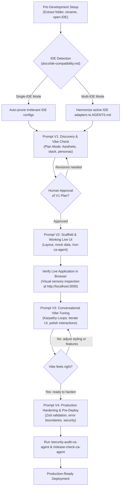
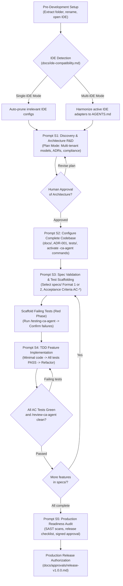

# AI-Powered Project Development Frameworks
### 2-in-1 Architecture: Vibe-Coding & Spec-Driven Development (SDD + TDD)

**Engineering Lead:** Chandan Adhikary & Antigravity Engineering  
**Version:** 2.0.0 (Production-Grade Universal Release)  
**Supported Platforms:** Claude Code, Cursor, Windsurf, Antigravity, OpenCode, Codex, Trae, VS Code with AI Agents  

---

## 🌟 Executive Overview

This repository provides two standardized, battle-tested engineering frameworks for developing **production-grade software** using autonomous AI coding agents. 

Both frameworks share the foundational rule of AI engineering:
> **Do not ask the AI agent to start coding immediately.**  
> First, let the agent inspect repository governance, propose an architecture, configure safe documentation, and obtain your approval.

---

## 🧭 The 2-in-1 Dual Workflow Framework

Choose the framework that matches your project requirements. Both tracks produce strictly production-grade software:

```text
=============================================================================================
             TRACK 1: VIBE-CODING                            TRACK 2: SDD + TDD
---------------------------------------------   ---------------------------------------------
* Location: Vibe-Coding-Chandan-Adhikary/       * Location: SDD-TDD-Chandan-Adhikary/
            Vibe-Coding/                                    Spec-Driven-Development/
* Workflow: 4 Fluid Prompts (Karpathy Loops)     * Workflow: 5 Formal Quality Gated Prompts
* Philosophy: Intuitive, visual, rapid UI        * Philosophy: Contract-first, zero regression
* Specs: Lightweight living feature docs        * Specs: Formal 'specs/' (Flat or Modular)
* Testing: Visual runtime & sanity harnesses    * Testing: Test-First (TDD Red-Green-Refactor)
* Best For: Rapid SaaS MVPs, UI-heavy apps,     * Best For: Enterprise SaaS, multi-tenant core,
  consumer dashboards, interactive web tools      fintech, healthcare, mission-critical systems
=============================================================================================
```

---

## 🔄 Prompt Workflow Diagrams

Here is how prompts flow through each development paradigm:

### Track 1: Vibe-Coding Workflow (4 Fluid Prompts & Karpathy Loops)



---

### Track 2: Spec-Driven Development + TDD Workflow (5 Formal Gated Prompts)



---

## 📁 Symmetrical 4 + 4 Repository Architecture

The repository is organized into a clean **4 + 4 symmetrical documentation suite** providing both **Universal blueprints for ANY software project** and **Concrete reference implementations for a School Management System (SMS)**:

```text
Guide-Github/
├── README.md                                         # Universal overview & quick-start guide
├── LICENSE                                           # MIT License (Chandan Adhikary / RMS Officials)
├── .gitignore                                        # Standard development ignores
│
├── 🌟 VIBE-CODING TRACK (STANDALONE GUIDES):
├── Vibe-Coding-Production-Guide-Universal.md         # Universal Vibe-Coding Production Guide for ANY Project
├── Vibe-Coding-Production-Guide-SMS.md               # Reference Vibe-Coding Production Guide (SMS Demo)
├── Vibe-Coding-Custom-Slash-Command-Universal.md     # Universal Vibe Slash Commands Guide (15 Commands Table)
├── Vibe-Coding-Custom-Slash-Command-SMS.md           # Reference Vibe Slash Commands Guide (SMS Demo)
│
├── 🛡️ SDD + TDD TRACK (STANDALONE GUIDES):
├── SDD-TDD-Production-Guide-Universal.md             # Universal SDD-TDD Production Guide for ANY Project
├── SDD-TDD-Production-Guide-SMS.md                   # Reference SDD-TDD Production Guide (SMS Demo)
├── SDD-TDD-Custom-Slash-Command-Universal.md         # Universal SDD Slash Commands Guide (15 Commands Table)
└── SDD-TDD-Custom-Slash-Command-SMS.md               # Reference SDD Slash Commands Guide (SMS Demo)
│
├── 📦 CANONICAL STARTER TEMPLATES:
├── Vibe-Coding-Chandan-Adhikary/
│   └── Vibe-Coding/                                  # Track 1 Baseline Template (Extract & Rename)
│       ├── AGENTS.md                                 # Portable agent entry point
│       ├── .agents/                                  # 15 collision-free commands & skills
│       ├── docs/                                     # Guidelines, architecture & ide-compatibility.md
│       ├── playbooks/                                # 11 operational workflow playbooks
│       └── tests/                                    # Test contracts
│
└── SDD-TDD-Chandan-Adhikary/
    └── Spec-Driven-Development/                      # Track 2 Baseline Template (Extract & Rename)
        ├── AGENTS.md                                 # Portable agent entry point
        ├── specs/                                    # Official specifications (Format 1 Flat or Format 2 Modular)
        ├── .agents/                                  # 15 collision-free commands & skills
        ├── docs/                                     # Constitution, rules, ADRs, ide-compatibility.md
        ├── playbooks/                                # 11 operational workflow playbooks
        └── tests/                                    # Test harness & test-first suites
```

---

## ⚡ Quick-Start Guide (Step-by-Step for Any Project)

### Step 1: Pick & Rename Your Framework
1. Copy or extract either `Vibe-Coding-Chandan-Adhikary/Vibe-Coding/` or `SDD-TDD-Chandan-Adhikary/Spec-Driven-Development/` to a clean working directory.
2. Rename the folder to your product name in lowercase `kebab-case` (e.g. `[your-project-name]/`).
3. Open the renamed folder in your AI coding IDE (Antigravity, Cursor, Windsurf, Claude Code, OpenCode, VS Code). Ensure the editor opens at the project root so it discovers `AGENTS.md` and `.agents/`.

### Step 2: Active IDE Detection & Cleanup (`docs/ide-compatibility.md`)
- **Single-IDE Mode (Automated Pruning):** Irrelevant configuration files belonging to other IDEs (`.cursorrules`, `.windsurfrules`, `CLAUDE.md`, etc.) can be automatically pruned during Prompt 1 to prevent rule conflicts and token bloat.
- **Multi-IDE Mode (Coexistence):** If using multiple IDEs across a team, declare them in Prompt 1. All declared adapters will point to canonical `AGENTS.md` and `.agents/`.

### Step 3: Run the Master Prompts or Custom Slash Commands

Choose your preferred execution method:

#### Option A: Natural Language Master Prompts
- For any new project via Vibe-Coding: Follow **[Vibe-Coding-Production-Guide-Universal.md](Vibe-Coding-Production-Guide-Universal.md)** (Prompts 1 through 4).
- For any new project via SDD + TDD: Follow **[SDD-TDD-Production-Guide-Universal.md](SDD-TDD-Production-Guide-Universal.md)** (Prompts 1 through 5).

#### Option B: Portable Custom Slash Commands (`-ca-agent`)
Type custom slash commands directly into your AI chat prompt:

**For Vibe-Coding (4 Fluid Steps):**
1. `/plan-ca-agent`: Aesthetic vision, design tokens, component hierarchy, read-only plan mode.
2. `/implement-ca-agent` followed by `/run-ca-agent`: Layout scaffolding, responsive navigation, and dev server verification.
3. `/task-ca-agent` followed by `/review-ca-agent`: Fast Karpathy conversational loops, 1-click status pills, optimistic UI.
4. `/security-audit-ca-agent` followed by `/release-check-ca-agent`: Zod validation, auth route middleware, `npm run build` verification.
*(Full operational guide & 15-command table: **[Vibe-Coding-Custom-Slash-Command-Universal.md](Vibe-Coding-Custom-Slash-Command-Universal.md)**)*

**For SDD + TDD (5 Formal Quality Gates):**
1. `/plan-ca-agent`: Enterprise architecture, data isolation, regulatory compliance, read-only plan mode.
2. `/task-ca-agent`: Repository baseline configuration, `ADR-001`, and `tests/` test runner setup.
3. `/spec-check-ca-agent` followed by `/testing-ca-agent`: Specification audit against Acceptance Criteria (`AC-*`) and failing test execution (RED state).
4. `/tdd-ca-agent` followed by `/review-ca-agent`: Minimal code implementation (GREEN state), refactoring, atomic git commit.
5. `/security-audit-ca-agent` followed by `/release-check-ca-agent`: Full test coverage (>90%), SAST security scan, and formal sign-off in `docs/approvals/`.
*(Full operational guide & 15-command table: **[SDD-TDD-Custom-Slash-Command-Universal.md](SDD-TDD-Custom-Slash-Command-Universal.md)**)*

---

## 🛡️ Built-in Capabilities & Collision Prevention

### Collision-Free Agent Commands (`.agents/commands/`)
To eliminate collisions with host IDE reserved slash commands (like Cursor or Claude Code's native `/run`, `/plan`, or `/test`), all 15 custom commands use the explicit `-ca-agent` namespace:

| Category | Slash Commands Available | Operational Scope |
| :--- | :--- | :--- |
| **Planning & Specs** | `/plan-ca-agent` · `/task-ca-agent` · `/spec-check-ca-agent` · `/change-request-ca-agent` | Discovery research, task harness initialization, spec validation, change impact assessment |
| **Execution & TDD** | `/testing-ca-agent` · `/tdd-ca-agent` · `/implement-ca-agent` · `/run-ca-agent` | Failing test execution, Red-Green-Refactor, bounded implementation, dev server startup |
| **Quality & Security** | `/review-ca-agent` · `/verify-ca-agent` · `/security-audit-ca-agent` · `/release-check-ca-agent` | Git diff review, criteria verification scorecard, SAST security scan, production release gate |
| **Diagnostics & Handoff** | `/errorlogs-ca-agent` · `/gitlogs-ca-agent` · `/handoff-ca-agent` | Stack trace root-cause triage, git commit audit trails, engineering handoff dossiers |

### Andrej Karpathy Engineering Skill (`andrej-karpathy-skill`)
Built into `.agents/skills/andrej-karpathy-skill/` across both tracks:
- **Inspect the Raw Data First:** Never guess schemas or APIs; inspect raw payloads and database seeds first.
- **Single-Batch Overfit / Micro-Baseline:** Make a single vertical feature slice work end-to-end before adding abstraction layers.
- **Immediate Feedback Loops:** Keep diffs small, verify each step live in the browser, and avoid blind multi-file refactoring.
- **Anti-Overengineering:** Keep code modular, inspectable, flat, and maintainable.

---

## 📖 Complete Documentation Catalog

### 1. Universal Guides for ANY Project
- **[Vibe-Coding-Production-Guide-Universal.md](Vibe-Coding-Production-Guide-Universal.md)**  
  Universal 4-prompt Vibe-Coding production guide with parameterized placeholders and variable mapping for any SaaS, web app, or marketplace.
- **[SDD-TDD-Production-Guide-Universal.md](SDD-TDD-Production-Guide-Universal.md)**  
  Universal 5-prompt Spec-Driven Development & TDD production guide with parameterized placeholders for any enterprise or regulated system.
- **[Vibe-Coding-Custom-Slash-Command-Universal.md](Vibe-Coding-Custom-Slash-Command-Universal.md)**  
  Universal Vibe-Coding custom slash commands operational reference with exhaustive tabular workings for all 15 commands.
- **[SDD-TDD-Custom-Slash-Command-Universal.md](SDD-TDD-Custom-Slash-Command-Universal.md)**  
  Universal SDD+TDD custom slash commands operational reference with exhaustive tabular workings for all 15 commands.

### 2. Concrete Reference Implementations (School Management System Demo)
- **[Vibe-Coding-Production-Guide-SMS.md](Vibe-Coding-Production-Guide-SMS.md)**  
  Step-by-step production guide for building the EduSphere School Management SaaS website (Indigo/Slate palette, 30-sec attendance, optimistic UI).
- **[SDD-TDD-Production-Guide-SMS.md](SDD-TDD-Production-Guide-SMS.md)**  
  Step-by-step enterprise production guide for building the EduSphere Enterprise SMS platform (PostgreSQL RLS, FERPA compliance, TDD cycles).
- **[Vibe-Coding-Custom-Slash-Command-SMS.md](Vibe-Coding-Custom-Slash-Command-SMS.md)**  
  Dedicated Vibe-Coding custom slash commands guide driving the EduSphere SMS demo via conversational Karpathy loops.
- **[SDD-TDD-Custom-Slash-Command-SMS.md](SDD-TDD-Custom-Slash-Command-SMS.md)**  
  Dedicated SDD+TDD custom slash commands guide driving the EduSphere Enterprise SMS demo via formal compliance gates.

### 3. Architecture & Specification References
- **[docs/ide-compatibility.md](SDD-TDD-Chandan-Adhikary/Spec-Driven-Development/docs/ide-compatibility.md)** — Active IDE detection, pruning, and multi-IDE synchronization standard.
- **[specs/](SDD-TDD-Chandan-Adhikary/Spec-Driven-Development/specs/)** — Official SDD specifications supporting dual formats (Flat files vs. Modular folders).
