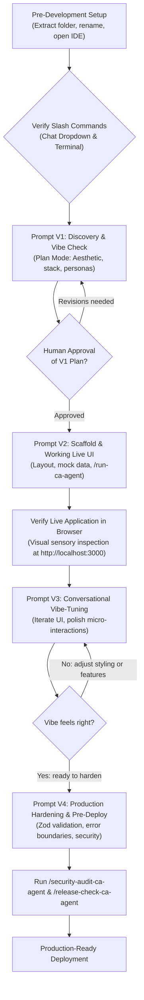
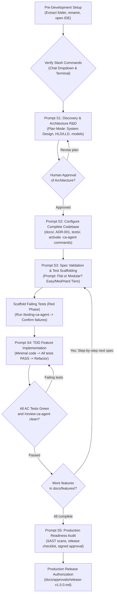

# AI-Powered Project Development Frameworks
### 2-in-1 Architecture: Vibe-Coding & Spec-Driven Development (SDD + TDD)

**Engineering Lead:** Chandan Adhikary & Antigravity Engineering  
**Version:** 2.0.0 (Production-Grade Universal Release)  
**Supported Platforms:** Claude Code, Cursor, Windsurf, Antigravity, OpenCode, Codex, Trae, VS Code with AI Agents, Terminal CLI Agents  
**License:** [MIT License](LICENSE.md) · **Security:** [Security Policy](.github/SECURITY.md)

---

## 🌟 Executive Overview

This repository provides two standardized, battle-tested engineering frameworks for developing **production-grade software** using autonomous AI coding agents. 

Both frameworks share the foundational rule of agentic engineering:
> **Do not ask the AI agent to start coding immediately.**  
> First, let the agent inspect repository governance, propose an architecture, configure safe documentation, and obtain your approval.

---

## 🧭 The 2-in-1 Dual Workflow Framework

Choose the framework that matches your project requirements. Both tracks produce strictly production-grade software:

```text
=============================================================================================
             TRACK 1: VIBE-CODING                            TRACK 2: SDD + TDD
---------------------------------------------   ---------------------------------------------
* Location: Vibe-Coding-Chandan-Adhikary/       * Location: SDD-TDD-Chandan-Adhikary/
            Vibe-Coding/                                    Spec-Driven-Development/
* Workflow: Fluid Prompts (Iterative Loops)     * Workflow: Formal Quality Gated Prompts
* Philosophy: Intuitive, visual, rapid UI        * Philosophy: Contract-first, zero regression
* Specs: Living 'docs/features/' contracts      * Specs: Formal 'docs/features/' (Flat/Modular)
* Testing: Visual runtime & sanity harnesses    * Testing: Test-First (TDD Red-Green-Refactor)
* Best For: Rapid SaaS MVPs, UI-heavy apps,     * Best For: Enterprise SaaS, multi-tenant core,
  consumer dashboards, interactive web tools      fintech, healthcare, mission-critical systems
=============================================================================================
```

---

## 🔄 Prompt Workflow Diagrams

Here is how prompts flow through each development paradigm:

### Track 1: Vibe-Coding Workflow



---

### Track 2: Spec-Driven Development + TDD Workflow



---

## 📁 Repository Structure

```text
Guide-Github/
├── README.md                                         # Universal overview & quick-start guide
├── LICENSE.md                                        # MIT License (Chandan Adhikary / RMS Officials)
├── CUSTOM-SLASH-COMMANDS-GUIDE.md                    # Universal Slash Commands & Prompting Guide
├── .gitignore                                        # Standard development ignores
├── .github/
│   ├── SECURITY.md                                   # Vulnerability disclosure & security policy
│   └── workflows/frameworks-ci.yml                   # CI pipeline validating framework packages
│
├── 🌟 VIBE-CODING TRACK (STANDALONE GUIDES):
├── Vibe-Coding-Production-Guide-Universal.md         # Universal Vibe-Coding Production Guide for ANY Project
├── Vibe-Coding-Production-Guide-SMS.md               # Reference Vibe-Coding Production Guide (SMS Demo)
├── Vibe-Coding-Custom-Slash-Command-Universal.md     # Universal Vibe Slash Commands Guide (16 Commands Table)
├── Vibe-Coding-Custom-Slash-Command-SMS.md           # Reference Vibe Slash Commands Guide (SMS Demo)
│
├── 🛡️ SDD + TDD TRACK (STANDALONE GUIDES):
├── SDD-TDD-Production-Guide-Universal.md             # Universal SDD-TDD Production Guide for ANY Project
├── SDD-TDD-Production-Guide-SMS.md                   # Reference SDD-TDD Production Guide (SMS Demo)
├── SDD-TDD-Custom-Slash-Command-Universal.md         # Universal SDD Slash Commands Guide (16 Commands Table)
└── SDD-TDD-Custom-Slash-Command-SMS.md               # Reference SDD Slash Commands Guide (SMS Demo)
│
├── 📦 CANONICAL STARTER TEMPLATES:
├── Vibe-Coding-Chandan-Adhikary/
│   └── Vibe-Coding/                                  # Track 1 Baseline Template (Extract & Rename)
│       ├── AGENTS.md                                 # Portable agent entry point
│       ├── LICENSE.md                                # MIT License
│       ├── .agents/                                  # 16 commands & core repository skills          
│       ├── docs/                                     # PRD, System Architecture, Design Tokens, features/
│       ├── Project-Manager-Dashboard/                # Fluid In-IDE dashboard (port 4201)
│       ├── scripts/                                  # Conformance & verification scripts
│       ├── playbooks/                                # 11 operational workflow playbooks
│       └── tests/                                    # Test contracts
│
└── SDD-TDD-Chandan-Adhikary/
    └── Spec-Driven-Development/                      # Track 2 Baseline Template (Extract & Rename)
        ├── AGENTS.md                                 # Portable agent entry point
        ├── LICENSE.md                                # MIT License
        ├── .agents/                                  # 16 commands & core repository skills          
        ├── docs/                                     # Constitution, PRD, System Architecture, features/
        ├── Project-Manager-Dashboard/                # Fluid In-IDE dashboard (port 4200)
        ├── scripts/                                  # Conformance & verification scripts
        ├── playbooks/                                # 11 operational workflow playbooks
        └── tests/                                    # Test harness & test-first suites
```

---

## ⚡ Quick-Start Guide (Step-by-Step for Any Project)

### Step 1: Pick & Rename Your Framework
1. Copy or extract either `Vibe-Coding-Chandan-Adhikary/Vibe-Coding/` or `SDD-TDD-Chandan-Adhikary/Spec-Driven-Development/` to a clean working directory.
2. Rename the folder to your product name in lowercase `kebab-case` (e.g. `[your-project-name]/`).
3. Open the renamed folder in your AI coding IDE (Antigravity, Cursor, Windsurf, Claude Code, OpenCode, VS Code). Ensure the editor opens at the project root so it discovers `AGENTS.md` and `.agents/`.

### Step 2: Mandatory — Verify Custom Slash Commands (Chat Dropdown & Terminal)
Before creating any application code or directories:
1. **Chat Dropdown:** Focus the chat box and type `/`. Confirm all 16 `*-ca-agent` commands appear with descriptions.
2. **Terminal / CLI:** Run `ls .agents/commands/*-ca-agent.md` to ensure contracts are present and readable.
*(Do not scaffold code until both checks pass!)*

### Step 3: Execute via Pure Prompts or Custom Slash Commands

Choose your preferred format:

#### Format 1: Pure Prompts (Brief vs. Descriptive)
Follow the 5-step cyclic loop:
1. **Reading Prompt:** Ingest requirements and scope.
2. **Analysis Prompt & Plan:** Deconstruct dependencies and technical boundaries before code.
3. **Check/Recheck docs/ & playbooks/:** Review architecture and governance.
4. **Review `*.md` Guidelines:** Identify required project customizations.
5. **Overwrite Full Guidelines:** Update living docs (`docs/prd.md`, `system-architecture.md`, `task.md`) before writing code.
6. **Step-by-Step Spec Development:** Implement, test, and review one spec at a time.

#### Format 2: Custom Slash Commands (`-ca-agent`) + Prompts
Type custom slash commands directly into your AI chat prompt:
- **Track 1 (Vibe-Coding):** `/plan-ca-agent` → `/implement-ca-agent` + `/run-ca-agent` → `/task-ca-agent` + `/review-ca-agent` → `/security-audit-ca-agent` + `/release-check-ca-agent`.
- **Track 2 (SDD-TDD):** `/plan-ca-agent` → `/task-ca-agent` → `/spec-check-ca-agent` + `/testing-ca-agent` (Red) → `/tdd-ca-agent` + `/review-ca-agent` (Green & Refactor) → `/security-audit-ca-agent` + `/release-check-ca-agent`.

---

## 🛡️ Built-in Capabilities & Collision Prevention

### Collision-Free Agent Commands (`.agents/commands/`)
All 16 custom commands use the explicit `-ca-agent` namespace to eliminate collisions with IDE-reserved commands:

| Category | Slash Commands Available | Operational Scope |
| :--- | :--- | :--- |
| **Planning & Specs** | `/plan-ca-agent` · `/task-ca-agent` · `/spec-check-ca-agent` · `/change-request-ca-agent` | Discovery research, task harness initialization, spec validation, change impact assessment |
| **Execution & TDD** | `/testing-ca-agent` · `/tdd-ca-agent` · `/implement-ca-agent` · `/run-ca-agent` | Failing test execution, Red-Green-Refactor, bounded implementation, dev server startup |
| **Quality & Security** | `/review-ca-agent` · `/verify-ca-agent` · `/security-audit-ca-agent` · `/release-check-ca-agent` | Git diff review, criteria verification scorecard, SAST security scan, production release gate |
| **Diagnostics & Handoff** | `/errorlogs-ca-agent` · `/gitlogs-ca-agent` · `/handoff-ca-agent` | Stack trace root-cause triage, git commit audit trails, engineering handoff dossiers |
| **Visual Mission Control** | `/dashboard-ca-agent` | Launches portable, fluid In-IDE Bento Grid dashboard across all monitor resolutions |

### Developer-Choice Skills Standard
- **No Hardcoded Third-Party Skills:** Pre-bundling arbitrary external guidelines is eliminated. `.agents/skills/` contains strictly core deterministic workspace skills.
- **On-Demand GitHub Installation:** Developers have full sovereignty to install skills directly from GitHub repositories or user plugins as their workflow requires.

---

## 🖥️ In-IDE Project-Manager-Dashboard: Portable & Dynamic

The in-built **Project-Manager-Dashboard** is a zero-dependency, Apple/Linear-inspired Bento Grid Mission Control running inside your IDE:

1. **100% Fluid & Portable Across All Resolutions:**
   - No fixed `1440px` width; dynamically expands and reflows across Ultra-wide (21:9, 32:9), 4K, 1440p, 1080p, laptop, tablet, and mobile screens.
2. **Current Running Task Always on Top:**
   - Whichever sequential task is in progress (`Task 1`, `Task 2`, `TASK-001`, `IN_PROGRESS`, `RED_TEST_FAIL`) dynamically floats to the top with a highlighted `⚡ CURRENT RUNNING TASK` badge. Subsequent tasks maintain natural numerical order.
3. **HEAD Git Commit Always on Top:**
   - The latest commit is pinned at the top of the git feed with a glowing `[HEAD / CURRENT COMMIT]` indicator.
4. **Token Telemetry & Context Health:**
   - Visual readout of active agent context window usage, cache hit rate, and cost savings.

### How to Launch:
- **Slash Command:** Type `/dashboard-ca-agent` in your AI chat.
- **One-Click Script:** Double-click `open-in-ide.bat` (Windows) or execute `./open-in-ide.sh` (Mac/Linux).
- **Dock in IDE:** Open `http://127.0.0.1:4200` (SDD) or `http://127.0.0.1:4201` (Vibe) in an IDE browser tab.

---

## 📖 Complete Documentation Catalog

### 1. Universal Guides for ANY Project
- **[CUSTOM-SLASH-COMMANDS-GUIDE.md](CUSTOM-SLASH-COMMANDS-GUIDE.md)** — Master guide for slash commands, prompt formats, activation steps, and Webdev / Data Analysis reference architectures.
- **[Vibe-Coding-Production-Guide-Universal.md](Vibe-Coding-Production-Guide-Universal.md)** — Universal Vibe-Coding production guide with variable mapping for any SaaS, web app, or marketplace.
- **[SDD-TDD-Production-Guide-Universal.md](SDD-TDD-Production-Guide-Universal.md)** — Universal SDD-TDD production guide with variable mapping for enterprise and regulated systems.
- **[Vibe-Coding-Custom-Slash-Command-Universal.md](Vibe-Coding-Custom-Slash-Command-Universal.md)** — Tabular operational reference for all 16 Vibe commands.
- **[SDD-TDD-Custom-Slash-Command-Universal.md](SDD-TDD-Custom-Slash-Command-Universal.md)** — Tabular operational reference for all 16 SDD commands.

### 2. Concrete Reference Implementations (School Management System Demo)
- **[Vibe-Coding-Production-Guide-SMS.md](Vibe-Coding-Production-Guide-SMS.md)** — Step-by-step production guide for building the EduSphere School Management SaaS.
- **[SDD-TDD-Production-Guide-SMS.md](SDD-TDD-Production-Guide-SMS.md)** — Enterprise production guide for building EduSphere with PostgreSQL RLS and FERPA compliance.
- **[Vibe-Coding-Custom-Slash-Command-SMS.md](Vibe-Coding-Custom-Slash-Command-SMS.md)** — Dedicated Vibe-Coding slash command SMS demo.
- **[SDD-TDD-Custom-Slash-Command-SMS.md](SDD-TDD-Custom-Slash-Command-SMS.md)** — Dedicated SDD-TDD slash command SMS demo.
