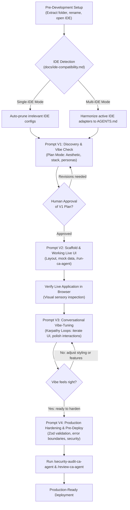
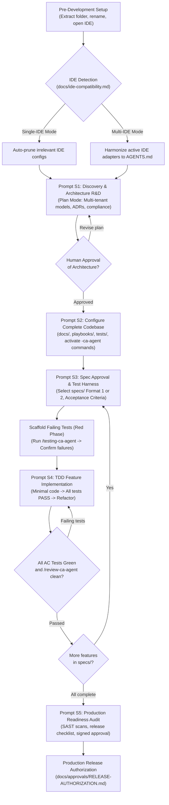

# AI-Powered Project Development Frameworks
### 2-in-1 Architecture: Vibe-Coding & Spec-Driven Development (SDD + TDD)

**Engineering Lead:** Chandan Adhikary & Antigravity Engineering  
**Version:** 2.0.0 (Production-Grade Universal Release)  
**Supported Platforms:** Claude Code, Cursor, Windsurf, Antigravity, OpenCode, Codex, Trae, VS Code with AI Agents  

---

## 🌟 Executive Overview

This repository provides two standardized, battle-tested engineering frameworks for developing **production-grade software** using autonomous AI coding agents. 

Both frameworks share the core rule of AI engineering:
> **Do not ask the AI agent to start coding immediately.**
> First, let the agent inspect repository governance, propose an architecture, configure safe documentation, and obtain your approval.

---

## 🧭 The 2-in-1 Dual Workflow Framework

Choose the framework that matches your project requirements. Both tracks produce strictly production-grade software:

```text
=============================================================================================
             TRACK 1: VIBE-CODING                            TRACK 2: SDD + TDD
---------------------------------------------   ---------------------------------------------
* Location: Vibe-Coding-Chandan-Adhikary/       * Location: SDD-TDD-Chandan-Adhikary/
            Vibe-Coding/                                    Spec-Driven-Development/
* Workflow: 4 Fluid Prompts (Karpathy Loops)     * Workflow: 5 Formal Quality Gated Prompts
* Philosophy: Intuitive, visual, rapid UI        * Philosophy: Contract-first, zero regression
* Specs: Lightweight working memory             * Specs: Formal 'specs/' (Flat or Modular)
* Testing: Visual runtime & sanity harnesses    * Testing: Test-First (TDD Red-Green-Refactor)
* Best For: Rapid SaaS MVPs, UI-heavy apps,     * Best For: Enterprise SaaS, multi-tenant core,
  consumer dashboards, interactive web tools      fintech, healthcare, mission-critical systems
=============================================================================================
```

---

## 🔄 Prompt Workflow Diagrams

Here is how prompts flow through each development paradigm:

### Track 1: Vibe-Coding Workflow (4 Fluid Prompts & Karpathy Loops)



---

### Track 2: Spec-Driven Development + TDD Workflow (5 Formal Gated Prompts)



---

## 📁 Repository Map

```text
Guide-Github/
├── README.md                                    # This universal overview & quick-start guide
├── GUIDE.md                                     # Complete 2-in-1 Prompting Guide (Markdown)
├── AI-Powered Project Development — ... .docx   # Complete 2-in-1 Prompting Guide (Word document)
│
├── Vibe-Coding-Chandan-Adhikary/
│   └── Vibe-Coding/                             # Framework Track 1: Vibe-Coding Template
│       ├── AGENTS.md                            # Portable agent entry point
│       ├── .agents/                             # Collision-free commands & skills
│       │   ├── commands/ (*-ca-agent.md)        # Portable slash commands (/plan-ca-agent, etc.)
│       │   ├── skills/                          # Skills (including andrej-karpathy-skill)
│       │   ├── hooks/                           # Execution matrix (HOOK-MATRIX.md)
│       │   └── templates/                       # Standardized reporting contracts
│       ├── docs/                                # Guidelines, architecture & ide-compatibility.md
│       ├── playbooks/                           # 11 operational workflow playbooks
│       └── tests/                               # Test contracts
│
└── SDD-TDD-Chandan-Adhikary/
    └── Spec-Driven-Development/                 # Framework Track 2: SDD + TDD Template
        ├── AGENTS.md                            # Portable agent entry point
        ├── specs/                               # Official specifications (Format 1 or 2)
        ├── .agents/                             # Collision-free commands & skills
        ├── docs/                                # Constitution, rules, ADRs, ide-compatibility.md
        ├── playbooks/                           # 11 operational workflow playbooks
        └── tests/                               # Test harness & test-first suites
```

---

## ⚡ Quick-Start Guide (Step-by-Step for Laymen)

### Step 1: Pick & Rename Your Framework
1. Select either `Vibe-Coding/` or `Spec-Driven-Development/`.
2. Rename the folder to your product name in lowercase kebab-case (e.g. `school-management-saas/`).
3. Open the renamed folder in your AI coding IDE (Antigravity, Cursor, Windsurf, OpenCode, Claude Code, VS Code).

### Step 2: Active IDE Detection & Cleanup (`docs/ide-compatibility.md`)
- **Single-IDE Mode (Automated Pruning):** Irrelevant configuration folders belonging to other IDEs (`.cursor/`, `.windsurf/`, `.claude/`, etc.) are automatically pruned before or during Prompt 1 to prevent rule conflicts and token bloat.
- **Multi-IDE Mode (Coexistence):** If using multiple IDEs simultaneously (e.g. Antigravity + Cursor), declare them in Prompt 1 (`ACTIVE_IDES=["antigravity", "cursor"]`). All declared adapters are harmonized to point to canonical `AGENTS.md` and `.agents/`, while only unselected IDEs are pruned.

### Step 3: Run the Master Prompts
Follow the detailed prompt-by-prompt guide in [`GUIDE.md`](GUIDE.md) or the `.docx` file:

#### For Vibe-Coding (4 Fluid Prompts):
1. **Prompt V1 (Discovery):** Vision, aesthetic theme, tech stack selection, IDE cleanup.
2. **Prompt V2 (Scaffold):** Core layout, responsive navigation, high-fidelity mock data, local dev server (`/run-ca-agent`).
3. **Prompt V3 (Vibe-Tuning):** Fast Karpathy conversational loops, visual polish, interactive feature expansion.
4. **Prompt V4 (Hardening):** Input validation (Zod), security headers, error boundaries, production build verification.

#### For SDD + TDD (5 Formal Prompts):
1. **Prompt S1 (Discovery & R&D):** Enterprise architecture, data models, ADRs, IDE cleanup.
2. **Prompt S2 (Codebase Config):** Full configuration of `docs/`, `playbooks/`, `tests/`, `.agents/`, and activation of `-ca-agent` commands.
3. **Prompt S3 (Spec Approval & Failing Tests):** Authoring `specs/` (Format 1: Flat files or Format 2: Modular folders) and scaffolding failing unit/integration tests.
4. **Prompt S4 (TDD Feature Implementation):** Red-Green-Refactor cycle, minimal passing code, atomic commits.
5. **Prompt S5 (Production Release Audit):** Full test suite, SAST security scan (`/security-audit-ca-agent`), and release authorization.

---

## 🛡️ Built-in Capabilities & Collision Prevention

### Collision-Free Agent Commands (`.agents/commands/`)
To eliminate collisions with host IDE reserved slash commands (like Cursor or Claude Code's native `/run`, `/plan`, or `/test`), all custom commands use the `-ca-agent` namespace:
`/plan-ca-agent` · `/run-ca-agent` · `/tdd-ca-agent` · `/testing-ca-agent` · `/implement-ca-agent` · `/review-ca-agent` · `/verify-ca-agent` · `/spec-check-ca-agent` · `/task-ca-agent` · `/security-audit-ca-agent` · `/release-check-ca-agent` · `/change-request-ca-agent` · `/handoff-ca-agent` · `/errorlogs-ca-agent` · `/gitlogs-ca-agent`

### Andrej Karpathy Engineering Skill (`andrej-karpathy-skill`)
Built-in to `.agents/skills/andrej-karpathy-skill/` for both tracks:
- **Inspect the Raw Data First:** Never guess schemas or APIs; inspect raw payloads first.
- **Single-Batch Overfit / Micro-Baseline:** Make a single vertical slice work completely before adding abstraction.
- **Failure-Mode Test Harnesses:** Probe boundary conditions and edge cases early.
- **Anti-Overengineering:** Keep code modular, inspectable, and flat.

---

## 📖 Complete Documentation & Production Demo

For the complete prompt-by-prompt walkthrough and an end-to-end production **School Management SaaS (SMS)** demo, refer to:
- **[GUIDE.md](GUIDE.md)** — Complete Setup & Prompting Guide (Markdown)
- **`AI-Powered Project Development — Complete Setup & Prompting Guide.docx`** — Formatted Word Document
- **[`docs/ide-compatibility.md`](SDD-TDD-Chandan-Adhikary/Spec-Driven-Development/docs/ide-compatibility.md)** — IDE Detection & Pruning Standard
- **[`specs/`](SDD-TDD-Chandan-Adhikary/Spec-Driven-Development/specs/)** — Dual-format specification templates
