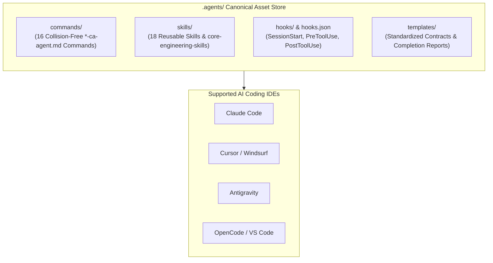
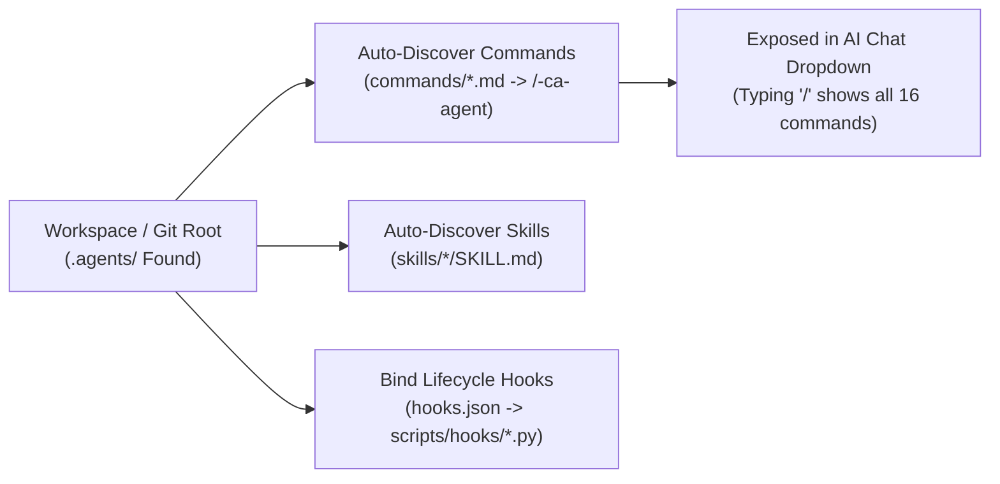

# `.agents/` — Portable Autonomous Agent Assets & Engine
### Unified Cross-IDE Capability Layer for Spec-Driven Development (SDD-TDD)

[-indigo?style=for-the-badge)](commands/README.md)

**Framework Track:** Spec-Driven Development · **Standard:** Cross-IDE Portability Release 2.0.0  
**Supported Hosts:** Claude Code · Cursor · Windsurf · Antigravity · OpenCode · Codex · VS Code

[🌟 Purpose](#-purpose) • [🏛️ Architecture](#️-agent-asset-architecture) • [🔄 Discovery Pipeline](#-multi-ide-discovery--dispatch-pipeline) • [🛡️ Collision Prevention](#️-collision-prevention-policy) • [📦 Activation](#-active-agent-activation)

---

## 🌟 Purpose

The `.agents/` directory is the single cross-IDE canonical source of truth for autonomous AI coding agents operating within this framework. It houses deterministic commands, executable skills, runtime lifecycle hooks, and reporting templates that function uniformly across all major AI code editors without vendor lock-in.

---

## 🏛️ Agent Asset Architecture

---

## 🔄 Multi-IDE Discovery & Dispatch Pipeline

All supported IDEs discover `.agents/` by walking up the directory tree to the workspace root:

---

## 📁 Directory Structure

| Subdirectory / File | Purpose & Operational Contract |
| :--- | :--- |
| `commands/` | 16 canonical, collision-free agent commands named `<name>-ca-agent.md` (see [`commands/README.md`](commands/README.md)). |
| `workflows/` | Antigravity-native slash-command mirrors (`<name>-ca-agent.md`) synced from `commands/` so `/<name>-ca-agent` appears in the `/` dropdown. |
| `skills/` | 18 domain-specific capability playbooks, each `skills/<name>/SKILL.md` with standardized `name`/`description` frontmatter. |
| `hooks.json` | Executable Antigravity lifecycle hooks (`SessionStart`, `PreToolUse`, `PostToolUse`) backed by `scripts/hooks/*.py`. |
| `hooks/` | Lifecycle hook execution contracts and security matrices ([`hooks/HOOK-MATRIX.md`](hooks/HOOK-MATRIX.md)). |
| `templates/` | Standardized reporting artifacts (`AGENT-TASK-CONTRACT.md`, `AGENT-COMPLETION-REPORT.md`). |

---

## 🛡️ Collision Prevention Policy

> [!CRITICAL]
> Assets within `.agents/` (commands, skills, hooks, templates) **MUST NOT** use generic names or identifiers (such as `/run`, `/plan`, `/test` or `/review`) that overlap or shadow native features of host coding IDEs.

1. **Explicit Namespace:** Commands **MUST** use the `-ca-agent` suffix (e.g. `/plan-ca-agent`, `/run-ca-agent`, `/tdd-ca-agent`).
2. **Deterministic Skills:** Skills **MUST** reside in explicit subdirectories with a standardized `SKILL.md` definition whose `name` matches the directory.
3. **Execution Bounding:** Hooks **MUST** declare execution criteria, timeouts, and fallbacks in `hooks/HOOK-MATRIX.md`.

---

## 📦 Active Agent Activation

When copying this framework into another project:
1. Place `.agents/` (and `AGENTS.md`, `docs/`, `scripts/`) at the **workspace/git root**.
2. Run `python scripts/init_project.py --ides antigravity` (or `--ides all` / `--ides claude,cursor,windsurf,copilot`) to sync native adapters.
3. Verify that typing `/` in your chat palette displays all 16 custom `-ca-agent` commands.
