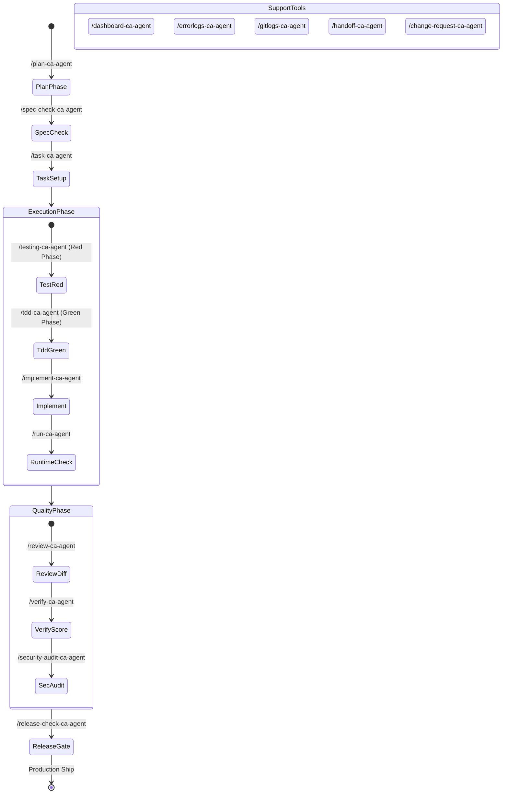
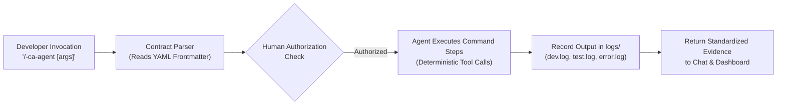

# Portable Agent Slash Commands (`-ca-agent`)
### 16 Canonical, Collision-Free Command Contracts for Autonomous Coding Agents

[🌟 Overview](#-overview) • [🔄 Lifecycle State Machine](#-command-lifecycle-state-machine) • [⚡ Dispatch Pipeline](#-command-dispatch--authorization-pipeline) • [📋 Catalog](#-command-catalog-16)

---

## 🌟 Overview

Every custom command in this framework uses the explicit `-ca-agent` namespace suffix (e.g. `run-ca-agent.md`, `review-ca-agent.md`, `plan-ca-agent.md`) and is invoked directly inside agent chat as `/<name>-ca-agent`.

### Collision Prevention Policy
> [!CRITICAL]
> **MUST NOT** name custom commands with generic tokens such as `/run`, `/plan`, `/test` or `/review`. Host coding IDEs (Cursor, Claude Code, Windsurf, Antigravity, OpenCode) reserve these tokens for internal system features. The `-ca-agent` suffix guarantees:
> 1. Zero collisions with built-in IDE slash commands.
> 2. Predictable invocation across multi-agent environments.
> 3. 100% portability between all host IDE adapters.

---

## 🔄 Command Lifecycle State Machine

---

## ⚡ Command Dispatch & Authorization Pipeline

---

## 📋 Command Catalog (16)

| Command | Category | Purpose | Required Evidence |
| :--- | :--- | :--- | :--- |
| **`/plan-ca-agent`** | Planning | Scoped, read-only system design proposal. | Plan artifact, risk analysis, no code modified. |
| **`/task-ca-agent`** | Planning | Atomic task harness initialization and contract tracking. | `docs/task.md` entry, sequential task ID. |
| **`/spec-check-ca-agent`** | Specs | Feature specification compliance verification. | Traceability verification table against `AC-*`. |
| **`/change-request-ca-agent`** | Specs | Formal change request and architectural impact evaluation. | Change impact matrix, spec version bump. |
| **`/testing-ca-agent`** | Execution | Targeted test execution and suite validation. | Real terminal command outputs, exit codes. |
| **`/tdd-ca-agent`** | Execution | Red-Green-Refactor test-driven implementation. | Red fail evidence, Green pass, refactor diff. |
| **`/implement-ca-agent`** | Execution | Scope-restricted feature implementation. | Strict file modifications matching spec only. |
| **`/run-ca-agent`** | Execution | Local startup and runtime health verification. | Observed URLs (`localhost:PORT`), health response. |
| **`/review-ca-agent`** | Quality | Pre-commit diff, lint, and security review. | Clean `git diff` review, zero unauthorized files. |
| **`/verify-ca-agent`** | Quality | Objective quality-gate validation against specs. | AC scorecard, test pass percentages. |
| **`/security-audit-ca-agent`** | Security | SAST, secret leak, and permission audit. | Dependency scan, zero secret leak verification. |
| **`/release-check-ca-agent`** | Release | Production readiness and release-checklist gate. | Signed approval evidence, ship/no-ship verdict. |
| **`/dashboard-ca-agent`** | Mission Control | Launches local In-IDE Project-Manager-Dashboard. | Confirmed local URL (`http://127.0.0.1:4200`). |
| **`/errorlogs-ca-agent`** | Diagnostics | Structured runtime error and diagnostic log analysis. | Root cause triage, reproduction test case. |
| **`/gitlogs-ca-agent`** | Diagnostics | Git history, commit traceability, and branch state check. | Commit hash audit, DD-MM-YYYY dates verified. |
| **`/handoff-ca-agent`** | Handoff | Verifiable engineering handoff report generation. | Complete handoff dossier for engineering team. |
