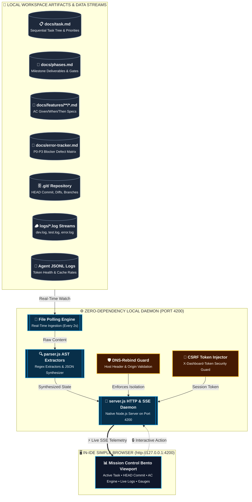
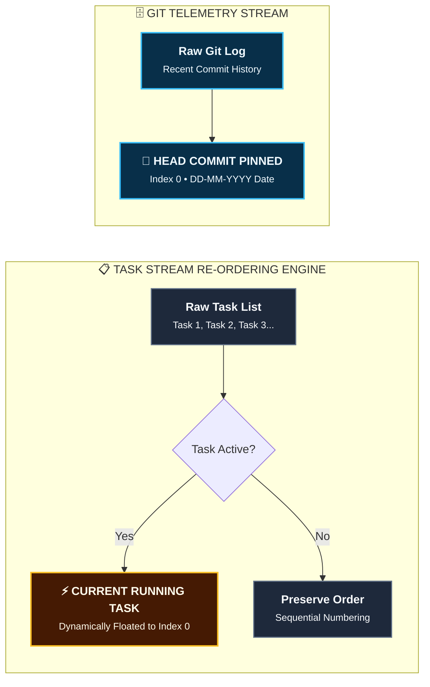
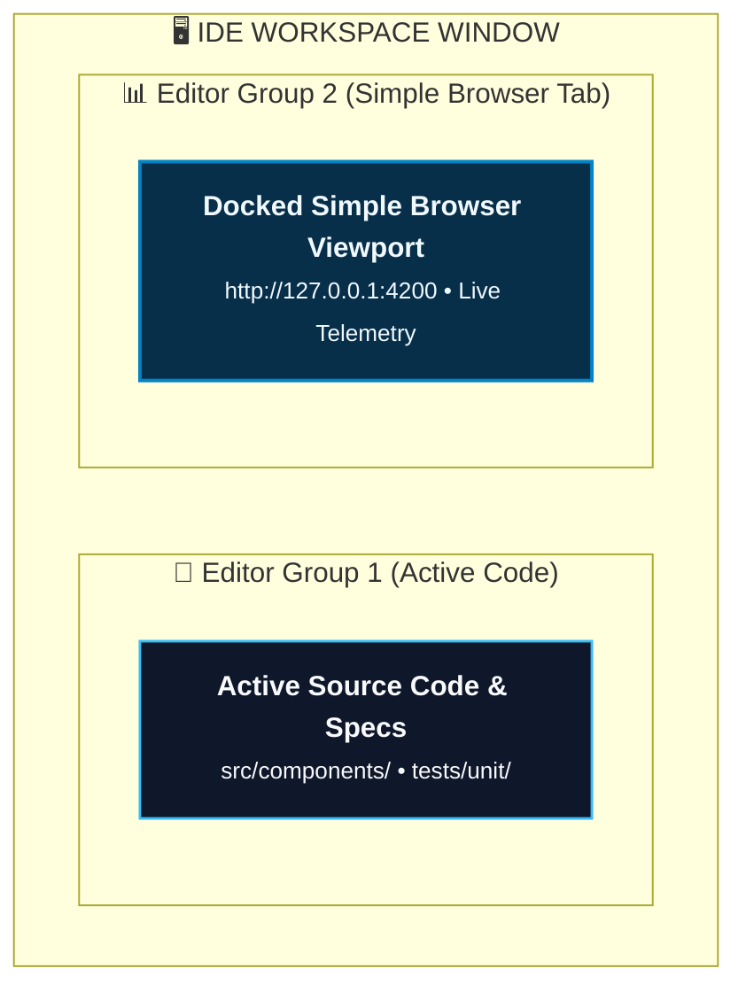
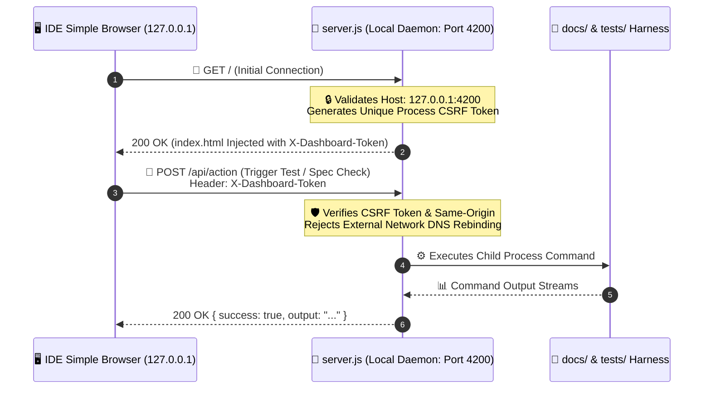

# Project-Manager-Dashboard (In-IDE Subproject)
### Local-Only, Zero-Dependency Telemetry Mission Control for SDD-TDD

<div align="center">

[](.)
[](.)
[](.)
[](.)

**Framework Track:** Spec-Driven Development (SDD-TDD) · **Host Mode:** In-IDE Simple Browser & Local Daemons  
**Access URL:** `http://127.0.0.1:4200` · **Git Status:** Strictly Gitignored / Machine-Local Only

[🌟 Overview](#-overview) • [🏛️ Architecture](#️-mission-control-architecture) • [⚡ Quick Start](#-quick-start-inside-your-ide) • [📊 Telemetry Modules](#-visual-telemetry-modules) • [🔒 Security Model](#-security-model)

</div>

---

## 🌟 Overview

The **Project-Manager-Dashboard** is an embedded telemetry mission control designed exclusively for local IDE development within the **Spec-Driven Development (SDD-TDD)** framework. It runs side-by-side with your source code in an IDE split tab (Simple Browser), providing immediate, real-time visibility into task execution, acceptance criteria contracts, git commits, milestone gates, defect triage, and agent token usage.



---

## 🏛️ Mission Control Architecture

### Dynamic Prioritization Pipeline
The dashboard dynamically prioritizes the items developers care about most:



---

## ⚡ Quick Start (Inside Your IDE)

### 1. Start the Local Daemon
In your terminal or command prompt:
```bash
# Windows
open-in-ide.bat

# macOS / Linux
bash open-in-ide.sh

# Or directly with Node.js (Port 4200):
node server.js
```

### 2. Dock the Dashboard in Your IDE (Side-by-Side Viewport)


1. In your IDE (Cursor, VS Code, Windsurf, Antigravity), press `Ctrl + Shift + P` (or `Cmd + Shift + P` on macOS).
2. Type **`Simple Browser: Show`** and press **Enter**.
3. In the URL prompt, enter:
   ```text
   http://127.0.0.1:4200
   ```
4. Drag the tab to **Editor Group 2** (docked to the right of your active editor).

---

## 📊 Visual Telemetry Modules

1. **Active Running Task on Top:** The currently running task floats to the top of the Kanban with a highlighted `⚡ CURRENT RUNNING TASK` badge.
2. **HEAD Commit Pinned on Top:** The latest commit is locked at Index 0 with an exact `📅 DD-MM-YYYY` timestamp and author chip.
3. **Interactive AC Contract Engine:** Live inspection of Acceptance Criteria (`AC-FEAT###-##`) with Given/When/Then scenarios and clickable status toggling (`GREEN` / `RED` / `PENDING`).
4. **Prev Error Tracker:** Comprehensive defect triage matrix with instant search, P0 blocker tracking, and 1-click status persistence to `docs/error-tracker.md`.
5. **Live Logs Explorer:** Real-time stream viewing of `logs/dev.log`, `logs/test.log`, and `logs/error.log` with semantic line highlighting.
6. **Token Telemetry:** Active context usage, cache hit rate, and session savings tracking.

---

## 🔒 Security Model



- **Localhost 127.0.0.1 Binding Only:** Strictly rejects all external and LAN network traffic.
- **DNS-Rebinding Protection:** Rejects any HTTP request whose `Host` header does not match `127.0.0.1:4200` or `localhost:4200`.
- **CSRF Token Validation:** All mutating requests require a valid per-process `X-Dashboard-Token`.
- **Source Code Protection:** Server daemon is strictly read-only regarding application source code.
