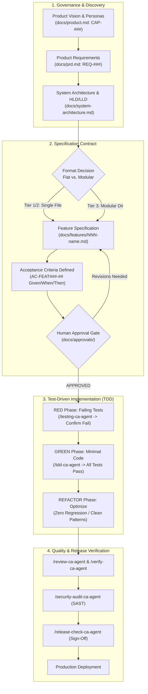
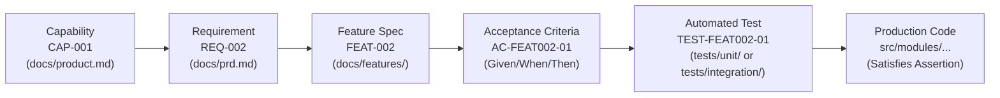
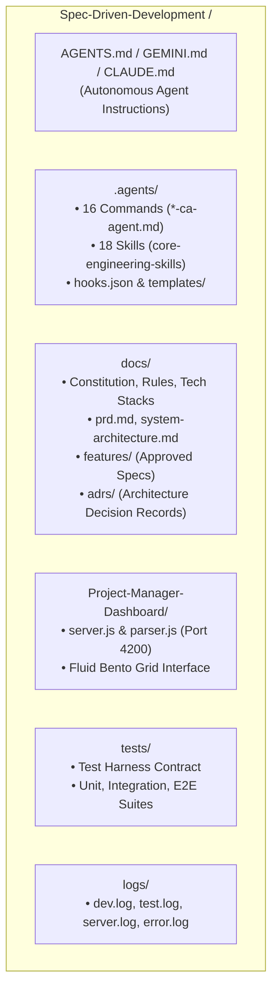

# Spec-Driven Development (SDD) & TDD Framework
### Enterprise Production-Grade Software Engineering with Autonomous AI Agents

<div align="center">

[](.)
[-indigo?style=for-the-badge)](.)
[](.)
[](.)
[](../../LICENSE.md)

**Framework Lead:** Chandan Adhikary · **Standard:** Enterprise Production Release 2.0.0  
**Target Domains:** Enterprise SaaS · FinTech Core · HealthTech · Multi-Tenant Platforms · Regulated Systems

[🌟 Framework Overview](#-framework-overview) • [🏛️ System Architecture](#️-system-architecture--spec-driven-pipeline) • [🔄 Traceability Flow](#-spec-to-code-traceability-contract) • [⚡ Quick-Start](#-quick-start-guide) • [🛡️ Slash Commands](#️-collision-free-agent-slash-commands--ca-agent) • [📁 Structure](#-repository-structure--component-map) • [📋 Governance](#-governance-rules--policies)

</div>

---

## 🌟 Framework Overview

**Spec-Driven Development (SDD)** paired with **Test-Driven Development (TDD)** is an enterprise engineering framework designed for high-assurance, zero-defect software creation with AI coding agents. In this framework, **the specification is the law**: no code is ever written speculatively, and every single production function is directly verified by failing automated tests before implementation begins.

### The 4 Pillars of SDD + TDD:
1. **Contract-First Authority:** All behavior must be formally declared in `docs/features/` and approved by a human lead before any code is drafted.
2. **Strict Red-Green-Refactor Cycle:** Write executable unit/integration tests directly against approved Acceptance Criteria (`AC-*`), verify that they fail (`RED`), implement the absolute minimal code (`GREEN`), and refactor cleanly.
3. **Staged Web Development:** For web applications, develop the frontend first (UI design, layout, responsiveness, mock/client state), verify it via a live demo run (`/run-ca-agent`), and only after visual sign-off proceed to backend persistence, security hardening, and test suites.
4. **Mandatory Development Logging (`logs/` Folder):** Always record clean, sanitized development logs (`logs/dev.log`, `logs/test.log`, `logs/server.log`, `logs/error.log`) inside a dedicated `logs/` directory.

---

## 🏛️ System Architecture & Spec-Driven Pipeline

The end-to-end SDD-TDD lifecycle follows a strict contract-first progression:



---

## 🔄 Spec-to-Code Traceability Contract

Every line of production code is mathematically traceable to a root business capability:



---

## ⚡ Quick-Start Guide

### Step 1: Scaffolding into Your Project Workspace
Extract or copy the `Spec-Driven-Development/` directory into your project root:
```bash
# Rename to your target project name (kebab-case)
mv Spec-Driven-Development my-enterprise-core
cd my-enterprise-core
```

### Step 2: Verify Slash Commands
Verify that your host IDE recognizes the `.agents/` contracts:
1. Focus your AI agent chat and type `/`. Confirm all 16 `*-ca-agent` commands appear with descriptions.
2. In terminal, verify command contracts:
   ```bash
   ls .agents/commands/*-ca-agent.md
   ```

### Step 3: Launch In-IDE Project-Manager-Dashboard
Launch the dedicated telemetry dashboard on port `4200`:
- **Slash Command:** Type `/dashboard-ca-agent` in agent chat.
- **Terminal:** Run `open-in-ide.bat` (Windows) or `bash open-in-ide.sh` (macOS/Linux).
- **Dock in IDE:** Open `Simple Browser: Show`, navigate to `http://127.0.0.1:4200`, and dock in Editor Group 2.

---

## 🛡️ Collision-Free Agent Slash Commands (`-ca-agent`)

All custom commands carry the `-ca-agent` namespace to guarantee zero collisions with IDE-reserved tokens:

| Command | Category | Operational Purpose |
| :--- | :--- | :--- |
| `/plan-ca-agent` | Planning | Scoped, read-only system design and architectural alignment. |
| `/task-ca-agent` | Planning | Atomic task harness initialization and contract tracking. |
| `/spec-check-ca-agent` | Specs | Validates feature spec compliance against acceptance criteria. |
| `/change-request-ca-agent` | Specs | Formal change request, impact assessment, and spec revision. |
| `/testing-ca-agent` | Execution | Targeted test execution; confirms failing tests in Red phase. |
| `/tdd-ca-agent` | Execution | Red-Green-Refactor implementation satisfying acceptance criteria. |
| `/implement-ca-agent` | Execution | Scope-restricted feature implementation. |
| `/run-ca-agent` | Execution | Local runtime verification; reports observed server URLs. |
| `/review-ca-agent` | Quality | Pre-commit diff, lint, and security review. |
| `/verify-ca-agent` | Quality | Objective scorecard validation against specification contracts. |
| `/security-audit-ca-agent` | Security | SAST, secret leak, and dependency audit across codebase. |
| `/release-check-ca-agent` | Release | Production readiness gate and ship/no-ship decision. |
| `/dashboard-ca-agent` | Dashboard | Launches local In-IDE Project-Manager-Dashboard on port 4200. |
| `/errorlogs-ca-agent` | Diagnostics | Structured runtime error triage and stack trace analysis. |
| `/gitlogs-ca-agent` | Diagnostics | Commit history and git traceability validation against task IDs. |
| `/handoff-ca-agent` | Handoff | Generates verifiable engineering handoff report for team transfer. |

---

## 📁 Repository Structure & Component Map



---

## 📋 Governance Rules & Policies

- **Guideline Baseline:** Fixed baseline `2.0.0`; modifications require explicit justification and logging in `docs/guideline-CHANGELOG.md`.
- **Feature Specification Authority:** Never implement code missing from the latest approved spec in `docs/features/`.
- **Dual Format Policy:**
  - **Flat Format (`docs/features/NNN-name.md`):** Tier 1 (Easy) and Tier 2 (Intermediate) features.
  - **Modular Format (`docs/features/NNN-name/{feature,acceptance,test-plan}.md`):** Tier 3 (Complex / Distributed) features.
- **Traceability Requirement:** All tests must carry `TEST-FEAT###-## / AC-FEAT###-##: <behavior>` in their title.
- **Development Logging:** All command runs and background test suites must write sanitized output to `logs/*.log`.
