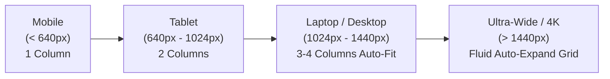

# Visual Design & UI System Contract

> **Document class:** Living feature/specification  
> **Framework:** SDD  
> **Guideline baseline:** 2.0.0  
> **Status:** Template; project-specific instantiation requires review  

## Purpose

Design system standards, design tokens, responsive layout rules, component state coverage, and visual accessibility contracts.

## Agent read trigger

**MUST** read or consult this file: Before designing or modifying UI components, pages, layout systems, styles, or accessibility features.

---

## 1. Design Tokens Specification

### 1.1 Color Roles & Semantic Palette
| Token Name | Dark Mode | Light Mode | Semantic Purpose |
|---|---|---|---|
| `--bg-canvas` | `#070a11` | `#f8fafc` | Deep background canvas |
| `--bg-surface` | `rgba(15, 23, 42, 0.65)` | `rgba(255, 255, 255, 0.90)` | Glassmorphism cards / panels |
| `--border-subtle` | `rgba(255, 255, 255, 0.08)` | `rgba(0, 0, 0, 0.08)` | Subtle container dividers |
| `--primary-accent` | `#06b6d4` (Cyan) | `#0284c7` (Sky Blue) | Interactive actions, active states |
| `--success-state` | `#10b981` (Emerald) | `#059669` (Emerald) | Passing tests, success alerts |
| `--warning-state` | `#f59e0b` (Amber) | `#d97706` (Amber) | Pending actions, warnings |
| `--error-state` | `#ef4444` (Crimson) | `#dc2626` (Crimson) | Failing tests, error boundaries |
| `--text-main` | `#f8fafc` | `#0f172a` | High-contrast body typography |
| `--text-muted` | `#94a3b8` | `#64748b` | Secondary descriptions, captions |

### 1.2 Typography Hierarchy
| Role | Size | Weight | Line Height | Letter Spacing |
|---|---|---|---|---|
| **Display / Hero** | `2.25rem` (36px) | `700` (Bold) | `1.2` | `-0.02em` |
| **H1 Headline** | `1.50rem` (24px) | `600` (SemiBold) | `1.3` | `-0.01em` |
| **H2 Section** | `1.125rem` (18px) | `600` (SemiBold) | `1.4` | `0` |
| **Body (Main)** | `0.875rem` (14px) | `400` (Regular) | `1.5` | `0` |
| **Caption / Badge** | `0.75rem` (12px) | `500` (Medium) | `1.4` | `+0.02em` |
| **Code / Mono** | `0.8125rem` (13px)| `400` (Regular) | `1.5` | `0` (JetBrains Mono) |

---

## 2. Dynamic Responsive Breakpoints Matrix

Layouts must be 100% fluid and auto-responsive. Fixed widths (e.g. `1440px`) are strictly prohibited.

| Breakpoint Name | Viewport Width | Grid Behavior | Padding / Gutters |
|---|---|---|---|
| **Mobile (`sm`)** | `< 640px` | Single column stack; full-width cards | `12px` gutters |
| **Tablet (`md`)** | `640px – 1024px` | 2-column bento grid; collapsible sidebars | `16px` gutters |
| **Desktop (`lg`)** | `1024px – 1440px`| 3 to 4 columns (`minmax(300px, 1fr)`) | `20px` gutters |
| **Ultra-Wide (`xl/2k/4k`)** | `> 1440px` | 100% fluid auto-fill grid; no max-width clamping | `24px` gutters |

---

## 3. Comprehensive Component State Matrix

Every interactive component MUST explicitly define and test the following 8 states:

| State | Visual Treatment | Accessibility (A11y) Requirement |
|---|---|---|
| **Default** | Standard background, clear readable contrast ratio (> 4.5:1). | Semantic role, aria-label if icon-only. |
| **Hover** | Subtle scale (`scale(1.02)`), elevated brightness or glow. | Never hover-dependent for mobile touch. |
| **Active / Pressed** | Slight indentation (`scale(0.98)`), accent ring. | Visual feedback within 50ms. |
| **Focus Visible** | 2px high-contrast outline (`outline-offset: 2px`). | Complete keyboard tab-order navigation. |
| **Disabled** | `opacity: 0.5`, `cursor: not-allowed`. | `aria-disabled="true"`, excluded from tab order. |
| **Loading** | Animated skeleton pulse or spinner with layout stability. | `aria-busy="true"`, screen reader announcement. |
| **Empty State** | Clean illustrative placeholder + action prompt. | Clear descriptive text of missing data. |
| **Error State** | Red border/glow (`--error-state`), descriptive inline message. | `aria-invalid="true"`, `aria-describedby` error text. |

---

## 4. Visual Verification & Quality Gates

- **MUST** achieve WCAG 2.1 AA compliance across all components.
- **MUST** support dynamic light/dark theme switching without layout flashes (FOUC).
- **MUST** verify responsive scaling using dynamic viewport testing across ultra-wide, desktop, and mobile form factors.

## Evidence and change control

- **MUST** record owner, revision/date, relevant approval reference, and traceable evidence in the applicable project instantiation.
- **MUST** route changes to process rules through `docs/guideline-CHANGELOG.md` and formal baseline revision; route feature behavior through approved versioned specs and `docs/CHANGELOG.md`.
- **SHOULD** keep links to canonical artifacts instead of duplicating definitions.

## SDD enforcement

- **MUST** verify the latest approved feature spec version before changing implementation.
- **MUST** stop if this document conflicts with approved guidelines; pursue a guideline revision rather than an implicit exception.
