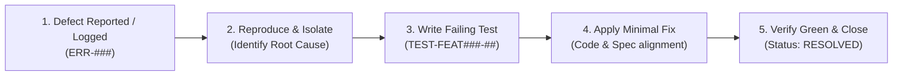

# Defect & Error Tracker

> **Document class:** Living feature/specification  
> **Framework:** SDD  
> **Guideline baseline:** 2.0.0  
> **Status:** Active Standard  

## Purpose

Systematic tracking, root cause analysis, regression prevention, and defect history.

## Agent read trigger

**MUST** read or consult this file: Whenever encountering unexpected test failures, runtime errors, regression reports, or during `/errorlogs-ca-agent`.

---

## 1. Defect Resolution Lifecycle

---

## 2. Severity Classification Matrix

| Severity | Definition & Impact | Response SLA | Target Gate |
|---|---|---|---|
| **P0 (Critical)** | System outage, data loss, security vulnerability, blocked deployment pipeline. | Immediate (< 2h) | Release Blocker |
| **P1 (High)** | Core feature broken, acceptance criterion violated, no workaround available. | Same day (< 8h) | Sprint Blocker |
| **P2 (Medium)** | Secondary feature broken, workaround available, minor API contract flaw. | Within 3 days | Planned Patch |
| **P3 (Low)** | Cosmetic flaw, UI misalignment, minor logging noise. | Next release cycle| Non-blocking |

---

## 3. Active & Resolved Defect Log

| Defect ID | Date | Sev | Summary | Impacted Path | Violated AC / Spec Gap | Root Cause | Fix (Commit / PR) | Regression Test | Status |
|---|---|---|---|---|---|---|---|---|---|
| `ERR-001` | 13-11-2026 | `P1` | Sample: Null pointer on student enrollment submission | `src/enrollment/service.ts` | `AC-FEAT002-01` | Missing schema validation on optional guardian phone | commit `a1b2c3d` | `tests/unit/student-enrollment.test.ts` | `RESOLVED` |
| `ERR-002` | 16-11-2026 | `P0` | Test runner ENOENT crash when package.json absent | `Project-Manager-Dashboard/server.js` | `AC-FEAT001-03` | Hardcoded npm test command in server action | commit `f9ef182` | `tests/test_ac_contracts.js` | `RESOLVED` |
| `ERR-003` | 16-11-2026 | `P1` | AC inspection sheet displayed placeholder fallback text | `Project-Manager-Dashboard/assets/dashboard.js` | `AC-FEAT001-01` | Modal queried spec.given instead of spec.scenario | commit `f9ef182` | `tests/test_ac_contracts.js` | `RESOLVED` |
| `ERR-004` | 16-11-2026 | `P2` | Unhandled stream event on rapid SSE client reconnection | `Project-Manager-Dashboard/server.js` | `AC-FEAT001-01` | Client socket destroyed before SSE handshake flush | In Triage | `tests/test_sse_stream.js` | `ACTIVE` |

---

## 4. Enforcement Rules

- **MUST** link every bug to an explicit `AC-FEAT###-##` or declare a formal `SPEC-GAP`.
- **MUST** implement a failing regression test before writing fix code.
- **MUST** never close an error without automated test verification.

## Evidence and change control

- **MUST** record owner, revision/date, relevant approval reference, and traceable evidence in the applicable project instantiation.
- **MUST** route changes to process rules through `docs/guideline-CHANGELOG.md` and formal baseline revision; route feature behavior through approved versioned specs and `docs/CHANGELOG.md`.
- **SHOULD** keep links to canonical artifacts instead of duplicating definitions.

## SDD enforcement

- **MUST** verify the latest approved feature spec version before changing implementation.
- **MUST** stop if this document conflicts with approved guidelines; pursue a guideline revision rather than an implicit exception.
