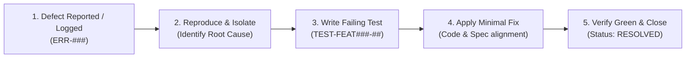

# Defect & Error Tracker

> **Document class:** Living feature/specification  
> **Framework:** SDD  
> **Guideline baseline:** 2.0.0  
> **Status:** Active Standard  

## Purpose

Systematic tracking, root cause analysis, regression prevention, and defect history.

## Agent read trigger

**MUST** read or consult this file: Whenever encountering unexpected test failures, runtime errors, regression reports, or during `/errorlogs-ca-agent`.

---

## 1. Defect Resolution Lifecycle

---

## 2. Severity Classification Matrix

| Severity | Definition & Impact | Response SLA | Target Gate |
|---|---|---|---|
| **P0 (Critical)** | System outage, data loss, security vulnerability, blocked deployment pipeline. | Immediate (< 2h) | Release Blocker |
| **P1 (High)** | Core feature broken, acceptance criterion violated, no workaround available. | Same day (< 8h) | Sprint Blocker |
| **P2 (Medium)** | Secondary feature broken, workaround available, minor API contract flaw. | Within 3 days | Planned Patch |
| **P3 (Low)** | Cosmetic flaw, UI misalignment, minor logging noise. | Next release cycle| Non-blocking |

---

## 3. Active & Resolved Defect Log

| Defect ID | Date | Sev | Summary | Violated AC / Spec Gap | Root Cause | Fix (Commit / PR) | Regression Test | Status |
|---|---|---|---|---|---|---|---|---|
| `ERR-001` | 2026-11-13 | `P1` | Sample: Null pointer on student enrollment submission | `AC-FEAT002-01` | Missing schema validation on optional guardian phone | commit `a1b2c3d` | `TEST-FEAT002-01` | `RESOLVED` |

---

## 4. Enforcement Rules

- **MUST** link every bug to an explicit `AC-FEAT###-##` or declare a formal `SPEC-GAP`.
- **MUST** implement a failing regression test before writing fix code.
- **MUST** never close an error without automated test verification.
