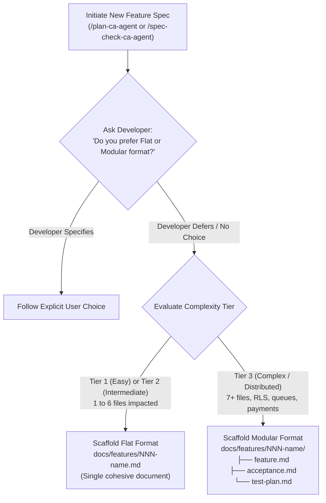
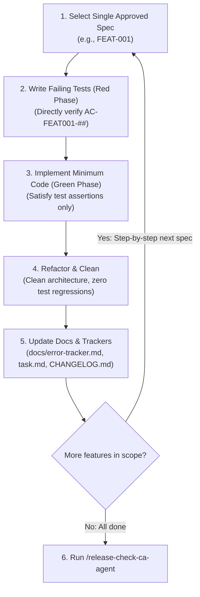
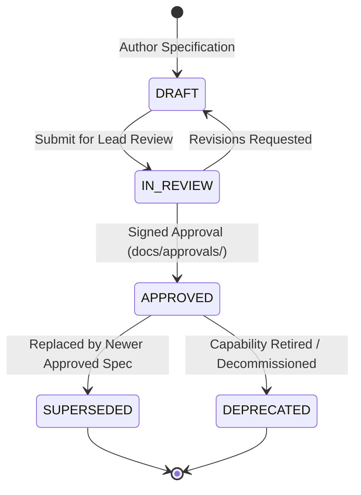

# Feature Specifications (`docs/features/`)
### Canonical Living Contracts & Acceptance Criteria Architecture

[🌟 Purpose](#-purpose) • [🏛️ Format Decision Tree](#️-flat-vs-modular-decision-tree) • [📊 Complexity Tiers](#-feature-complexity-breakdown-tiers) • [🔄 Lifecycle State Machine](#-specification-lifecycle-state-machine) • [📋 Traceability](#-identifier-traceability-scheme)

---

## 🌟 Purpose

`docs/features/` is the **only** canonical location for versioned feature contracts within the repository. A root-level `specs/` directory is not permitted. `docs/spec.md` indexes the current approved version of every feature; it never overrides an individual feature file.

### Traceability Hierarchy:
`docs/product.md` (Capabilities `CAP-###`) → `docs/prd.md` (Requirements `REQ-###`) → `docs/features/` (Contracts `FEAT-###`) → Automated Tests (`TEST-*`) → Production Code.

---

## 🏛️ Flat vs. Modular Decision Tree

---

## 📊 Feature Complexity Breakdown Tiers

Every feature must be categorized into one of three complexity tiers to drive sizing, test strategies, and implementation pacing:

| Tier | Complexity Category | Characteristics & Scope | Verification Strategy |
|---|---|---|---|
| **Tier 1** | **Easy (Low Complexity)** | Self-contained, static or simple CRUD, single table/model, minimal dependencies, read-only views, health check endpoints (1–2 files). | Unit tests only; rapid Red-Green cycle. |
| **Tier 2** | **Intermediate (Medium Complexity)** | Multi-table relational logic, form validation, role-based auth guards, API endpoints, state management, UI component interactions (3–6 files). | Unit + API integration tests; component state testing. |
| **Tier 3** | **Hard / Complex (High Complexity)** | Multi-tenant row-level security (RLS), distributed transactions, WebSocket live streams, external payment webhooks, background worker queues, forecasting/ML pipelines (7+ files). | Unit + Integration + Contract tests + E2E failure recovery scenarios. |

---

## 🔄 Step-by-Step Spec Development Protocol

> [!CRITICAL]
> **MUST NOT** begin work on a subsequent feature until the current feature's acceptance criteria are fully met, verified green by automated tests, and all relevant documentation files are updated.

---

## 🔄 Specification Lifecycle State Machine

| Status | Meaning | Implementation Permitted? |
| :--- | :--- | :--- |
| **`DRAFT`** | Initial specification draft being written. | **No** |
| **`IN REVIEW`** | Submitted for developer/lead review. | **No** (tests may be drafted) |
| **`APPROVED`** | Formally signed off; record exists in `docs/approvals/`. | **YES** — strictly this approved version |
| **`SUPERSEDED`** | Replaced by a newer approved version. | **No** (new work forbidden) |
| **`DEPRECATED`** | Capability retired or decommissioned. | Removal work only |

---

## 📋 Identifier Traceability Scheme

Defined canonically in `docs/requirements-traceability.md`:

| Artifact | Pattern | Concrete Example |
| :--- | :--- | :--- |
| **Feature Contract** | `FEAT-###` | `FEAT-002` |
| **Functional Requirement** | `FR-FEAT###-##` | `FR-FEAT002-01` |
| **Non-Functional Requirement** | `NFR-FEAT###-##` | `NFR-FEAT002-01` |
| **Acceptance Criterion** | `AC-FEAT###-##` | `AC-FEAT002-03` |
| **Test Case Identifier** | `TEST-FEAT###-##` | `TEST-FEAT002-03` |

- **MUST** reference the AC ID (`AC-FEAT###-##`) in the title and description of every unit/integration test.
- **MUST** trace each feature to at least one `CAP-###` in `docs/product.md` and one `REQ-###` in `docs/prd.md`.
