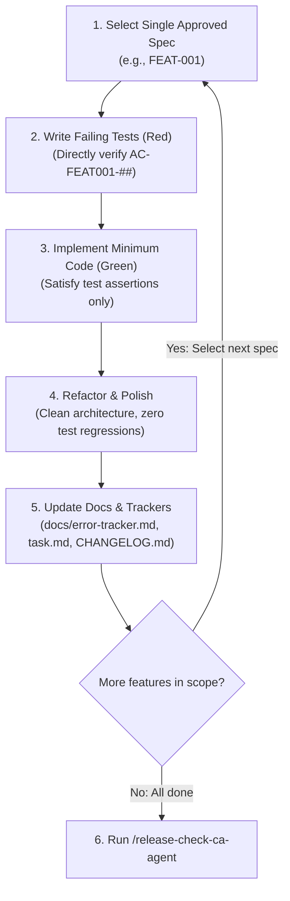

# Feature Specifications (`docs/features/`)

> **Document class:** Controlled process guideline  
> **Framework:** SDD  
> **Guideline baseline:** 2.0.0  
> **Status:** Active Standard  

## Purpose

`docs/features/` is the **only** canonical location for versioned feature contracts. A repository-level `specs/` directory is not permitted. `docs/spec.md` indexes the current approved version of every feature; it never overrides a feature file.

Hierarchy: `docs/product.md` (capabilities `CAP-###`) → `docs/prd.md` (requirements `REQ-###`) → `docs/features/` (contracts `FEAT-###`) → tests → code.

## Agent Read & Execution Triggers

- **MUST** read this file before creating, renaming, versioning, or validating any feature specification.
- **MUST** develop features **step-by-step, spec-by-spec**: never attempt to implement all features or multiple core features simultaneously. Finish one spec completely (Red → Green → Refactor → Verification → Doc Update) before progressing to the next.

---

## Normative Sections and Rules

### 1. Mandatory Format Inquiry: Flat vs. Modular

Whenever initiating a new feature specification (during `/plan-ca-agent`, `/spec-check-ca-agent`, or planning prompts), the agent **MUST ALWAYS ask the developer first**:

> *"Would you prefer this specification to be created in **Flat format** (`docs/features/NNN-name.md`) or **Modular format** (`docs/features/NNN-name/{feature,acceptance,test-plan}.md`)?"*

- If the developer specifies a preference, the agent strictly follows it.
- If the developer defers or does not specify, the agent **MUST decide autonomously** based on the Feature Complexity Tier:
  - **Easy / Intermediate Features** → **Flat Format** (single cohesive file).
  - **Hard / Complex Features** → **Modular Format** (separated `feature.md`, `acceptance.md`, `test-plan.md`).

| Format | Directory Layout | Criteria & Use Case |
|---|---|---|
| **Flat** | `docs/features/NNN-name.md`<br/>(Single file containing all sections) | Easy to Medium features (Tier 1 & Tier 2); focused scope, 1–6 files impacted. |
| **Modular** | `docs/features/NNN-name/`<br/>├── `feature.md` (sections 1–6, 9)<br/>├── `acceptance.md` (section 7)<br/>└── `test-plan.md` (section 8) | Complex features (Tier 3); multi-model relationships, payment gateways, RLS, background pipelines. |

---

### 2. Feature Complexity Breakdown Tiers

Every feature must be categorized into one of three complexity tiers to drive sizing, test strategies, and implementation pacing:

| Tier | Complexity Category | Characteristics & Scope | Verification Strategy |
|---|---|---|---|
| **Tier 1** | **Easy (Low Complexity)** | Self-contained, static or simple CRUD, single table/model, minimal dependencies, read-only views, health check endpoints (1–2 files). | Unit tests only; rapid Red-Green cycle. |
| **Tier 2** | **Intermediate (Medium Complexity)** | Multi-table relational logic, form validation, role-based auth guards, API endpoints, state management, UI component interactions (3–6 files). | Unit + API integration tests; component state testing. |
| **Tier 3** | **Hard / Complex (High Complexity)** | Multi-tenant row-level security (RLS), distributed transactions, WebSocket live streams, external payment webhooks, background worker queues, forecasting/ML pipelines (7+ files). | Unit + Integration + Contract tests + E2E failure recovery scenarios. |

---

### 3. Step-by-Step Spec Development Protocol



- **MUST NOT** begin work on a subsequent feature until the current feature's acceptance criteria are fully met, verified green by automated tests, and all relevant documentation files are updated.

---

### 4. Status Lifecycle

```text
DRAFT ──► IN REVIEW ──► APPROVED ──► SUPERSEDED (by newer approved version)
  ▲            │            └──────► DEPRECATED (capability retired)
  └── changes ─┘
```

| Status | Meaning | Implementation allowed? |
|---|---|---|
| `DRAFT` | Initial specification draft being written. | No |
| `IN REVIEW` | Submitted for developer/lead review. | No (tests may be drafted) |
| `APPROVED` | Formally signed off; record exists in `docs/approvals/`. | **Yes** — strictly this version |
| `SUPERSEDED`| Replaced by a newer approved version. | No new work |
| `DEPRECATED`| Capability retired or decommissioned. | Removal work only |

---

### 5. Identifier Traceability Scheme

Defined canonically in `docs/requirements-traceability.md`:

| Artifact | Pattern | Example |
|---|---|---|
| Feature Contract | `FEAT-###` | `FEAT-002` |
| Functional Requirement | `FR-FEAT###-##` | `FR-FEAT002-01` |
| Non-Functional Requirement | `NFR-FEAT###-##` | `NFR-FEAT002-01` |
| Acceptance Criterion | `AC-FEAT###-##` | `AC-FEAT002-03` |
| Test Case Identifier | `TEST-FEAT###-##` | `TEST-FEAT002-03` |

- **MUST** reference the AC ID (`AC-FEAT###-##`) in the title and description of every unit/integration test.
- **MUST** trace each feature to at least one `CAP-###` in `docs/product.md` and one `REQ-###` in `docs/prd.md`.
