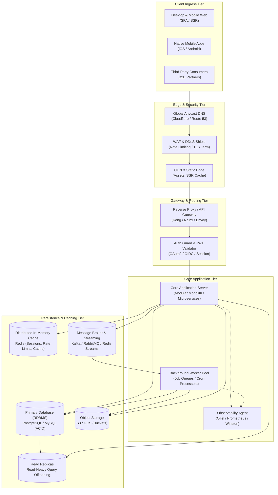
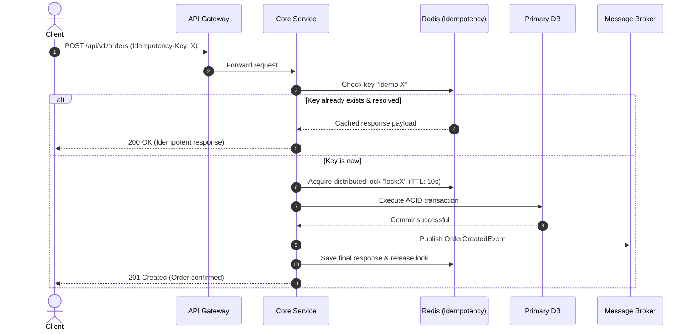
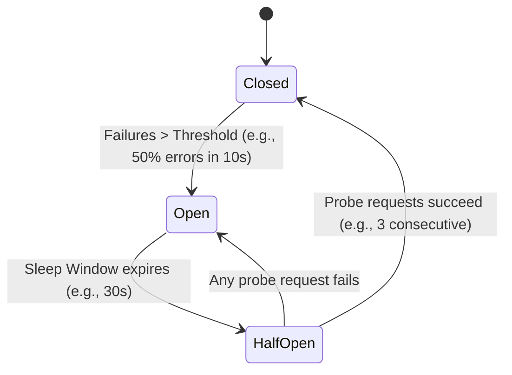

# System Architecture & System Design Specification

> **Document class:** Living feature/specification  
> **Framework:** SDD  
> **Guideline baseline:** 2.0.0  
> **Status:** Template; project-specific instantiation requires review  

## Purpose

High-level and low-level system designs, architectural patterns, boundary contracts, scalability, data consistency, reliability, and technical trade-offs.

## Agent read trigger

**MUST** read or consult this file: Prior to module creation, architectural modifications, database schema modeling, API contract definition, or cross-cutting infrastructure changes.

---

## 1. System Design Architecture (HLD & LLD)

### 1.1 High-Level Design (HLD)
The High-Level Design outlines the end-to-end topological boundaries, ingress traffic flows, microservices / modular monolith components, and peripheral infrastructure.



### 1.2 Low-Level Design (LLD)
The Low-Level Design defines class and module boundaries, interface segregation, state machines, and design patterns:

- **Clean Architecture Layers:**
  1. **Domain Layer:** Pure business entities, value objects, and domain exceptions (zero framework dependencies).
  2. **Application / Use Case Layer:** Orchestration workflows, DTOs, and input boundary interfaces.
  3. **Infrastructure Layer:** Database repositories, external API clients, messaging adapters, and cache implementations.
  4. **Presentation / Interface Layer:** Controllers, API route handlers, GraphQL resolvers, and serializers.

- **Design Patterns Enforced:**
  - **Repository Pattern:** Abstracting storage engines behind deterministic interfaces.
  - **Dependency Injection (DI):** Inverting control to guarantee testability and mockability.
  - **Factory & Strategy Patterns:** Decoupling algorithm variants (e.g. multi-provider payment or auth handlers).
  - **Unit of Work:** Transactional coordination across multiple entity aggregates.

---

## 2. Scalability, Partitioning & Load Balancing

| Dimension | Strategy & Implementation Standard |
|---|---|
| **Horizontal Scaling** | Stateless application tier scaled horizontally behind L7 Round-Robin / Least-Connections load balancers with auto-scaling triggers (CPU > 70% or P95 Latency > 250ms). |
| **Database Scaling** | CQRS separation: Writes routed to Primary RDBMS; read-heavy queries routed across Read Replicas with connection pooling (e.g., PgBouncer). |
| **Data Partitioning / Sharding** | Hash or range partitioning based on `tenant_id` or `created_at` for high-volume audit logs and transaction ledgers. |
| **Connection Pooling** | Enforced client-side connection limits with eager health checks and graceful reconnection timeouts. |

---

## 3. Data Consistency, Transactions & CAP Theorem Trade-Offs

### 3.1 Consistency Strategy
- **Relational Data (RDBMS):** Enforce strict **ACID** properties for critical business logic (billing, accounts, core state mutations) with explicit isolation levels (default: `READ COMMITTED`, critical ledger: `SERIALIZABLE`).
- **Distributed State & Analytics (BASE):** Enforce **Eventual Consistency** for non-blocking read models, search indices, and activity feeds.
- **Idempotency Keys:** All mutating HTTP requests (`POST / PUT / PATCH`) accept a unique `Idempotency-Key` header stored in Redis with an auto-expiring TTL to prevent duplicate execution.



---

## 4. Multi-Layer Caching Architecture & Invalidation

1. **Layer 1: Browser / Client:** Cache-Control headers (`stale-while-revalidate`, immutable content hashes for bundles).
2. **Layer 2: Edge CDN:** Static assets, public marketing pages, and regional SSR caching.
3. **Layer 3: Application In-Memory / Distributed Cache (Redis):**
   - **Pattern:** **Cache-Aside** (Read: cache check -> DB fallback -> populate cache; Write: DB write -> cache invalidate).
   - **TTL Enforced:** Every cached item MUST have an explicit Time-To-Live (TTL) to avoid permanent cache pollution.
   - **Eviction Policy:** `allkeys-lru` with memory ceiling alarms.

---

## 5. Asynchronous Processing & Event-Driven Architecture

- **Message Queues:** Message brokers (Kafka / RabbitMQ / Redis Streams) handle decoupled background operations (emails, PDF generation, webhook dispatches, analytical ETL).
- **Dead-Letter Queues (DLQ):** Messages failing after 3 exponential backoff retries are moved to a designated DLQ for inspection.
- **Outbox Pattern:** Guarantee at-least-once message delivery by writing domain events to an `outbox` table within the primary DB transaction before emitting to the message broker.

---

## 6. Resilience, Fault Tolerance & Security Boundaries



- **Circuit Breakers:** Guard all outbound third-party calls (payment gateways, external APIs).
- **Rate Limiting:** Token Bucket or Leaky Bucket algorithm at the API Gateway per client IP and authenticated `user_id`.
- **Graceful Degradation:** Fall back to cached or default responses when peripheral dependencies fail.
- **Zero-Trust Security:** Mutual TLS (mTLS) for inter-service communication, scoped JWT validation, strict CORS whitelist, and parameterized SQL queries exclusively.

---

## 7. Repository Structure & Boundary Contracts

```text
[project-root]/
├── docs/                     # Specifications, architecture, PRD, and guidelines
├── playbooks/                # Step-by-step operational workflows
├── .agents/                  # Autonomous commands, skills, and templates
│   ├── commands/             # Custom deterministic slash command contracts
│   └── skills/               # Core repository skills
├── [application-modules]/    # Segregated application code
└── tests/                    # Unit, integration, and contract test suites
```

---

## 8. Normative Enforcement Rules

- **MUST** document any architectural change via an Architecture Decision Record (ADR) under `docs/adrs/`.
- **MUST** maintain up-to-date visual Mermaid diagrams matching deployed infrastructure.
- **MUST** stop and review if an implementation conflicts with approved boundary contracts or scalability constraints.
