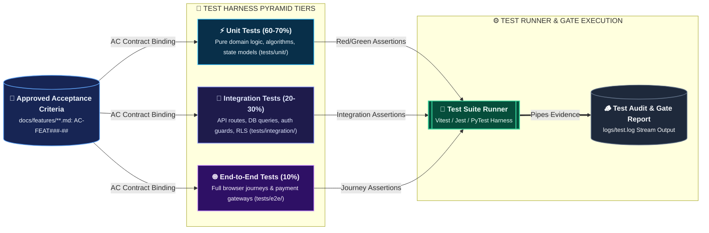

# Test Harness Contract & Verification Engine
### Zero-Regression Automated Testing Architecture for SDD-TDD

<div align="center">

[](.)
[](.)
[](.)
[](.)

[🌟 Overview](#-overview) • [🏛️ Testing Pyramid](#️-testing-pyramid--ac-traceability-pipeline) • [📁 Directory Layout](#-directory-layout--conventions) • [📋 Traceability](#-traceability-naming-convention) • [⚡ Commands](#-execution-commands)

</div>

---

## 🌟 Overview

The test harness in **Spec-Driven Development (SDD-TDD)** is an immutable quality gate. Production code is never written before failing automated tests exist. Every test must directly verify one or more Acceptance Criteria (`AC-FEAT###-##`) defined in approved specifications.

---

## 🏛️ Testing Pyramid & AC Traceability Pipeline



---

## 📁 Directory Layout & Conventions

```text
tests/
├── unit/                                     # Fast, isolated unit test suites
│   ├── auth/password-hash.test.ts            # TEST-FEAT001-01 / AC-FEAT001-01
│   └── students/admission-number.test.ts     # TEST-FEAT002-01 / AC-FEAT002-01
├── integration/                              # API, Database, and Middleware tests
│   ├── api/auth-flow.test.ts                 # TEST-FEAT001-02 / AC-FEAT001-02
│   └── students/enroll.test.ts               # TEST-FEAT002-02, TEST-FEAT002-03
├── e2e/                                      # Critical user journey browser tests
│   └── enrollment-journey.spec.ts            # Full browser lifecycle checks
├── fixtures/                                 # Deterministic test fixtures (zero real PII)
└── mocks/                                    # Service stubs & mock adapters
```

---

## 📋 Traceability Naming Convention

- Each test that verifies an acceptance criterion **MUST** declare its IDs in the test title:
  ```typescript
  // Example Vitest/Jest test:
  describe('FEAT-002: Student Enrollment', () => {
    it('TEST-FEAT002-03 / AC-FEAT002-03: rejects duplicate student with 409 conflict', async () => {
      // test implementation
    });
  });
  ```
- The mapping `AC → TEST` is declared in the feature's verification matrix (`docs/features/…`, section 8) and rolled up in `docs/requirements-traceability.md`.
- Tests without an AC reference are allowed only for internal utility functions; they **MUST NOT** be cited as acceptance evidence.

---

## ⚡ Execution Commands

| Target | Command | Operational Scope |
| :--- | :--- | :--- |
| **All Tests** | `npm test` or `pytest` | Runs full test harness across all tiers. |
| **Unit Only** | `npm run test:unit` | Fast unit test execution during Red-Green TDD cycle. |
| **Integration** | `npm run test:integration` | Verifies database migrations and API contracts. |
| **E2E** | `npm run test:e2e` | Headless browser journey validation. |
| **Coverage Gate** | `npm run test:coverage` | Enforces statement, branch, and function thresholds. |

> [!NOTE]
> All test executions initiated by autonomous agents must pipe output cleanly to `logs/test.log` and verify zero secret leakage.
