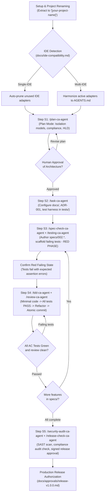

# AI-Powered Project Development — Universal Custom Slash Commands for SDD & TDD
### Operational Reference for `.agents/commands/` & Complete Universal Production Demo for Any Project

**Framework:** Spec-Driven Development (SDD) + Test-Driven Development (TDD) · High-Assurance Production Software  
**Author / Engineering Lead:** Chandan Adhikary & Antigravity Engineering  
**Version:** 2.0.0 (Production-Grade Universal Release)  
**Application Scope:** Universal (Enterprise SaaS, Multi-Tenant Platforms, FinTech, HealthTech, Core APIs, Regulated Systems)  
**Reference Example:** EduSphere Enterprise Multi-Tenant School Management System (SMS)  
**Applies to:** Claude Code, Cursor, Windsurf, Antigravity, GitHub Copilot, Codex, Trae, VS Code with AI Agents  

---

## 1. Executive Overview & Formal Governance Architecture

In the **Spec-Driven Development (SDD) + TDD Framework**, custom slash commands serve as **binding compliance gates**. 

When an AI agent receives a slash command (such as `/spec-check-ca-agent` or `/tdd-ca-agent`), it is bound by immutable repository policies defined in `.agents/commands/<name>-ca-agent.md`.

```text
+-------------------------------------------------------------------------------+
|                       SDD + TDD SLASH COMMAND PIPELINE                        |
+-------------------------------------------------------------------------------+
|                                                                               |
|   /plan-ca-agent           --> Enterprise architecture, data isolation,       |
|                                compliance standards, strict plan mode.        |
|                                                                               |
|   /task-ca-agent           --> Configure docs/, ADRs, and automated harness   |
|                                in 'tests/' directory.                         |
|                                                                               |
|   /spec-check-ca-agent     --> Author & validate specs/ (Format 1 or 2)       |
|                                with explicit Acceptance Criteria (AC-*).      |
|                                                                               |
|   /testing-ca-agent        --> Scaffold failing tests (TDD Red Phase)         |
|                                and verify intended failure state.             |
|                                                                               |
|   /tdd-ca-agent            --> Implement MINIMAL code to turn tests green,    |
|                                followed by architectural refactoring.         |
|                                                                               |
|   /review-ca-agent         --> Verify test-to-spec traceability & code diff.  |
|                                                                               |
|   /security-audit-ca-agent --> Run SAST scan, compliance checks, RLS audit.   |
|                                                                               |
|   /release-check-ca-agent  --> Final gate: 100% green tests & signed approval |
|                                in docs/approvals/release-v1.0.0.md.           |
|                                                                               |
+-------------------------------------------------------------------------------+
```

### 1.1 The Invariant Rules of SDD Commands
1. **No Spec, No Code:** The agent is prohibited from writing application source code unless an approved specification exists in `specs/`.
2. **Tests Before Code (Red First):** Any command attempting to implement code before failing tests are authored and executed will be aborted.
3. **Traceability Invariant:** Every commit and pull request must cite the active Spec ID and Acceptance Criteria (e.g. `feat([module]): satisfy [SPEC_AC_PREFIX]-001`).
4. **Collision Prevention (`-ca-agent` Suffix):** Standard tokens (`/plan`, `/test`, `/review`) are namespace-protected with `-ca-agent` to eliminate collisions with IDE-native commands across Cursor, Claude Code, Windsurf, Antigravity, and VS Code.

---

## 2. Universal Variable Substitution Matrix

When invoking custom slash commands on any software project, replace the placeholder tokens in brackets with your domain-specific values. 

The table below illustrates how to customize these variables using the **School Management System (SMS)** reference alongside an **Enterprise FinTech / Core Banking** example:

| Variable Token | Description | School Management System (SMS) Example | FinTech / Core Banking Example |
| :--- | :--- | :--- | :--- |
| `[PROJECT_NAME]` | Name of the software project | EduSphere Enterprise School Management System | ApexLedger Multi-Asset Core Banking Engine |
| `[PRODUCT_TYPE]` | Delivery model & architecture | Multi-Tenant Enterprise Educational SaaS | High-Throughput Double-Entry Ledger API |
| `[PRODUCT_VISION]` | System vision & scope | Multi-campus student records, attendance, grades | Real-time multi-currency transaction clearing |
| `[TARGET_USERS]` | Stakeholder roles | District SuperAdmins, Principals, Teachers, Parents | Treasury Ops, Compliance Auditors, Risk Officers |
| `[COMPLIANCE_STANDARDS]` | Regulatory policies | FERPA, COPPA, GDPR | PCI-DSS v4.0, SOC 2 Type II, ISO 27001 |
| `[DATA_ISOLATION_MODEL]` | Multi-tenancy isolation | Shared PostgreSQL with Row-Level Security (RLS) | PostgreSQL RLS + Hardware Security Module (HSM) |
| `[PRIMARY_FEATURE]` | Core module for first TDD cycle | `specs/002.spec.student-enrollment.md` | `specs/002.spec.double-entry-transfer.md` |
| `[SPEC_AC_PREFIX]` | Acceptance Criteria prefix | `AC-ENROLL-*` | `AC-TXN-*` |

---

## 3. Managing `specs/` via Slash Commands: Flat vs. Modular Formats

The SDD framework supports two specification layouts in `specs/`:

```text
specs/
├── Format 1 (Flat Spec Files - for discrete, cohesive features):
│   ├── 001.spec.[feature-name].md
│   └── 002.spec.[feature-name].md
│
└── Format 2 (Modular Spec Folders - for complex enterprise sub-systems):
    ├── 001.spec.[module-name]/
    │   ├── spec.md
    │   ├── schema.json
    │   └── acceptance-criteria.md
    └── 002.spec.[module-name]/
        ├── spec.md
        ├── schema.json
        └── acceptance-criteria.md
```

Using `/spec-check-ca-agent`, the agent automatically parses either format, validates requirement traceability, and verifies that every feature has unambiguous, testable Acceptance Criteria (`[SPEC_AC_PREFIX]-[NUMBER]`).

---

## 4. The Complete 15 SDD + TDD Slash Commands Operational Matrix

The SDD + TDD framework includes **15 custom slash commands** residing in .agents/commands/*-ca-agent.md. Each command enforces deterministic behavioral rules, input validation, and stop conditions.

### 4.1 Master Operational Matrix of All 15 Commands

| Slash Command | File Location | Lifecycle Phase | Execution Mode | Input Syntax / Parameters | Internal Agent Workings & Mechanism | Generated Output / Artifact | Invariant Rules & Stop Conditions |
|---|---|---|---|---|---|---|---|
| /plan-ca-agent | .agents/commands/plan-ca-agent.md | Discovery & Architecture | Read-Only (Plan Mode) | [PROJECT_NAME], [PRODUCT_TYPE], [PRODUCT_VISION], [TARGET_USERS], [COMPLIANCE_STANDARDS] | Reads AGENTS.md and docs/; prunes competitor IDE configs; performs domain and regulatory R&D; designs HLD/LLD; formulates 17-point planning report. | 17-Section Architecture & Pre-Development Report; Implementation Plan Artifact | **MUST NOT** generate application code, install packages, or mutate database schemas. Halts on missing approvals. |
| /task-ca-agent | .agents/commands/task-ca-agent.md | Configuration & Setup | Mutating (Filesystem) | Task description, target docs/ files, ADR details, test harness options | Reads architecture baseline; updates docs/INDEX.md, system-architecture.md, database.md, security.md; initializes test runner in 	ests/; creates .env.example. | Updated docs/ files, docs/decision-log.md (ADR-001), 	ests/ directory & sanity test | **MUST NOT** implement feature endpoints or modify canonical guidelines without explicit authorization. |
| /spec-check-ca-agent | .agents/commands/spec-check-ca-agent.md | Spec Governance | Verification (Read-Only) | Path to target specification: specs/[SPEC_FILE].md | Inspects target specification (Format 1 Flat or Format 2 Modular); validates against PRD and data contracts; verifies numbered Acceptance Criteria (AC-*). | Spec Audit Report confirming readiness for TDD or listing validation defects | **MUST** reject specifications lacking explicit, testable Acceptance Criteria or containing ambiguous requirements. |
| /testing-ca-agent | .agents/commands/testing-ca-agent.md | Test Scaffolding & Run | Test Execution | Path to test file or suite: 	ests/[PATH].test.ts | Discovers and executes targeted test suite; verifies assertion failures; captures actual exit codes and stack traces without modifying application source code. | Terminal test runner output report verifying the intended **RED** failing state | **MUST NOT** alter production code. **MUST NOT** invent test results. Halts if tests unexpectedly pass before implementation. |
| /tdd-ca-agent | .agents/commands/tdd-ca-agent.md | Feature Implementation | Red-Green-Refactor | Spec path, target test path, feature scope | Enforces Red-to-Green cycle: writes MINIMAL code in src/ to turn failing tests Green; runs tests continuously; performs clean refactoring; checks static types. | Production service/component, 100% Green test output, atomic commit message draft | **MUST** halt if tests are missing or unverified in RED state. **MUST NOT** add unapproved feature scope. |
| /implement-ca-agent | .agents/commands/implement-ca-agent.md | Scope-Bound Coding | Implementation | Approved spec, target file list, task boundaries | Implements code strictly bounded by approved specifications; follows project coding conventions, type safety invariants, and architectural layers. | Created/modified source files, type-check confirmation (	sc --noEmit) | **MUST NOT** write code outside the approved spec boundary. Rejects ambiguous instructions. |
| /run-ca-agent | .agents/commands/run-ca-agent.md | Runtime Verification | Execution / Dev Server | Shell command: 
pm run dev, 
pm run build, 
pm test | Executes documented commands via terminal; monitors stdout/stderr; detects active port/URL; confirms clean startup without inventing outputs. | Actual terminal output, active verified localhost URL, exit code status | **MUST** report exact runtime errors. Never swallows crashes or suppresses stack traces. |
| /review-ca-agent | .agents/commands/review-ca-agent.md | Pre-Commit Review | Static Analysis | Target file(s) or git diff range | Inspects staged diffs; scans for secrets (.env), hardcoded tokens, type violations, lint errors; verifies test-to-spec traceability against active AC-*. | Code review report (Clean / Warning / Critical) with suggested diff improvements | **MUST** flag unapproved modifications, untyped ny, secret leaks, or missing Acceptance Criteria citations. |
| /verify-ca-agent | .agents/commands/verify-ca-agent.md | Quality Gate Check | Objective Verification | Target feature, spec ID, acceptance IDs | Executes end-to-end verification suite; validates input validation schemas, database foreign keys, and expected status codes against Acceptance Criteria. | Verification gate scorecard with PASS/FAIL status per Acceptance Criterion | **MUST** fail the gate if any single Acceptance Criterion test fails or is skipped. |
| /security-audit-ca-agent | .agents/commands/security-audit-ca-agent.md | Security & Compliance | Security Scanner | Repository root or specific module path | Scans for OWASP Top 10 vulnerabilities; audits database queries for Row-Level Security (	enant_id); scans dependencies (
pm audit); verifies audit logging triggers. | SAST audit report, dependency vulnerability table, data isolation verification | **MUST** block release on critical or high vulnerabilities or unvalidated multi-tenant database queries. |
| /release-check-ca-agent | .agents/commands/release-check-ca-agent.md | Production Gate | Release Authorization | Target release version (e.g. 1.0.0) | Executes full test suite with coverage (>90% branch); verifies production build (
pm run build); checks docker container build; generates release sign-off. | Formal release sign-off dossier written to docs/approvals/release-vX.Y.Z.md | **MUST NOT** authorize release if any test fails, coverage is below threshold, or security scan fails. |
| /change-request-ca-agent | .agents/commands/change-request-ca-agent.md | Spec Modification | Impact Assessment | Proposed change description, affected spec path | Analyzes impact of requested change on approved specs, data models, and existing tests; calculates regression risk; proposes spec delta and migration path. | Formal Change Impact Assessment report, proposed spec version bump (SemVer) | **MUST** require explicit human approval before modifying any approved specification or schema. |
| /handoff-ca-agent | .agents/commands/handoff-ca-agent.md | Documentation / Handoff | State Synchronization | Target milestone, outgoing agent / developer ID | Synthesizes current sprint state, completed AC-* items, pending blockers, active test status, and exact next commands for incoming developers or agents. | Engineering Handoff Dossier written to docs/handoff.md | **MUST** provide exact verifiable reproduction commands. Never generates vague handoff summaries. |
| /errorlogs-ca-agent | .agents/commands/errorlogs-ca-agent.md | Diagnostics & Triage | Diagnostic Analysis | Log file path, error snippet, or stack trace | Parses error stack traces, correlates with source lines; inspects database connection states; identifies root cause (schema mismatch, null pointer, syntax). | Root cause diagnostic report with minimal-diff fix recommendation | **MUST** isolate root cause before proposing edits. Adheres to Karpathy's smallest-reproducible-fix heuristic. |
| /gitlogs-ca-agent | .agents/commands/gitlogs-ca-agent.md | Audit & Traceability | Git History Analysis | Commit range (e.g. HEAD~5..HEAD), branch name | Audits git commit history; verifies that every commit message cites valid Spec IDs and AC-* tags; checks for unauthorized file changes or dirty branches. | Git Audit Traceability Report showing commit-to-spec correlation score | **MUST** report any orphan commits lacking Spec ID or Acceptance Criteria references. |

---

### 4.2 Tabular Workings by SDD-TDD Lifecycle Phase

To provide actionable guidance during active pairing sessions, the 15 commands are grouped below by engineering lifecycle stage:

#### Phase 1: Planning, Architecture & Specification Governance
| Command | Primary Developer Intent | What Agent Verifies First | Primary Artifact Produced |
|---|---|---|---|
| /plan-ca-agent | Initialize greenfield project or major architectural pivot | Checks AGENTS.md, active IDE compatibility, and regulatory requirements | 17-Point Planning Report (Plan Mode) |
| /task-ca-agent | Configure documentation baseline and test runners | Verifies that architecture plan has received explicit human sign-off | Updated docs/ and initialized 	ests/ harness |
| /spec-check-ca-agent | Audit and freeze feature specifications in specs/ | Validates input schemas, foreign keys, and numbered AC-* definitions | Spec Validation Scorecard (Draft → Approved) |
| /change-request-ca-agent | Propose modifications to already-approved specifications | Evaluates breaking changes, database migration impact, and test rewrites | Change Impact Assessment & Spec Version Delta |

#### Phase 2: Test-First Harness & Strict TDD Implementation
| Command | Primary Developer Intent | What Agent Verifies First | Primary Artifact Produced |
|---|---|---|---|
| /testing-ca-agent | Scaffold failing tests and execute test runs | Verifies that tests map 1:1 to approved AC-* requirements | Terminal test runner output confirming **RED** state |
| /tdd-ca-agent | Implement minimal passing code and refactor | Verifies tests are currently failing before writing any production code | Minimal passing source code turning tests **GREEN** |
| /implement-ca-agent | Implement bounded utility or non-TDD scaffolding | Verifies task boundaries and ensures no unapproved scope is added | Clean, type-safe source files conforming to docs/ |
| /run-ca-agent | Start local servers and verify runtime execution | Verifies build scripts and port availability; monitors for runtime crashes | Verified localhost URL and terminal process health |

#### Phase 3: Quality Gates, Security Audit & Production Release
| Command | Primary Developer Intent | What Agent Verifies First | Primary Artifact Produced |
|---|---|---|---|
| /review-ca-agent | Pre-commit sanity check on staged git diffs | Scans for secret leaks (.env), missing types, and untracked files | Clean pre-commit audit & atomic commit message |
| /verify-ca-agent | Objective acceptance testing against criteria | Evaluates all automated tests, schema validations, and error codes | Acceptance Verification Scorecard |
| /security-audit-ca-agent | SAST scan, dependency CVE check, and RLS audit | Audits database queries for tenant isolation barriers | Security & Compliance Audit Report |
| /release-check-ca-agent | Authorize production deployment | Executes full test coverage (>90%) and production bundle build | Signed release sign-off in docs/approvals/ |

#### Phase 4: Diagnostic, Log Analysis & Team Handoff Utilities
| Command | Primary Developer Intent | What Agent Verifies First | Primary Artifact Produced |
|---|---|---|---|
| /errorlogs-ca-agent | Debug runtime crashes or failed test assertions | Inspects stack traces, correlating error lines to raw source files | Diagnostic RCA Report & minimal reproducible fix |
| /gitlogs-ca-agent | Verify commit compliance and audit trails | Inspects commit messages for valid Spec ID and AC-* citations | Git Traceability Audit Report |
| /handoff-ca-agent | Hand off active codebase state to another developer | Captures active branch, passing/failing tests, and pending tasks | Complete Engineering Handoff Dossier (docs/handoff.md) |

---

## 5. Visual Workflow Diagram: The Universal SDD + TDD Flow



---

## 6. End-to-End Universal Production Demo via Slash Commands
### Complete Step-by-Step Command Sequence for Any Project

> [!IMPORTANT]
> **Pure Template Invariant:**
> The framework folder (`SDD-TDD-Chandan-Adhikary/Spec-Driven-Development/`) is an immutable distribution template. Always copy or extract it to `[your-project-name]/` before executing these commands.

---

### Step S1: Enterprise Architecture Discovery & Compliance R&D (`/plan-ca-agent`)

**Command Typed into Chat:**
```markdown
/plan-ca-agent Project Name: [PROJECT_NAME]
Product Type: [PRODUCT_TYPE]
Product Vision: [PRODUCT_VISION: A comprehensive description of the mission-critical operations, institutional/enterprise lifecycles, and audit logging needs]
Target Users: [TARGET_USERS: Primary administrative, operational, and customer roles]
Compliance Requirements: [COMPLIANCE_STANDARDS: e.g. SOC 2, GDPR, HIPAA, FERPA, PCI-DSS]
Architecture: [DATA_ISOLATION_MODEL: e.g. Shared PostgreSQL database with mandatory tenant_id and native Row-Level Security (RLS) policies]
Active IDE: [ACTIVE_IDE: e.g. Claude Code, Cursor, Windsurf, or Antigravity]
```

<details>
<summary><b>View Concrete Reference Example (School Management System)</b></summary>

```markdown
/plan-ca-agent Project Name: EduSphere Enterprise School Management System
Product Type: Multi-Tenant Enterprise Educational Platform & SaaS
Product Vision: A mission-critical School Management System for school districts and multi-campus networks. Governs Student Enrollment Lifecycle (SIS), Course Scheduling, Classroom Attendance, Examination Gradebooks, and Fee Invoicing with immutable audit trails.
Target Users: District SuperAdmins, Principals, Registrars, Teachers, Students, Parents.
Compliance Requirements: Strict FERPA (Family Educational Rights and Privacy Act), COPPA, and GDPR compliance.
Architecture: Shared PostgreSQL database with mandatory tenant_id and native Row-Level Security (RLS) policies.
Active IDE: Claude Code (or Cursor)
```
</details>

**What the AI Agent Does:**
1. Invokes the `.agents/commands/plan-ca-agent.md` contract in **Plan Mode (Read-Only)**.
2. Detects the active IDE and prunes irrelevant competitor config files per `docs/ide-compatibility.md`.
3. Inspects `AGENTS.md` and repository guidelines.
4. Generates a comprehensive **17-section planning report** covering:
   - High-Level Architecture (HLD) & Low-Level Architecture (LLD).
   - Relational database schema & data isolation policy.
   - Immutable audit logging tables.
   - Testing strategy: Unit, integration, and API contract testing.
5. **Stops and awaits human review.**

---

### Step S2: Approved Project Configuration & Harness Setup (`/task-ca-agent`)

**Command Typed into Chat:**
```markdown
/task-ca-agent The architecture baseline for [PROJECT_NAME] has been APPROVED.
1. Update 'docs/INDEX.md', 'docs/system-architecture.md', 'docs/database.md', and 'docs/security.md'.
2. Record 'ADR-001: Architecture & Data Isolation Baseline' in 'docs/decision-log.md'.
3. Initialize the automated test harness in 'tests/' with path alias support ('@/*').
4. Configure 'tests/unit/', 'tests/integration/', and 'tests/fixtures/'.
5. Create '.env.example' with required database and environment variables (zero real credentials).

Do not implement application features or production endpoints.
```

**What the AI Agent Does:**
1. Updates all canonical architecture and database documentation in `docs/`.
2. Creates test runner configuration (e.g. `vitest.config.ts`) and directory structure in `tests/`.
3. Adds a sanity test (`tests/unit/sanity.test.ts`) and verifies test runner health with `npm test`.
4. Prepares `.env.example`.
5. Reports configuration status and requests human approval.

---

### Step S3: Specification Validation & Failing Test Scaffolding (`/spec-check-ca-agent` + `/testing-ca-agent`)

**Command Typed into Chat:**
```markdown
/spec-check-ca-agent specs/002.spec.[PRIMARY_FEATURE].md
Validate the [PRIMARY_FEATURE_NAME] specification against the approved architecture.
Ensure it defines the following Acceptance Criteria:
- [SPEC_AC_PREFIX]-001: System generates a unique sequential identifier scoped to the tenant/organization.
- [SPEC_AC_PREFIX]-002: System rejects invalid business states with appropriate HTTP 422 errors.
- [SPEC_AC_PREFIX]-003: System enforces strict data isolation across tenants/organizations.
- [SPEC_AC_PREFIX]-004: System writes an immutable audit log upon successful state mutation.

Follow immediately with:
/testing-ca-agent Scaffold tests/unit/[PRIMARY_FEATURE].test.ts covering [SPEC_AC_PREFIX]-001 through [SPEC_AC_PREFIX]-004.
Execute the tests and confirm they FAIL in the RED state.
```

<details>
<summary><b>View Concrete Reference Example (School Management System)</b></summary>

```markdown
/spec-check-ca-agent specs/002.spec.student-enrollment.md
Validate the Student Enrollment specification against the approved architecture.
Ensure it defines the following Acceptance Criteria:
- AC-ENROLL-001: System generates a unique sequential admission number (e.g. 'ADM-2026-0001') scoped to the tenant.
- AC-ENROLL-002: System rejects enrollment if student age is below the grade level minimum with an HTTP 422 error.
- AC-ENROLL-003: System enforces multi-tenant isolation; School A cannot access School B enrollments.
- AC-ENROLL-004: System writes an immutable audit log upon successful enrollment.

Follow immediately with:
/testing-ca-agent Scaffold tests/unit/student-enrollment.test.ts covering AC-ENROLL-001 through AC-ENROLL-004.
Execute the tests and confirm they FAIL in the RED state.
```
</details>

**What the AI Agent Does:**
1. Runs `/spec-check-ca-agent` to validate `specs/002.spec.[PRIMARY_FEATURE].md`.
2. Scaffolds `tests/unit/[PRIMARY_FEATURE].test.ts` covering all 4 Acceptance Criteria.
3. Runs the test suite via `/testing-ca-agent`.
4. Confirms the **RED Phase**: All tests fail with expected assertion or module resolution errors.
5. **Stops and awaits authorization to implement.**

---

### Step S4: Feature Implementation via Strict TDD (`/tdd-ca-agent` + `/review-ca-agent`)

**Command Typed into Chat:**
```markdown
/tdd-ca-agent Implement Feature 002: [PRIMARY_FEATURE_NAME] according to specs/002.spec.[PRIMARY_FEATURE].md.
1. Implement minimum code in 'src/services/[PRIMARY_FEATURE].service.ts' to satisfy all tests in tests/unit/[PRIMARY_FEATURE].test.ts.
2. Verify all tests pass (GREEN Phase).
3. Refactor: Optimize query performance and extract reusable middleware without breaking tests.
4. Run static type checking ('npx tsc --noEmit') and linting.

Follow immediately with:
/review-ca-agent Inspect git diff and verify acceptance criteria traceability.
```

**What the AI Agent Does:**
1. Creates `src/services/[PRIMARY_FEATURE].service.ts` with runtime validation and tenant-scoped sequencing.
2. Re-runs `tests/unit/[PRIMARY_FEATURE].test.ts`—all tests pass (**100% GREEN**).
3. Refactors code cleanly, ensuring zero regressions.
4. Runs `/review-ca-agent`, which inspects the diff and generates a proposed atomic commit message:
   `feat([module]): implement [PRIMARY_FEATURE] service satisfying [SPEC_AC_PREFIX]-001 through [SPEC_AC_PREFIX]-004`.

---

### Step S5: Production Readiness Audit & Release Gate (`/security-audit-ca-agent` + `/release-check-ca-agent`)

**Command Typed into Chat:**
```markdown
/security-audit-ca-agent
Perform an exhaustive security and compliance audit on [PROJECT_NAME]:
1. Validate database data isolation enforcement across all queries.
2. Verify compliance audit trail generation for all sensitive mutations.
3. Scan for OWASP Top 10 vulnerabilities and dependency CVEs ('npm audit').

Follow immediately with:
/release-check-ca-agent
Execute full test suite with coverage, verify production build, and generate the release sign-off report at 'docs/approvals/release-v1.0.0.md'.
```

**What the AI Agent Does:**
1. Runs `/security-audit-ca-agent`: confirms zero data leaks, zero isolation bypasses, and zero critical CVEs.
2. Runs `/release-check-ca-agent`: executes full test suite (>90% branch coverage verified), runs production build, and writes formal release documentation to `docs/approvals/release-v1.0.0.md`.
3. Reports release readiness and requests final human deployment authorization.

---

## 7. Best Practices for Developers Using SDD Slash Commands

1. **Never Skip `/spec-check-ca-agent`:** Always ensure the specification has explicit Acceptance Criteria (`AC-*`) before authoring tests.
2. **Honor the RED State:** Always run `/testing-ca-agent` before implementing production code to verify that the tests genuinely catch missing functionality.
3. **Commit Atomically with Traceability:** Always cite the Spec ID and AC numbers in git commits to maintain an unbroken audit trail for compliance officers and enterprise clients.

