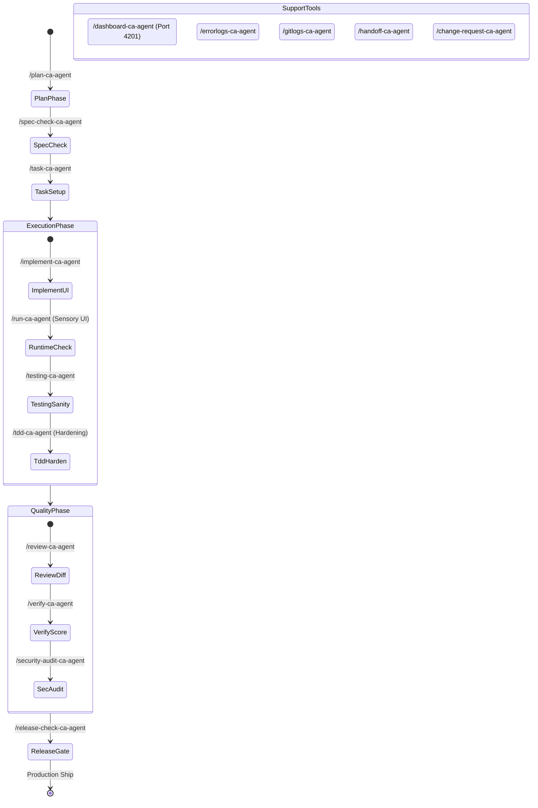
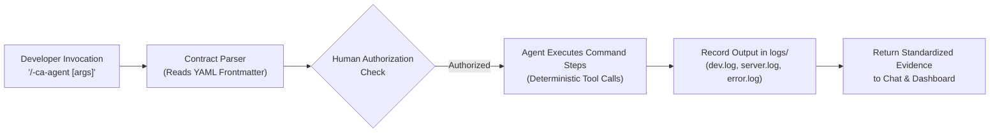

# Portable Agent Slash Commands (`-ca-agent`)
### 16 Canonical, Collision-Free Command Contracts for Autonomous Coding Agents

[🌟 Overview](#-overview) • [🔄 Lifecycle State Machine](#-command-lifecycle-state-machine) • [⚡ Dispatch Pipeline](#-command-dispatch--authorization-pipeline) • [📋 Catalog](#-command-catalog-16)

---

## 🌟 Overview

Every custom command in this framework uses the explicit `-ca-agent` namespace suffix (e.g. `run-ca-agent.md`, `review-ca-agent.md`, `plan-ca-agent.md`) and is invoked directly inside agent chat as `/<name>-ca-agent`.

### Collision Prevention Policy
> [!CRITICAL]
> **MUST NOT** name custom commands with generic tokens such as `/run`, `/plan`, `/test` or `/review`. Host coding IDEs (Cursor, Claude Code, Windsurf, Antigravity, OpenCode) reserve these tokens for internal system features. The `-ca-agent` suffix guarantees:
> 1. Zero collisions with built-in IDE slash commands.
> 2. Predictable invocation across multi-agent environments.
> 3. 100% portability between all host IDE adapters.

---

## 🔄 Command Lifecycle State Machine

---

## ⚡ Command Dispatch & Authorization Pipeline

---

## 📋 Command Catalog (16)

| Command | Category | Purpose in Vibe-Coding | Required Evidence |
| :--- | :--- | :--- | :--- |
| **`/plan-ca-agent`** | Planning | Discovery research, aesthetic proposal, and stack alignment. | Plan artifact, personas, no code modified. |
| **`/task-ca-agent`** | Planning | Atomic task harness initialization and living contract tracking. | `docs/task.md` entry, sequential task ID. |
| **`/implement-ca-agent`** | Execution | Rapid UI prototyping and component feature scaffolding. | Scaffolding diffs, mock states, styling files. |
| **`/run-ca-agent`** | Execution | Local startup and runtime health verification. | Observed URLs (`http://localhost:3000`). |
| **`/testing-ca-agent`** | Execution | Targeted visual runtime checks and component sanity tests. | Test outputs, console log inspection. |
| **`/tdd-ca-agent`** | Execution | Progressive hardening converting living specs to tests. | Passing regression tests, refactored components. |
| **`/spec-check-ca-agent`** | Specs | Syncs living feature contracts with implementation reality. | Updated living contracts in `docs/features/`. |
| **`/change-request-ca-agent`** | Specs | Rapid impact assessment when pivoting product direction. | Architectural impact matrix, living spec bump. |
| **`/review-ca-agent`** | Quality | Pre-commit diff review to prevent secret leaks and bloat. | Clean `git diff` review, zero unauthorized files. |
| **`/verify-ca-agent`** | Quality | Evaluates feature completion against living acceptance criteria. | Living criteria scorecard, visual approval note. |
| **`/security-audit-ca-agent`** | Security | SAST, secret leak, and dependency audit before production. | Dependency scan, zero secret leak verification. |
| **`/release-check-ca-agent`** | Release | Production readiness gate and ship/no-ship decision. | Signed release checklist, ship verdict. |
| **`/dashboard-ca-agent`** | Mission Control | Launches local In-IDE Project-Manager-Dashboard on port 4201. | Confirmed local URL (`http://127.0.0.1:4201`). |
| **`/errorlogs-ca-agent`** | Diagnostics | Diagnoses client-side errors, hydration bugs, and warnings. | Console stack trace triage, fix verification. |
| **`/gitlogs-ca-agent`** | Diagnostics | Git history, commit traceability, and branch state check. | Commit hash audit, DD-MM-YYYY dates verified. |
| **`/handoff-ca-agent`** | Handoff | Verifiable engineering handoff report generation. | Complete handoff dossier for engineering team. |
