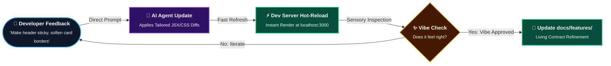
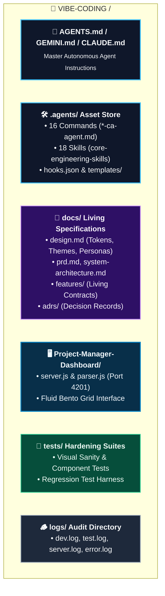

# Vibe-Coding Framework
### Fluid Sensory Prototyping & Progressive Production Hardening with AI Agents

<div align="center">

[](.)
[](.)
[](.)
[](.)
[](../../LICENSE.md)

**Framework Lead:** Chandan Adhikary · **Standard:** Production-Grade Universal Release 2.0.0  
**Target Domains:** Consumer SaaS · Modern Web Apps · Rapid MVPs · Interactive Tools · Creator Platforms

[🌟 Framework Overview](#-framework-overview) • [🏛️ System Architecture](#️-vibe-coding-architecture--sensory-loop) • [🔄 Sensory Feedback](#-visual-sensory-inspection--fast-feedback-loop) • [⚡ Quick-Start](#-quick-start-guide) • [🛡️ Slash Commands](#️-collision-free-agent-slash-commands--ca-agent) • [📁 Structure](#-repository-structure--component-map) • [📋 Governance](#-governance-rules--progressive-hardening)

</div>

---

## 🌟 Framework Overview

**Vibe-Coding** is an intuitive, visual-first engineering methodology designed for maximum product velocity. It leverages autonomous AI coding agents through **fluid conversational prompts**, instant live application scaffolding, and real-time sensory browser inspection. Instead of getting bogged down in rigid pre-coding gates during discovery, Vibe-Coding allows developers to explore aesthetic, UX, and functional workflows in an interactive browser demo—and then progressively hardens the codebase into production-grade reliability.

### The 4 Pillars of Vibe-Coding:
1. **Frontend-First Sensory Demo:** Never build backend or complex logic first. Scaffold the UI, start the local development server with `/run-ca-agent`, and visually verify design, styling, and interactions on screen (`http://localhost:3000`).
2. **Fluid Conversational Tuning:** Tune micro-interactions, responsive layouts, and animations through iterative, fluid feedback with the agent until the vibe is 100% right.
3. **Living Feature Contracts:** Maintain flexible, living feature specifications in `docs/features/` that evolve smoothly as user requirements and UI discoveries mature.
4. **Progressive Production Hardening:** Once the sensory UI is approved, apply Zod validation schemas, error boundaries, automated test harnesses, and security audits before production release.

---

## 🏛️ Vibe-Coding Architecture & Sensory Loop

```mermaid
flowchart TD
    classDef vibe fill:#2e1065,stroke:#c084fc,stroke-width:1.5px,color:#faf5ff;
    classDef gate fill:#451a03,stroke:#fbbf24,stroke-width:2px,color:#fffbeb;
    classDef live fill:#064e3b,stroke:#34d399,stroke-width:2px,color:#ecfdf5;
    classDef harden fill:#082f49,stroke:#38bdf8,stroke-width:1.5px,color:#f0f9ff;

    subgraph DiscoveryPhase ["🎨 1. DISCOVERY & AESTHETIC VIBE CHECK"]
        VibePrompt["<b>💡 Prompt V1: Discovery & Aesthetics</b><br/><sub>Aesthetic Tokens • Color Palette • User Personas</sub>"]:::vibe
        VibePlan["<b>📑 Visual & Technical Blueprint</b><br/><sub>docs/product.md • docs/design.md Tokens</sub>"]:::vibe
        HumanSignOff{"<b>👤 Human Lead Vibe Approval</b><br/><sub>Sign-off on Aesthetic Direction</sub>"}:::gate
    end

    subgraph PrototypePhase ["🏗️ 2. LIVE INTERACTIVE UI SCAFFOLD"]
        ScaffoldCode["<b>💻 Prompt V2: Scaffold Live UI Shell</b><br/><sub>Component Wireframes • Mock State • Dynamic Styling</sub>"]:::vibe
        StartDevServer["<b>🔌 Run /run-ca-agent</b><br/><sub>Starts Local Server at http://localhost:3000</sub>"]:::live
        BrowserInspect["<b>🌐 Sensory Browser Inspection</b><br/><sub>Visual Layout Check • Tactile Feel • Micro-Interactions</sub>"]:::live
    end

    subgraph TuningPhase ["✨ 3. CONVERSATIONAL VIBE-TUNING"]
        FeedbackPrompt["<b>🎨 Prompt V3: Polish Micro-Interactions</b><br/><sub>Padding, Typography, Hover States, Transitions</sub>"]:::vibe
        HotReload["<b>⚡ Instant Fast Refresh Hot-Reload</b><br/><sub>Immediate Visual Feedback in Browser</sub>"]:::live
        VibeApproval{"<b>✨ Vibe Approval Gate</b><br/><sub>Does the UX feel intuitive, elegant, and responsive?</sub>"}:::gate
    end

    subgraph HardeningPhase ["🔒 4. PROGRESSIVE PRODUCTION HARDENING"]
        HardeningPrompt["<b>🛡️ Prompt V4: Production Hardening</b><br/><sub>Zod Validation • Error Boundaries • Database APIs</sub>"]:::harden
        SanityTests["<b>🧪 Execute /testing-ca-agent</b><br/><sub>Visual Sanity & Component Regression Suites</sub>"]:::harden
        SecurityGate["<b>🛡️ /security-audit-ca-agent & /release-check-ca-agent</b><br/><sub>SAST Scan • Secret Leak Audit • Release Checklist</sub>"]:::harden
        ShipProduction(["<b>🚀 Production Release Deployment</b><br/><sub>Zero-Defect Ship to Production</sub>"]):::live
    end

    VibePrompt -->|"Architects"| VibePlan
    VibePlan -->|"Reviews"| HumanSignOff
    HumanSignOff -->|"Revisions Needed"| VibePrompt
    HumanSignOff -->|"APPROVED"| ScaffoldCode

    ScaffoldCode -->|"Launches"| StartDevServer
    StartDevServer -->|"Inspects"| BrowserInspect
    BrowserInspect -->|"Feedback"| FeedbackPrompt

    FeedbackPrompt -->|"Updates Code"| HotReload
    HotReload -->|"Validates"| VibeApproval
    VibeApproval -->|"No: Refine UI"| FeedbackPrompt
    VibeApproval -->|"YES: Vibe Approved"| HardeningPrompt

    HardeningPrompt -->|"Harness Test"| SanityTests
    SanityTests -->|"Audit Scan"| SecurityGate
    SecurityGate -->|"Ship Authorized"| ShipProduction
```



---

## 🔄 Visual Sensory Inspection & Fast-Feedback Loop

The developer and the AI agent collaborate in a high-speed sensory feedback loop:



---

## ⚡ Quick-Start Guide

### Step 1: Scaffolding into Your Project Workspace
Extract or copy the `Vibe-Coding/` directory into your project root:
```bash
# Rename to your target project name (kebab-case)
mv Vibe-Coding my-vibe-saas
cd my-vibe-saas
```

### Step 2: Verify Slash Commands
Verify that your host IDE recognizes the `.agents/` contracts:
1. Focus your AI agent chat and type `/`. Confirm all 16 `*-ca-agent` commands appear with descriptions.
2. In terminal, verify command contracts:
   ```bash
   ls .agents/commands/*-ca-agent.md
   ```

### Step 3: Launch In-IDE Project-Manager-Dashboard
Launch the dedicated telemetry dashboard on port `4201`:
- **Slash Command:** Type `/dashboard-ca-agent` in agent chat.
- **Terminal:** Run `open-in-ide.bat` (Windows) or `bash open-in-ide.sh` (macOS/Linux).
- **Dock in IDE:** Open `Simple Browser: Show`, navigate to `http://127.0.0.1:4201`, and dock in Editor Group 2.

---

## 🛡️ Collision-Free Agent Slash Commands (`-ca-agent`)

All custom commands carry the `-ca-agent` namespace to guarantee zero collisions with IDE-reserved tokens:

| Command | Category | Operational Purpose in Vibe-Coding |
| :--- | :--- | :--- |
| `/plan-ca-agent` | Planning | Discovery research, aesthetic proposal, and stack alignment. |
| `/task-ca-agent` | Planning | Atomic task harness initialization and living contract tracking. |
| `/implement-ca-agent` | Execution | Rapid UI prototyping and component feature scaffolding. |
| `/run-ca-agent` | Execution | Starts local dev server; reports live URL (`http://localhost:3000`). |
| `/testing-ca-agent` | Execution | Targeted visual runtime checks and component sanity tests. |
| `/tdd-ca-agent` | Execution | Hardening cycle converting living specs into regression tests. |
| `/spec-check-ca-agent` | Specs | Syncs living feature contracts with implementation reality. |
| `/change-request-ca-agent` | Specs | Rapid impact assessment when pivoting product direction. |
| `/review-ca-agent` | Quality | Pre-commit diff review to prevent secret leaks and style bloat. |
| `/verify-ca-agent` | Quality | Evaluates feature completion against living acceptance criteria. |
| `/security-audit-ca-agent` | Security | SAST, secret leak, and dependency audit before production. |
| `/release-check-ca-agent` | Release | Production readiness gate and ship/no-ship decision. |
| `/dashboard-ca-agent` | Dashboard | Launches local In-IDE Project-Manager-Dashboard on port 4201. |
| `/errorlogs-ca-agent` | Diagnostics | Diagnoses client-side errors, console warnings, and hydration bugs. |
| `/gitlogs-ca-agent` | Diagnostics | Commit history and git traceability validation against task IDs. |
| `/handoff-ca-agent` | Handoff | Generates verifiable engineering handoff report for team transfer. |

---

## 📁 Repository Structure & Component Map



---

## 📋 Governance Rules & Progressive Hardening

- **Sensory-First Principle:** Never build persistent data models or backend logic until the frontend UI demo is verified live and approved on screen.
- **Living Contract Model:** Specs in `docs/features/` start as `PROTOTYPE` / `DRAFT` and are hardened into `APPROVED` as features stabilize.
- **Progressive Hardening Gate:** Before merging to main or releasing to production, every feature must pass:
  1. Input validation (Zod schemas or typed DTOs).
  2. Error boundary wrapping to prevent full-screen crashes.
  3. SAST security audit via `/security-audit-ca-agent`.
  4. Release checklist verification via `/release-check-ca-agent`.
- **Mandatory Development Logging:** All dev server sessions and command runs must log cleanly to `logs/*.log`.
