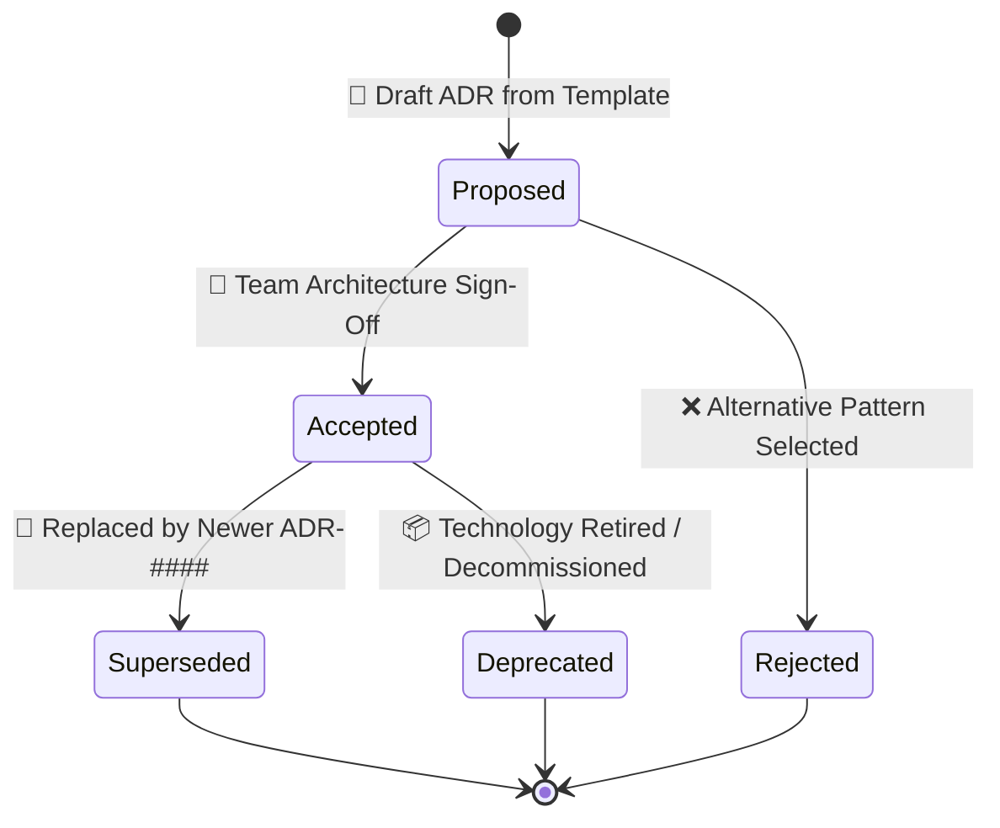

# Architecture Decision Records (ADRs)
### Architectural Governance & Technical Choice History for Vibe-Coding

[🌟 Overview](#-overview) • [🔄 ADR State Machine](#-adr-lifecycle-state-machine) • [📋 Governance Rules](#-governance-rules) • [📁 Directory Index](#-directory-index)

---

## 🌟 Overview

Architecture Decision Records (ADRs) in the Vibe-Coding framework capture significant technology choices, UI framework adoptions, state management approaches, and persistent backend decisions. While prototyping moves at high velocity, architectural decisions remain immutable once adopted.

---

## 🔄 ADR Lifecycle State Machine

---

## 📋 Governance Rules

1. **Sequential Naming:** Store numbered records as `ADR-####-short-title.md` (e.g., `ADR-0001-adopt-guideline-baseline.md`).
2. **Strict Immutability:** Never overwrite an accepted decision. To change architecture, author a new record and mark the predecessor as `Superseded by ADR-####`.
3. **Cross-Linkage:** Every ADR must be referenced in affected feature contracts (`Depends on` field) and indexed in `docs/system-architecture.md`.
4. **Standard Template:** Always start new decisions from `ADR-TEMPLATE.md`.

---

## 📁 Directory Index

| File | Status | Description |
| :--- | :--- | :--- |
| [`ADR-TEMPLATE.md`](ADR-TEMPLATE.md) | Standard | Master template for authoring new architecture decisions. |
| [`ADR-0001-adopt-guideline-baseline.md`](ADR-0001-adopt-guideline-baseline.md) | Accepted | Baseline guideline adoption and framework standard. |
