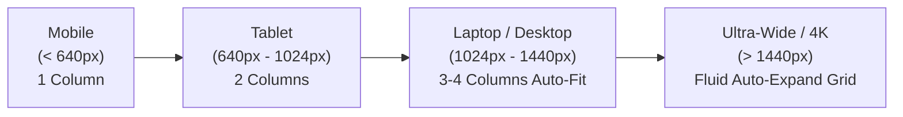

# Visual Design & UI System Contract

> **Document class:** Living feature/specification  
> **Framework:** Vibe Coding  
> **Guideline baseline:** 2.0.0  
> **Status:** Template; project-specific instantiation requires review  

## Purpose

Design system standards, design tokens, fluid layouts, responsive breakpoints, component states, and micro-interactions.

## Agent read trigger

**MUST** read or consult this file: Before designing or modifying UI components, layouts, sensory effects, animations, or styling.

---

## 1. Design Tokens Specification

### 1.1 Color Roles & Semantic Palette
| Token Name | Dark Mode | Light Mode | Semantic Purpose |
|---|---|---|---|
| `--bg-canvas` | `#070a11` | `#f8fafc` | Deep background canvas |
| `--bg-surface` | `rgba(15, 23, 42, 0.65)` | `rgba(255, 255, 255, 0.90)` | Glassmorphism cards / panels |
| `--border-subtle` | `rgba(255, 255, 255, 0.08)` | `rgba(0, 0, 0, 0.08)` | Subtle container dividers |
| `--primary-accent` | `#06b6d4` (Cyan) | `#0284c7` (Sky Blue) | Interactive actions, active states |
| `--success-state` | `#10b981` (Emerald) | `#059669` (Emerald) | Positive feedback, success alerts |
| `--warning-state` | `#f59e0b` (Amber) | `#d97706` (Amber) | Pending actions, warnings |
| `--error-state` | `#ef4444` (Crimson) | `#dc2626` (Crimson) | Error boundaries, failure alerts |
| `--text-main` | `#f8fafc` | `#0f172a` | High-contrast body typography |
| `--text-muted` | `#94a3b8` | `#64748b` | Secondary descriptions, captions |

---

## 2. Dynamic Responsive Breakpoints Matrix

Layouts must be 100% fluid and dynamically responsive across all monitor sizes. Fixed widths (e.g. `1440px`) are strictly prohibited.

| Breakpoint Name | Viewport Width | Grid Behavior | Padding / Gutters |
|---|---|---|---|
| **Mobile (`sm`)** | `< 640px` | Single column stack; full-width cards | `12px` gutters |
| **Tablet (`md`)** | `640px – 1024px` | 2-column bento grid; collapsible sidebars | `16px` gutters |
| **Desktop (`lg`)** | `1024px – 1440px`| 3 to 4 columns (`minmax(300px, 1fr)`) | `20px` gutters |
| **Ultra-Wide (`xl/2k/4k`)** | `> 1440px` | 100% fluid auto-fill grid; no max-width clamping | `24px` gutters |

---

## 3. Comprehensive Component State Matrix

| State | Visual Treatment | Micro-Interaction |
|---|---|---|
| **Default** | Balanced contrast, smooth borders. | Base elevation. |
| **Hover** | Glow or scale micro-transition (`scale(1.02)`). | Fast 150ms spring transition. |
| **Active / Pressed**| Tactile compression (`scale(0.98)`). | Instant feedback. |
| **Focus Visible** | High-contrast accent ring. | Fully accessible keyboard outline. |
| **Disabled** | Dimmed opacity, neutral cursor. | Excluded from tab index. |
| **Loading** | Fluid shimmer skeleton. | Prevents layout shifts. |
| **Empty State** | Friendly visual illustration + CTA. | Guides next user action. |
| **Error State** | Crimson boundary highlight with clear guidance. | Immediate corrective prompt. |

---

## 4. Visual Quality Gates

- **MUST** provide instant visual feedback on user inputs.
- **MUST** support seamless light/dark theme switching.
- **MUST** look balanced and polished across all resolutions from mobile screens to 4K ultrawide monitors.

## Evidence and change control

- **MUST** record owner, revision/date, and traceable evidence in the applicable project instantiation.
- **MUST** route process changes through formal baseline revisions and living feature specifications.

## Vibe Coding interpretation

- Treat living plans, design tokens, and sensory specifications as authoritative guides for implementation.
