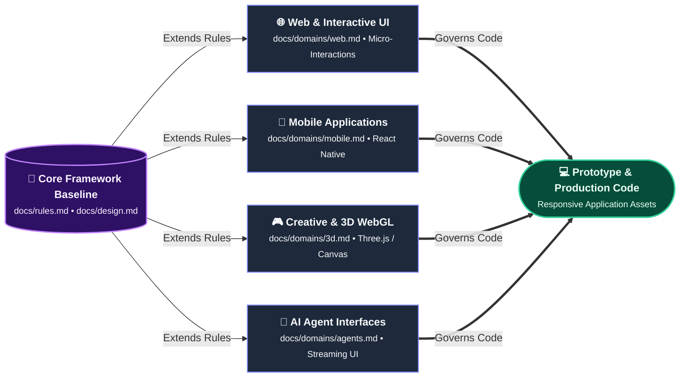

# Domain-Specific Engineering Extensions
### Industry Standards, Bounded Contexts & Platform Extensions for Vibe-Coding

<div align="center">

[](.)
[](.)
[](.)

[🌟 Overview](#-overview) • [🏛️ Domain Topology](#️-domain-extension-topology) • [📋 Governance Rules](#-governance-rules) • [📄 Template](#-extension-template)

</div>

---

## 🌟 Overview

The `docs/domains/` directory allows Vibe-Coding projects to cleanly layer on specialized domain standards—such as Mobile Apps (React Native/Flutter), Creative Audio/Video Tools, 3D WebGL, or AI/LLM interfaces—without disrupting foundational workflows.

---

## 🏛️ Domain Extension Topology



---

## 📋 Governance Rules

1. **Explicit Justification:** Domain extensions are added as `docs/domains/<domain>.md` only when base documentation is insufficient for specialized compliance or architectural requirements.
2. **Audit & Changelog Entry:** When introducing binding rules, record applicability, approval rationale, and a version entry in `docs/guideline-CHANGELOG.md`.
3. **AI/ML Requirements:** Any AI/ML domain extension **MUST** declare dataset lineage, evaluation thresholds, and drift detection criteria.
4. **Precedence Hierarchy:** Base governance rules (`docs/rules.md`) always take precedence unless an approved domain extension explicitly documents an authorized variance.

---

## 📄 Extension Template

```markdown
# Domain: <name>

> **Document class:** Controlled process guideline  
> **Framework:** Vibe-Coding  
> **Guideline baseline:** 2.0.0  
> **Status:** Proposed / Adopted  

## Purpose
<Describe the specialized domain context and why standard guidelines require extension.>

## Applicability
<Define which projects, modules, or services must comply with this extension.>

## Agent Read Trigger
**MUST** read or consult this file: <specify exact operational conditions>.

## Normative Sections and Rules
### 1. <Topic>
- **MUST** — <specific domain rule>

## Evidence and Change Control
- **MUST** record adoption approval and link the guideline-CHANGELOG entry.
```
