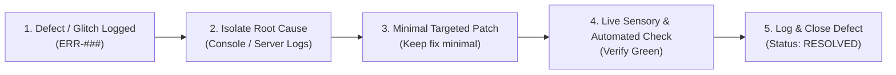

# Defect & Error Tracker

> **Document class:** Living feature/specification  
> **Framework:** Vibe Coding  
> **Guideline baseline:** 2.0.0  
> **Status:** Active Standard  

## Purpose

Defect tracking, sensory glitch logging, regression prevention, and resolution history.

## Agent read trigger

**MUST** read or consult this file: Whenever encountering unexpected crashes, UI glitches, test failures, or during `/errorlogs-ca-agent`.

---

## 1. Defect Resolution Flow

---

## 2. Severity Classification Matrix

| Severity | Definition & Impact | Resolution Target |
|---|---|---|
| **P0 (Critical)** | Application crash, white screen of death, unhandled runtime exception. | Immediate |
| **P1 (High)** | Core user action fails, form submission broken, auth loop. | Same session |
| **P2 (Medium)** | UI misalignment, layout shift, slow transition, jank. | Next iteration |
| **P3 (Low)** | Minor cosmetic inconsistency, typo, console warning. | Polish phase |

---

## 3. Active & Resolved Defect Log

| Defect ID | Date | Sev | Summary | Impacted Path | Violated AC / Spec Gap | Root Cause / Trigger | Fix (Commit / PR) | Regression Test | Status |
|---|---|---|---|---|---|---|---|---|---|
| `ERR-001` | 13-11-2026 | `P1` | Sample: Mobile menu overflow on small screens | `assets/dashboard.css` | `AC-FEAT001-02` | CSS fixed width on nav container overriding flex | commit `f4e3d2c` | `tests/test_dashboard_responsive.js` | `RESOLVED` |
| `ERR-002` | 16-11-2026 | `P0` | Test runner ENOENT crash when package.json absent | `Project-Manager-Dashboard/server.js` | `AC-FEAT001-03` | Hardcoded npm test command in server action | commit `f9ef182` | `tests/test_ac_contracts.js` | `RESOLVED` |
| `ERR-003` | 16-11-2026 | `P1` | AC inspection sheet displayed placeholder fallback text | `Project-Manager-Dashboard/assets/dashboard.js` | `AC-FEAT001-01` | Modal queried spec.given instead of spec.scenario | commit `f9ef182` | `tests/test_ac_contracts.js` | `RESOLVED` |
| `ERR-004` | 16-11-2026 | `P2` | Unhandled stream event on rapid SSE client reconnection | `Project-Manager-Dashboard/server.js` | `AC-FEAT001-01` | Client socket destroyed before SSE handshake flush | In Triage | `tests/test_sse_stream.js` | `ACTIVE` |

## Evidence and change control

- **MUST** record owner, revision/date, and traceable evidence in the applicable project instantiation.
- **MUST** route process changes through formal baseline revisions and living feature specifications.

## Vibe Coding interpretation

- Treat defect logs and sensory glitch records as active inputs for iterative refactoring.
