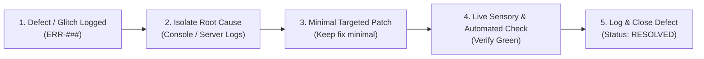

# Defect & Error Tracker

> **Document class:** Living feature/specification  
> **Framework:** Vibe-Coding  
> **Guideline baseline:** 2.0.0  
> **Status:** Active Standard  

## Purpose

Defect tracking, sensory glitch logging, regression prevention, and resolution history.

## Agent read trigger

**MUST** read or consult this file: Whenever encountering unexpected crashes, UI glitches, test failures, or during `/errorlogs-ca-agent`.

---

## 1. Defect Resolution Flow

---

## 2. Severity Classification Matrix

| Severity | Definition & Impact | Resolution Target |
|---|---|---|
| **P0 (Critical)** | Application crash, white screen of death, unhandled runtime exception. | Immediate |
| **P1 (High)** | Core user action fails, form submission broken, auth loop. | Same session |
| **P2 (Medium)** | UI misalignment, layout shift, slow transition, jank. | Next iteration |
| **P3 (Low)** | Minor cosmetic inconsistency, typo, console warning. | Polish phase |

---

## 3. Active & Resolved Defect Log

| Defect ID | Date | Sev | Summary | Trigger / Root Cause | Fix (Commit / PR) | Verification | Status |
|---|---|---|---|---|---|---|---|
| `ERR-001` | 2026-11-13 | `P1` | Sample: Mobile menu overflow on small screens | CSS fixed width on nav container | commit `f4e3d2c` | Responsive viewport test | `RESOLVED` |
