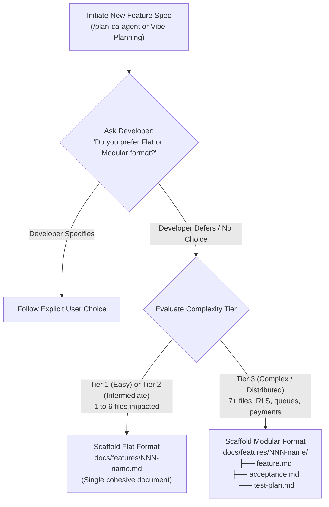
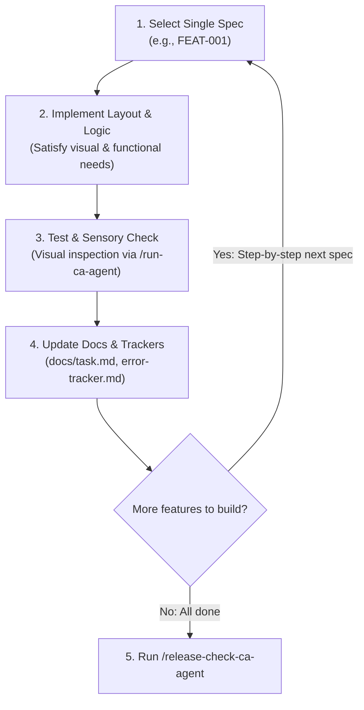
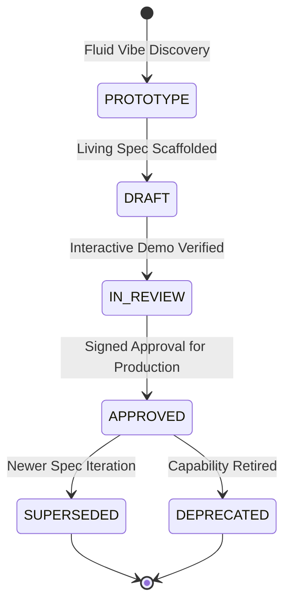

# Feature Specifications (`docs/features/`)
### Living Contracts & Sensory UI Specifications for Vibe-Coding

[🌟 Purpose](#-purpose) • [🏛️ Format Decision Tree](#️-flat-vs-modular-decision-tree) • [📊 Complexity Tiers](#-feature-complexity-breakdown-tiers) • [🔄 Lifecycle State Machine](#-living-specification-lifecycle-state-machine) • [📋 Traceability](#-identifier-traceability-scheme)

---

## 🌟 Purpose

`docs/features/` is the canonical location for living feature contracts within the Vibe-Coding framework. Feature specifications evolve from initial prototype notes into hardened, production-ready contracts.

---

## 🏛️ Flat vs. Modular Decision Tree

---

## 📊 Feature Complexity Breakdown Tiers

| Tier | Complexity Category | Scope & Criteria | Testing & Sensory Gate |
|---|---|---|---|
| **Tier 1** | **Easy (Low Complexity)** | Self-contained, static UI, simple CRUD, single table, read-only views (1–2 files). | Rapid sensory test & unit check. |
| **Tier 2** | **Intermediate (Medium Complexity)** | Form validation, interactive UI state transitions, auth guards, API endpoints (3–6 files). | Unit + component integration tests; visual state checks. |
| **Tier 3** | **Hard / Complex (High Complexity)** | Multi-tenant RLS, distributed state, WebSocket live streams, external payment webhooks, background pipelines (7+ files). | Automated integration tests + live end-to-end verification. |

---

## 🔄 Step-by-Step Spec Development Protocol

> [!CRITICAL]
> **MUST NOT** begin work on a subsequent feature until the current feature's acceptance criteria and sensory checkpoints are fully met, verified, and documented.

---

## 🔄 Living Specification Lifecycle State Machine

| Status | Meaning | Implementation Allowed? |
| :--- | :--- | :--- |
| **`PROTOTYPE`** | Initial discovery notes; experimental code. | Rapid prototyping only |
| **`DRAFT`** | Living specification draft being refined. | UI scaffolding permitted |
| **`IN REVIEW`** | Submitted for team and visual sign-off. | Pre-deploy testing |
| **`APPROVED`** | Formally signed off for production. | **YES** — production code |
| **`SUPERSEDED`**| Replaced by a newer approved version. | No new work |
| **`DEPRECATED`**| Capability retired or decommissioned. | Removal work only |

---

## 📋 Identifier Traceability Scheme

Defined canonically in `docs/requirements-traceability.md`:

| Artifact | Pattern | Concrete Example |
| :--- | :--- | :--- |
| **Feature Contract** | `FEAT-###` | `FEAT-002` |
| **Functional Requirement** | `FR-FEAT###-##` | `FR-FEAT002-01` |
| **Acceptance Criterion** | `AC-FEAT###-##` | `AC-FEAT002-03` |
| **Sensory UI Check** | `SENSORY-FEAT###-##` | `SENSORY-FEAT002-01` |
| **Test Case Identifier** | `TEST-FEAT###-##` | `TEST-FEAT002-03` |
