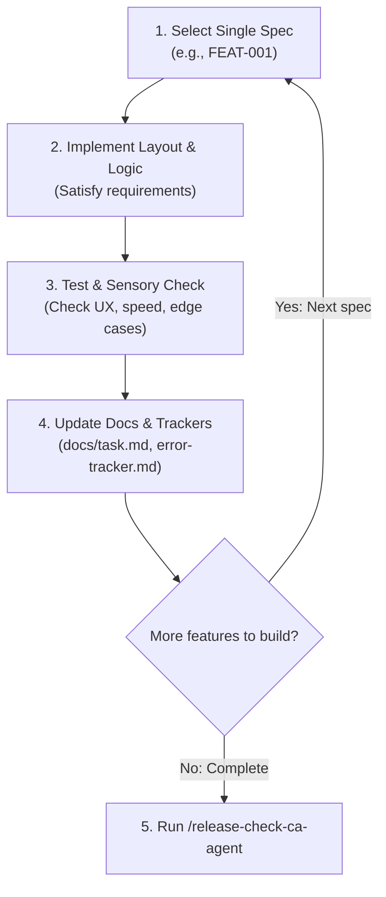

# Feature Specifications (`docs/features/`)

> **Document class:** Controlled process guideline  
> **Framework:** Vibe-Coding  
> **Guideline baseline:** 2.0.0  
> **Status:** Active Standard  

## Purpose

`docs/features/` is the canonical location for versioned feature specifications and UI/sensory contracts.

## Agent Read & Execution Triggers

- **MUST** read this file before creating, modifying, or implementing any feature specification.
- **MUST** develop features **step-by-step, spec-by-spec**: never attempt to implement all features simultaneously. Build, test, verify user sensory feedback, and update documentation before moving to the next feature.

---

## Normative Sections and Rules

### 1. Mandatory Format Inquiry: Flat vs. Modular

When initiating a new feature specification during `/plan-ca-agent` or vibe planning, the agent **MUST ALWAYS ask the developer first**:

> *"Would you prefer this specification to be created in **Flat format** (`docs/features/NNN-name.md`) or **Modular format** (`docs/features/NNN-name/{feature,acceptance,test-plan}.md`)?"*

- If the developer specifies a preference, the agent strictly follows it.
- If the developer defers or leaves it open, the agent decides based on the complexity tier:
  - **Easy / Intermediate Features** → **Flat Format**.
  - **Hard / Complex Features** → **Modular Format**.

| Format | Directory Layout | Criteria & Use Case |
|---|---|---|
| **Flat** | `docs/features/NNN-name.md` (Single file containing all sections) | Easy to Medium features (Tier 1 & Tier 2); focused scope, 1–6 files impacted. |
| **Modular** | `docs/features/NNN-name/` ├── `feature.md` ├── `acceptance.md` └── `test-plan.md` | Complex features (Tier 3); multi-model relationships, payment integrations, real-time websockets. |

---

### 2. Feature Complexity Breakdown Tiers

| Tier | Complexity Category | Scope & Criteria | Testing & Sensory Gate |
|---|---|---|---|
| **Tier 1** | **Easy (Low Complexity)** | Self-contained, static UI, simple CRUD, single table, read-only views (1–2 files). | Rapid sensory test & unit check. |
| **Tier 2** | **Intermediate (Medium Complexity)** | Form validation, interactive UI state transitions, auth guards, API endpoints (3–6 files). | Unit + component integration tests; visual state checks. |
| **Tier 3** | **Hard / Complex (High Complexity)** | Multi-tenant RLS, distributed state, WebSocket live streams, external payment webhooks, background pipelines (7+ files). | Automated integration tests + live end-to-end verification. |

---

### 3. Step-by-Step Spec Development Protocol

- **MUST NOT** begin work on a subsequent feature until the current feature's acceptance criteria and sensory checkpoints are fully met, verified, and documented.
