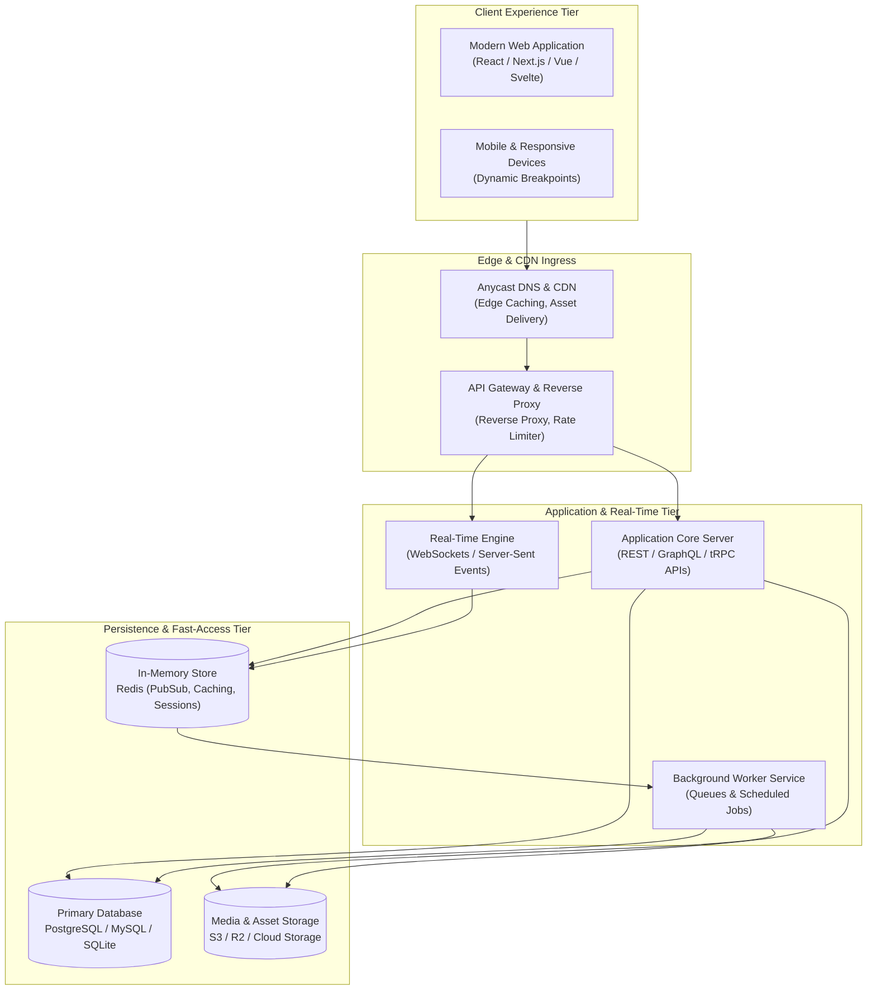
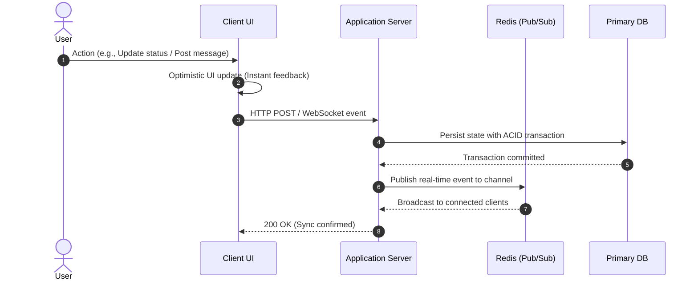

# System Architecture & System Design Specification

> **Document class:** Living feature/specification  
> **Framework:** Vibe Coding  
> **Guideline baseline:** 2.0.0  
> **Status:** Template; project-specific instantiation requires review  

## Purpose

High-level and low-level system designs, aesthetic/interactive boundaries, data consistency, scalability, caching, and fluid architecture evolution.

## Agent read trigger

**MUST** read or consult this file: Prior to module creation, architectural modifications, database modeling, API contract updates, or real-time feature integrations.

---

## 1. System Design Architecture (HLD & LLD)

### 1.1 High-Level Design (HLD)
The High-Level Design provides the end-to-end topology balancing fluid user experiences, instant UI feedback, and backend scalability.

### 1.2 Low-Level Design (LLD) & Component Modularization
- **Component Design Patterns:**
  - **Component Composition:** Atomic UI hierarchy (Atoms -> Molecules -> Organisms -> Pages).
  - **Optimistic UI & State Machines:** Instant client-side state mutation before server confirmation with automatic rollback on error.
  - **Service & Repository Layer:** Decouple data retrieval and mutations from UI rendering and routing.

---

## 2. Scalability, Caching & Performance Optimization

| Domain | Standard & Strategy |
|---|---|
| **Edge & Asset Delivery** | Immutable asset hashing, WebP/AVIF image formats, dynamic CDN distribution. |
| **In-Memory Caching (Redis)** | Cache-aside pattern for expensive aggregates, session tracking, and real-time Pub/Sub channel management. |
| **Database Optimization** | Indexed foreign keys, connection pooling, prepared statements, and query execution plan analysis. |
| **State Hydration** | Selective SSR streaming and client hydration to achieve sub-second Time-to-Interactive (TTI). |

---

## 3. Data Consistency, Transactions & Real-Time State

- **ACID Core:** Relational integrity for user data, access tokens, and transactional state.
- **Eventual Consistency:** Activity feeds, notifications, analytics dashboards.
- **Real-Time Sync:** WebSockets or SSE for collaborative live state updates.

---

## 4. Resilience, Fault Tolerance & Error Handling

- **Error Boundaries:** Isolate component errors on the frontend without crashing the whole application.
- **Retry with Jitter:** Exponential backoff with random jitter for transient network or external API errors.
- **Graceful Fallbacks:** Empty states, fallback banners, and offline cached views.

---

## 5. Normative Enforcement Rules

- **MUST** complete domain knowledge synthesis and system design modeling before the first prompting phase; if not manually provided, consult the AI agent during planning to formulate system architecture and integrate it into Prompt 1.
- **MUST** follow staged web development (Frontend-First Verification): develop and verify frontend design and features during a demo run before backend persistence.
- **MUST** maintain all development logs inside `logs/` (`logs/*.log`) with credentials sanitized.
- **MUST** keep system architecture synchronized with actual codebase implementations.
- **MUST** document major architectural shifts in `docs/adrs/`.
- **MUST** maintain clean separation between domain logic and presentation layers.

## Evidence and change control

- **MUST** record owner, revision/date, and traceable evidence in the applicable project instantiation.
- **MUST** route process changes through formal baseline revisions and living feature specifications.

## Vibe Coding interpretation

- System design architecture serves as a living foundation that evolves dynamically with product features.
