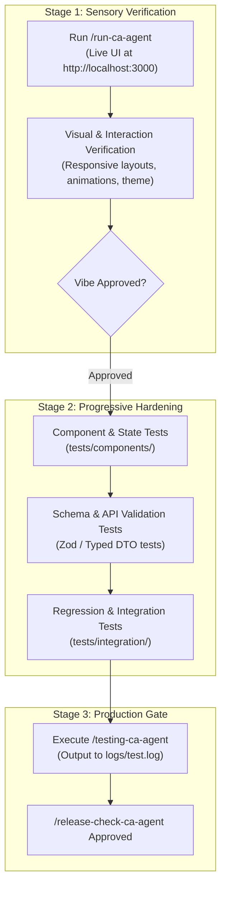

# Test Harness & Hardening Suite
### Visual Runtime Sanity & Progressive Hardening for Vibe-Coding

<div align="center">

[](.)
[](.)
[](.)
[](.)

[🌟 Overview](#-overview) • [🏛️ Hardening Pipeline](#️-vibe-hardening-pipeline) • [📁 Directory Layout](#-directory-layout--conventions) • [⚡ Commands](#-execution-commands)

</div>

---

## 🌟 Overview

In **Vibe-Coding**, testing follows a progressive hardening philosophy. During the initial exploration and UI prototyping stages, verification is visual and sensory via `/run-ca-agent` at `http://localhost:3000`. Once user flows and aesthetics are approved, automated sanity and regression tests are implemented to harden the application before production release.

---

## 🏛️ Vibe Hardening Pipeline



---

## 📁 Directory Layout & Conventions

```text
tests/
├── components/                               # Visual and interaction component tests
│   ├── hero.test.tsx                         # Header, navigation, and CTA checks
│   └── dashboard-card.test.tsx               # State rendering & interaction checks
├── integration/                              # API routes and client-server tests
│   └── api/newsletter.test.ts                # Endpoint validation & status checks
├── fixtures/                                 # Mock datasets for rapid testing
└── mocks/                                    # Service stubs & handlers
```

---

## ⚡ Execution Commands

| Target | Command | Operational Scope |
| :--- | :--- | :--- |
| **All Tests** | `npm test` or `pnpm test` | Runs all progressive hardening test suites. |
| **Component Tests** | `npm run test:components` | Validates UI rendering and interaction state. |
| **API Integration** | `npm run test:api` | Verifies endpoints, status codes, and schema validation. |
| **Watch Mode** | `npm run test:watch` | Instant feedback while refactoring components. |

> [!NOTE]
> All test executions must write clean, sanitized output to `logs/test.log`.
