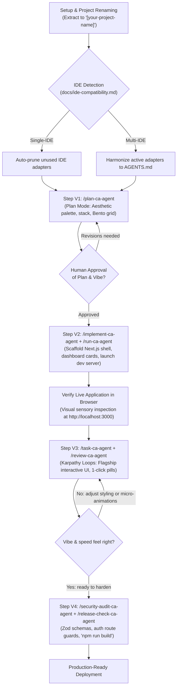

# AI-Powered Project Development — Universal Custom Slash Commands for Vibe-Coding
### Operational Reference for `.agents/commands/` & Complete Universal Vibe-Coding Demo for Any Project

**Framework:** Vibe Coding Framework · Rapid Interactive Prototyping to Production SaaS  
**Author / Engineering Lead:** Chandan Adhikary & Antigravity Engineering  
**Version:** 2.0.0 (Production-Grade Universal Release)  
**Application Scope:** Universal (SaaS Platforms, Consumer Web Apps, B2B Dashboards, Marketplaces, AI Web Interfaces, Internal Tools)  
**Reference Example:** EduSphere Multi-Tenant School Management SaaS Website (SMS)  
**Applies to:** Claude Code, Cursor, Windsurf, Antigravity, GitHub Copilot, Codex, Trae, VS Code with AI Agents  

---

## 1. Executive Overview & Behavioral Contract Architecture

In the **Vibe-Coding Framework**, custom slash commands are not merely chat shortcuts—they are **deterministic behavioral contracts**.

When you type a slash command (such as `/plan-ca-agent` or `/implement-ca-agent`), your AI coding agent automatically binds its execution to the governance rules, styling guidelines, and quality gates defined in `.agents/commands/<name>-ca-agent.md`.

```text
+-------------------------------------------------------------------------------+
|                       VIBE-CODING SLASH COMMAND PIPELINE                      |
+-------------------------------------------------------------------------------+
|                                                                               |
|   /plan-ca-agent           --> Scoped discovery, aesthetic palette,           |
|                                tech stack, zero premature coding.             |
|                                                                               |
|   /implement-ca-agent      --> Scaffold core layout, bento grids, mock data.  |
|                                                                               |
|   /run-ca-agent            --> Start local dev server & verify live URL.      |
|                                                                               |
|   /task-ca-agent           --> Rapid Karpathy conversational loops;           |
|                                1-click status pills, optimistic UI.           |
|                                                                               |
|   /review-ca-agent         --> Inspect git diff, verify clean component state.|
|                                                                               |
|   /security-audit-ca-agent --> Runtime Zod schemas & auth route guards.       |
|                                                                               |
|   /release-check-ca-agent  --> Production build check ('npm run build')       |
|                                and final release checklist sign-off.          |
|                                                                               |
+-------------------------------------------------------------------------------+
```

### 1.1 Why Slash Commands Prevent Vibe-Coding Pitfalls
1. **Preventing AI Drift:** Autonomous agents frequently hallucinate unneeded dependencies or change design tokens without permission. Slash commands force the agent to consult repository guidelines (`AGENTS.md`) first.
2. **Zero Reserved Token Collisions (`-ca-agent` Suffix):** Major AI IDEs (Cursor, Claude Code, Windsurf, Antigravity) reserve native tokens like `/run`, `/plan`, or `/test`. Our custom commands use the explicit `-ca-agent` namespace to guarantee 100% collision-free execution across all editors.
3. **Taste & Visual Verification:** Commands like `/run-ca-agent` and `/review-ca-agent` ensure that developers test working software interactively before layering further complexity.

---

## 2. Universal Variable Substitution Matrix

When invoking custom slash commands on any software project, replace the placeholder tokens in brackets with your domain-specific values. 

The table below illustrates how to customize these variables using the **School Management System (SMS)** reference alongside an **E-Commerce / Creator Marketplace** example:

| Variable Token | Description | School Management System (SMS) Example | E-Commerce / Creator Marketplace Example |
| :--- | :--- | :--- | :--- |
| `[PROJECT_NAME]` | Name of the software application | EduSphere SMS Website | ArtisanHub Creator Marketplace |
| `[PRODUCT_TYPE]` | Delivery model & architecture | Multi-Tenant School Management SaaS | Multi-Vendor Artisan Marketplace & Storefront |
| `[PRODUCT_VISION]` | System vision & core value | Cloud-native portal eliminating admin friction | Direct-to-consumer artisanal commerce & studio |
| `[TARGET_USERS]` | Primary personas | SuperAdmin, Principals, Teachers, Parents | Store Owners, Artisans, Retail Buyers |
| `[AESTHETIC_VIBE]` | Visual design feel & tokens | Indigo & Slate modern SaaS, clean rounded-xl | Warm Ochre & Forest Green, organic minimalist |
| `[PRIMARY_COLOR]` / `[ACCENT]` | Brand design token colors | Indigo (`#4F46E5`) / Violet (`#7C3AED`) | Warm Ochre (`#D97706`) / Forest (`#059669`) |
| `[CORE_FLAGSHIP_FEATURE]` | The hero interactive workflow | 30-Second Classroom Attendance Sheet | 1-Click Order Dispatch & Fulfillment Drawer |
| `[FLAGSHIP_STATUS_PILLS]` | Tactile interactive state buttons | `[P]` Present, `[A]` Absent, `[L]` Late, `[E]` Excused | `[Pending]`, `[Packed]`, `[Shipped]`, `[Delivered]` |

---

## 3. How Slash Commands Work in AI Coding IDEs

### 3.1 IDE Discovery & Autocompletion
- In **Cursor, Windsurf, Antigravity, OpenCode, and Claude Code**, typing `/` directly into the chat input triggers the slash command palette.
- Selecting any command (e.g. `/plan-ca-agent`) loads the operational prompt template from `.agents/commands/<name>-ca-agent.md`.

### 3.2 Two Invocation Patterns

#### Pattern 1: Direct Command with Attached Context (Recommended)
Type the slash command followed immediately by your project vision and requirements in the same prompt:
```text
/plan-ca-agent Project Name: [PROJECT_NAME], Vibe: [AESTHETIC_VIBE]...
```

#### Pattern 2: Action Triggering
Type the slash command as an isolated action instruction after completing a step:
```text
/run-ca-agent
/review-ca-agent
/release-check-ca-agent
```

---

## 4. The Vibe-Coding Slash Command Suite

| Slash Command | File Location | Operational Scope in Vibe-Coding |
|---|---|---|
| `/plan-ca-agent` | `.agents/commands/plan-ca-agent.md` | Pre-development discovery, color palette selection, component hierarchy, and read-only plan artifact. |
| `/implement-ca-agent` | `.agents/commands/implement-ca-agent.md` | Scaffolding application shell, responsive navigation, and interactive mock screens. |
| `/run-ca-agent` | `.agents/commands/run-ca-agent.md` | Starting the local development server and reporting the active URL without inventing output. |
| `/task-ca-agent` | `.agents/commands/task-ca-agent.md` | Fast Karpathy iterative feature execution (e.g., building interactive sheets or item drawers). |
| `/review-ca-agent` | `.agents/commands/review-ca-agent.md` | Visual diff inspection, type checking, and component sanity reviews. |
| `/security-audit-ca-agent` | `.agents/commands/security-audit-ca-agent.md` | Applying Zod runtime schemas, securing sessions, and scanning for secret leaks. |
| `/release-check-ca-agent` | `.agents/commands/release-check-ca-agent.md` | Running production bundle build (`npm run build`) and generating pre-deployment checklist. |

---

## 5. Andrej Karpathy Engineering Skill (`andrej-karpathy-skill`)

Embedded within `.agents/skills/andrej-karpathy-skill/SKILL.md`, this skill equips the AI agent with core heuristics for high-velocity Vibe Coding:
- **Inspect the Raw Data First:** Never guess API shapes or schema fields. Inspect mock data or database payloads directly.
- **Single-Batch Overfit / Micro-Baseline:** Make a single vertical feature slice work completely before abstracting into multi-tenant hierarchies.
- **Immediate Feedback Loops:** Keep diffs small, verify each change live in the browser, and avoid blind multi-file refactoring.
- **Anti-Overengineering:** Prefer clean, flat, readable React components over complex nested abstraction layers.

---

## 6. Visual Workflow Diagram: The Universal Vibe-Coding Flow



---

## 7. End-to-End Universal Production Demo via Slash Commands
### Complete Step-by-Step Command Sequence for Any Project

> [!IMPORTANT]
> **Pure Template Invariant:**
> The framework folder (`Vibe-Coding-Chandan-Adhikary/Vibe-Coding/`) is an immutable template. Always copy or extract it to `[your-project-name]/` before executing these commands.

---

### Step V1: Discovery & Aesthetic Vibe Check (`/plan-ca-agent`)

**Command Typed into Chat:**
```markdown
/plan-ca-agent Project Name: [PROJECT_NAME]
Product Type: [PRODUCT_TYPE]
Product Vision: [PRODUCT_VISION: A comprehensive description of the user experience, core operations, and value proposition]
Target Users: [TARGET_USERS: Primary administrative, operational, and customer personas]
Aesthetic / Vibe: [AESTHETIC_VIBE: e.g. Primary Color [PRIMARY_COLOR], Accent [ACCENT_COLOR], clean typography, rounded-xl cards, instant search filters, optimistic UI]
Active IDE: [ACTIVE_IDE: e.g. Antigravity, Cursor, Windsurf, or Claude Code]
```

<details>
<summary><b>View Concrete Reference Example (School Management System)</b></summary>

```markdown
/plan-ca-agent Project Name: EduSphere SMS Website
Product Type: Multi-Tenant School Management SaaS Platform
Product Vision: A modern, lightning-fast school portal designed to eliminate administrative friction. Schools manage student rosters, take daily classroom attendance in 30 seconds with 1-click status pills, generate tuition invoices, and give parents real-time visibility.
Target Users: SuperAdmin, Principals, Classroom Teachers (mobile-first), Students, Parents.
Aesthetic / Vibe: Warm Modern SaaS (Indigo #4F46E5 & Slate #0F172A palette, Emerald #10B981 for present, Rose #F43F5E for absent, clean geometric typography, rounded-xl cards, instant search filters, optimistic UI).
Active IDE: Antigravity (or Cursor)
```
</details>

**What the AI Agent Does:**
1. Invokes the `.agents/commands/plan-ca-agent.md` contract in **Plan Mode (Read-Only)**.
2. Detects the active IDE and prunes irrelevant competitor config files per `docs/ide-compatibility.md`.
3. Inspects `AGENTS.md` and repository guidelines.
4. Generates a comprehensive **17-section planning report** covering:
   - Bento Grid layout specifications and responsive navigation drawer.
   - Recommended modern tech stack (Next.js 15, Tailwind CSS v4, Lucide React).
   - Component tree and optimistic UI state management strategy.
   - Normalized relational schema for PostgreSQL.
5. **Stops and awaits human review.**

---

### Step V2: Scaffolding & Live Interactive Shell (`/implement-ca-agent` + `/run-ca-agent`)

**Command Typed into Chat:**
```markdown
/implement-ca-agent The plan for [PROJECT_NAME] has been APPROVED.
1. Configure 'globals.css' with the approved design tokens ([PRIMARY_COLOR], [ACCENT_COLOR], rounded-xl radiuses).
2. Scaffold the public marketing landing page at 'app/page.tsx' with hero section, feature bento grid, and pricing cards.
3. Scaffold the authenticated dashboard shell at 'app/dashboard/layout.tsx' with collapsible sidebar, top navbar, and user dropdown.
4. Populate 'lib/mock-data.ts' with realistic records.
5. Create 'app/dashboard/page.tsx' with metric KPI cards and recent activity feed.

Follow immediately with:
/run-ca-agent Start the local development server and report the active URL.
```

**What the AI Agent Does:**
1. Scaffolds design tokens, layout components, and mock data.
2. Ensures all TypeScript types compile without errors (`tsc --noEmit`).
3. Executes `/run-ca-agent`, which launches the dev server on `http://localhost:3000`.
4. Reports the active URL and stops for visual browser inspection.

---

### Step V3: Conversational Vibe-Tuning (Karpathy Loops) (`/task-ca-agent` + `/review-ca-agent`)

**Command Typed into Chat:**
```markdown
/task-ca-agent Implement the flagship interactive feature: the [CORE_FLAGSHIP_FEATURE] at 'app/dashboard/[feature-route]'.
Requirements:
1. Category and date filter controls with instant reactive updates.
2. Live summary counter pill: 'Total: 25 | Active: 22 | Pending: 2 | Flagged: 1'.
3. 1-click master batch action button ('Mark All Active').
4. Interactive item cards with tactile status toggle pills: [FLAGSHIP_STATUS_PILLS].
5. Optimistic UI: clicking any pill updates the status and top counter with zero latency.
6. Sticky footer with '[Save Changes]' button and celebratory toast confirmation.

Follow immediately with:
/review-ca-agent Inspect git diff and verify clean component architecture.
```

<details>
<summary><b>View Concrete Reference Example (School Management System)</b></summary>

```markdown
/task-ca-agent Implement the flagship feature: the 30-Second Classroom Attendance Sheet at 'app/dashboard/attendance/page.tsx'.
Requirements:
1. Class and date selector dropdowns with Grade 10-A default.
2. Live summary counter pill: 'Total: 25 | Present: 22 | Absent: 2 | Late: 1 (92% Present)'.
3. 1-click 'Mark All Present' batch button.
4. Student card grid with tactile status toggle pills: [P] Present, [A] Absent, [L] Late, [E] Excused.
5. Optimistic UI: clicking any status pill updates the student badge and top counter with zero latency.
6. Sticky footer with '[Save Attendance]' button and celebratory toast confirmation.

Follow immediately with:
/review-ca-agent Inspect git diff and verify clean component architecture.
```
</details>

**What the AI Agent Does:**
1. Builds the interactive component using React `useOptimistic` or responsive state hooks.
2. Implements immediate visual feedback and keyboard accessibility.
3. Runs `/review-ca-agent` to ensure clean React code, proper separation of client/server components, and zero lint warnings.

---

### Step V4: Production Hardening & Pre-Deploy Gate (`/security-audit-ca-agent` + `/release-check-ca-agent`)

**Command Typed into Chat:**
```markdown
/security-audit-ca-agent
Harden [PROJECT_NAME] for production deployment:
1. Create strict runtime Zod schemas in 'lib/validations/' for all form submissions and payload mutations.
2. Protect '/dashboard/*' routes with multi-role middleware ('middleware.ts').
3. Verify database connection pooling and PostgreSQL Row-Level Security policies.

Follow immediately with:
/release-check-ca-agent
Execute static type checking ('npx tsc --noEmit'), linter ('npm run lint'), and production bundle build ('npm run build').
Report bundle sizes and generate the deployment readiness checklist.
```

**What the AI Agent Does:**
1. Runs `/security-audit-ca-agent`: adds Zod validation, enforces route middleware auth guards, and verifies data isolation.
2. Runs `/release-check-ca-agent`: executes `npm run build`, confirms 100% successful static compilation with zero warnings, and produces the pre-deployment checklist.
3. Confirms production readiness for hosting deployment.

---

## 8. Best Practices for Developers Using Vibe Slash Commands

1. **Keep Prompts Actionable:** Combine the slash command with clear visual and functional intent (e.g. `/task-ca-agent Add a search filter for item names with a 200ms debounce`).
2. **Review Diffs Regularly:** Run `/review-ca-agent` after each major UI iteration to keep the codebase clean and maintainable.
3. **Never Skip the Build Gate:** Always run `/release-check-ca-agent` before pushing to production or staging to guarantee that `npm run build` succeeds without errors.

